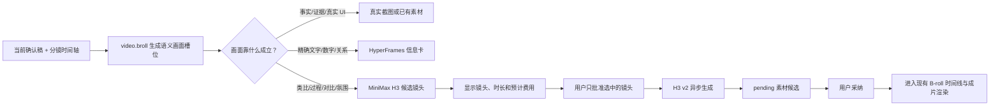

# MiniMax H3 文生视频与 B-roll Generator 接入 CreatorOS 调研

> 任务：T-834
> 日期：2026-08-14
> 结论：**有条件 GO。MiniMax H3 值得接入 CreatorOS 的文生视频与分镜素材链，但应作为现有 `video.generate` 的新协议能力和现有 B-roll 候选链的增强，不应把外部仓库整包安装成第二套制作系统。**
> 本次边界：只做代码、官方资料、许可证和开源实现调研；未调用付费 API，未修改生产模型配置，未上传用户内容。

## 1. 大白话结论

能接，而且最有价值的不是“再多一个文生视频模型”，而是三件事：

1. **把静态分镜图动起来**：H3 支持首帧、尾帧和参考图，可以把 CreatorOS 已生成或用户已有的画面做成 4–15 秒短镜头，比只靠文字随机生成更容易保持主体和构图。
2. **补齐没有真实素材的 B-roll**：适合类比、过程、对比、氛围、产品组装、空间关系等“非事实证据型”画面。
3. **让参考素材参与生成**：H3 可同时参考图片、视频和音频，适合人物/产品一致性、动作参考和已有镜头风格延续。

但它不适合替代真实截图、数据证据、精确 UI、Logo、复杂图表和必须逐字正确的中文排版。这些继续走 CreatorOS 已有的真实素材、网页截图和 HyperFrames 确定性信息卡。

## 2. MiniMax H3 当前官方能力

官方资料显示，H3 不是旧 Hailuo 2.3 的模型名升级，而是一套新的 v2 多模态视频协议：

| 能力 | 官方事实 | 对 CreatorOS 的价值 |
| --- | --- | --- |
| 文生视频 | `POST /v2/video_generation`，`content` 只有文本 | 为无素材的类比、过程和氛围段生成短 B-roll |
| 首/尾帧生视频 | 文本 + `first_frame` / `last_frame`，两者可单独或同时使用 | 把分镜静帧、用户图片或上一镜尾帧做成连续运动 |
| 多模态参考生视频 | 最多 9 张参考图、3 段参考视频、3 段参考音频；混合总数最多 12 | 保持人物、产品、动作、镜头语言或声音风格 |
| 原生音视频 | H3 同时生成视频与立体声音频 | 单独素材可用；口播成片中建议默认静音，避免抢占原口播 |
| 输出规格 | 4–15 秒整数时长，768P / 2K，支持 9:16、16:9、1:1 等 | 能直接适配抖音竖屏，不必先横屏再裁切 |
| H3-Context-IR | 独立异步接口，把多模态上下文整理为增强提示词 | 复杂参考模式可选使用；不应成为所有短 B-roll 的强制前置 |
| 视频再生成 | 768P 结果可连同原上下文再生为 2K | 只对最终保留的英雄镜头有价值，不宜默认烧两次费用 |

官方接口是异步任务：提交后取得 `task_id`，查询到 `succeeded` 后直接从 `task.content.url` 下载。付费账户并发上限当前为 15，免费档为 2；官方还提供 `callback_url`，但桌面本机通常没有公网回调地址，因此 CreatorOS 本地版继续采用可恢复轮询更合适。

主要官方证据：

- [MiniMax H3 视频生成指南](https://platform.minimax.io/docs/guides/video-generation)
- [H3 v2 创建任务 API](https://platform.minimax.io/docs/api-reference/video-generation-v2-create)
- [MiniMax 当前按量价格](https://platform.minimax.io/docs/guides/pricing-paygo)
- [MiniMax 当前限流说明](https://platform.minimax.io/docs/guides/rate-limits)
- [MiniMax H3 官方开源仓库](https://github.com/MiniMax-AI/MiniMax-H3)

## 3. 成本判断

截至 2026-08-14，H3 只能用按量 API 或单独商务方案；现有 Hailuo 视频资源包明确暂不支持 H3。

| 输出 | 768P | 2K |
| --- | ---: | ---: |
| 每秒 | $0.08 | $0.13 |
| 4 秒镜头 | $0.32 | $0.52 |
| 6 秒镜头 | $0.48 | $0.78 |
| 10 秒镜头 | $0.80 | $1.30 |
| 15 秒镜头 | $1.20 | $1.95 |

如果一条口播生成 5 个 6 秒 B-roll，纯输出成本约为 **$2.40（768P）或 $3.90（2K）**。参考视频还按输入视频时长额外计费；前 5 张参考图免费，更多图片每张 $0.04。H3-Context-IR 另按 token 计费。

因此产品默认建议：

- 普通 B-roll 默认 768P、4–6 秒；
- 只有主视觉、需要大幅裁切或用户明确要求时才用 2K；
- 先显示“本次将生成几镜、每镜时长、预计费用”，允许只批准部分镜头；
- 不自动把失败镜头换模型、改时长或重新付费；
- 生成后先预览，只有用户采纳才进入素材库和时间线。

## 4. 对 `minimax-h3-broll-generator` 的审查

审查快照：

- 仓库：[guangjun5952/minimax-h3-broll-generator](https://github.com/guangjun5952/minimax-h3-broll-generator)
- 审查提交：`0fec74d2a31e381e8cf24c250adfbe47f631f0b1`
- 仓库从 2026-08-10 开始，当前共 3 个提交，标签为 `v1.0.0`、`v1.1.0`；GitHub 审查时显示约 20 stars，仍属很新的项目。
- 许可证：MIT；复制实质代码或模板时须保留版权和许可文本。
- 本地只读验证：仓库自带 `validate.sh` 全绿，包括计划校验、提示词档位、视频管线与 FFmpeg 合成 smoke。

### 4.1 真正值得吸收的部分

1. **先分流、再生成**
   它先在 A-roll、真实证据、已有素材、确定性包装、H3 文字包装和 H3 纯画面之间做选择，不强迫每句话都上 B-roll。

2. **素材真实性边界**
   Logo、产品 UI、论文、截图、真实人物、地图数据和技术关系不能靠生成模型伪造；缺素材时明确请求，或把方案改成明显的视觉隐喻。

3. **付费前审片**
   先产 `broll-plan` 和审片单，再按镜头 ID 批准，批准后仍先 dry-run 检查真实请求。这与 CreatorOS 的候选—采纳原则一致。

4. **每镜一个认知任务**
   它把镜头限制为单一语义，约束同屏信息、运镜、景深和阅读停留，能减少“卡很多但观众看不懂”的问题。

5. **音频边界**
   对口播 B-roll 明确保留原说话声，生成音轨只允许克制的拟音/环境音；检测不到是否混入音乐时直接静音。

6. **按时间戳回填**
   逐字稿时间戳是唯一剪辑时间源，不按阅读速度猜时间。这与 CreatorOS 现有 SRT/分镜时间线契约一致。

### 4.2 不应原样搬入 CreatorOS 的部分

1. **不能直接安装为产品运行时依赖**
   它是 Codex Skill + Python CLI，不是多租户服务。CreatorOS 已有 TypeScript worker、模型配置、任务、候选、素材和渲染链，整包安装会形成第二套真相。

2. **不能新增平行 `broll-plan.json` 真相**
   CreatorOS 已有 `video_decisions`、`ai_task`、candidate、asset、material link 和 render props。外部 JSON 只能作为设计参考，不能与现有数据库状态并存。

3. **审批门不够产品级**
   外部脚本依赖计划文件状态、CLI 常量和当前对话确认；文件可手改。CreatorOS 必须继续使用服务端候选 ID、当前项目归属、任务指纹、镜头集合 hash 和用户采纳记录。

4. **任务恢复和防重复计费不足**
   外部脚本提交后串行轮询，但没有 CreatorOS 已有的 provider job checkpoint、重启恢复和“提交结果未知时禁止重发”机制，不能直接用于正式用户。

5. **自动剪辑器过于基础**
   它只做 FFmpeg 全屏替换和简单淡入淡出；没有 CreatorOS 已有的场景、信息卡、人物避让、主视觉安全区、素材接力和渲染回归。可借鉴“原口播不动”的规则，不借用整套编辑器。

6. **生成式中文排版仍不可靠**
   仓库自己也承认 H3 可能产生错字。T01–T21 可作为视觉灵感库，但所有精确文字、数字、引用、品牌和复杂关系继续走 HyperFrames/真实素材，不能为了展示 H3 而倒退。

7. **三档提示词不宜每次都让普通用户选**
   `v1/v2/v3` 对专家有用，但 CreatorOS 的编导应根据画面职责自动选择清晰度/动效预算，界面只保留“更简洁 / 更有动感”等自然语言改稿入口，减少额外决策负担。

## 5. CreatorOS 现状与缺口

### 5.1 已经具备的能力

- `video.broll` 已按 `fact_evidence / analogy / process / contrast / mood / info_card` 生成画面槽位，并保存口播锚点、视觉主张、画面 brief、生成提示词和搜索词。
- 事实证据已强制走真实来源，信息卡已强制走 `video.cards`，不会让自由生图冒充。
- `material.generate` 已能创建图/视频异步任务；生成结果先是 pending asset，用户采纳后才激活并绑定项目。
- `asset.generate` 已有 provider job checkpoint、重启恢复、防重复计费和失败诚实收口。
- `video.generate` 已是按 capability 配置的模型中立抽象，MiniMax 只是 provider 之一；现有 Seedance/OmniHi 也能并存。
- 现有渲染器已经消费 B-roll 时间轴，并负责素材安全区、人物画面和信息卡组合。

### 5.2 H3 接入必须补的缺口

| 缺口 | 当前事实 | 需要的增量 |
| --- | --- | --- |
| 协议 | MiniMax adapter 仍只实现旧 `/v1/video_generation`、`file_id` 下载 | `MiniMax-H3` 分流到 v2 `content[]`、新状态和 `content.url`；旧 Hailuo 保持 v1 |
| 输入 | `GenerateVideoOptions` 只有 prompt、画幅和一个未落地的 `firstFrame` | 增加时长、分辨率、首尾帧和受控 reference image/video/audio 列表 |
| 真接线 | 当前 `material.generate` 只传 `kind/prompt/style` | 从 B-roll 槽位带入段落、镜头时长、画幅、参考素材 ID 和音频策略 |
| 首帧 | 现有 MiniMax adapter 的 `firstFrame` 仍是 TODO，实际不会发图 | 由 backend 按归属读取 asset bytes/URL，校验格式、尺寸、时长后交 adapter |
| 轮询 | 旧 adapter 固定约 5 分钟超时且没有用现有 `onJobSubmitted/resumeJobId` | H3 v2 接入现有 checkpoint；真实试跑收集耗时后设置独立有界长任务策略 |
| 费用 | 生成前没有按镜头显示费用 | 根据官方单价、输出时长/分辨率和参考视频时长给估算，确认时冻结计费输入 |
| 批量候选 | 可单独生成素材，但分镜槽位不会自动形成“可生成镜头清单” | 把安全可生成槽位变成可勾选镜头候选，一次批准选中集合，逐镜追踪 |
| 音频 | H3 会生成原生音频，现有 B-roll 渲染通常静音 | 口播成片首版强制 `mute`；以后只有经过独立试听确认才允许混拟音 |
| 兼容性 | 现有真测主要覆盖旧 MiniMax/OmniHi/Seedance 协议 | 直连官方 H3 v2 真测；中转站或秘塔声称兼容也必须逐端点实测，不能按模型名推断 |

## 6. 推荐的产品与技术方案

### 6.1 接入方式

在现有 `minimax` provider 内按模型/能力选择协议：

- `MiniMax-H3` → v2 多模态视频适配器；
- `MiniMax-Hailuo-2.3` 等旧模型 → 保留现有 v1 适配器；
- 上层仍调用统一 `video.generate`，不让业务代码依赖供应商模型名；
- 用户自配 MiniMax Key 与渠道托管配置继续走同一 capability authority；H3 必须标注“按量 API”，不能误用不支持 H3 的视频资源包 Key。

### 6.2 分镜里的用户体验

在“分镜/画面素材”审片单中，为安全可生成的槽位增加：

- 建议画面与它服务的口播原句；
- 文生视频 / 首帧生视频 / 首尾帧 / 参考素材模式；
- 时长、画幅、分辨率；
- 使用了哪些当前项目真实素材；
- 预计费用与“最终以供应商账单为准”；
- 单镜批准、全选批准、取消；
- 生成后预览、采纳、拒绝、按自然语言修改后重生。

批准的是“镜头 ID + 当前稿版本/hash + 提示词/hash + 输入素材 ID/hash + 时长 + 分辨率 + 预计费用”这组冻结快照。任一关键输入变化都应使原批准失效，防止用户批准 A 却付费生成 B。

### 6.3 B-roll 路由

- `fact_evidence`：真实网页、截图、录屏、论文、数据，不生成。
- `info_card`：HyperFrames/确定性卡片，不交给 H3 排字。
- `analogy / process / contrast / mood`：无合适真实素材时，可建议 H3。
- 已有高质量图片：优先首帧生视频；已有起止状态：优先首尾帧；需要人物/产品/动作一致性：才用参考模式；其余使用文生视频。
- T01–T21 不作为写死关键词路由。可把部分构图范式变成 Skill 示例与质量 rubric，由模型做语义选择，代码只校验真实 ID、类型、范围、时长、费用和确认状态。

### 6.4 默认质量与声音

- 普通插入镜头：768P、4–6 秒、项目原画幅；
- 主视觉或明确高质量需求：2K；
- 单镜只承担一个认知任务，默认无可读文字、数字、Logo、假 UI 和水印；
- 口播成片中的 H3 音轨默认静音，只保留原说话声；
- H3 产物进入现有 renderer，不引入外部 FFmpeg 编辑链。

## 7. 不建议本地自部署 H3

官方开源的 H3-Base 是 33B 稠密模型，官方 SGLang 示例使用 4 张 GPU；开源部分只直接生成 768P，H3-Context-IR 和 H3-Regenerate-2K 仍需官方 API或尚未开源。

更重要的是，开源权重使用 **MiniMax H3 Community License**，不是 MIT/Apache：许可地域明确排除美国、欧盟、英国和韩国；商业产品还带 UI 标识、下游条款、安全治理和年营收阈值等义务。CreatorOS 面向跨地区桌面用户，不应把权重随包分发或默认本地托管。

因此建议：**产品接官方 API，不接本地权重。** 外部 B-roll 仓库自身的脚本和模板是 MIT，但 MiniMax 官方权重与官方 Skill 仍受 H3 Community License 约束，两者不能混为同一许可。

## 8. 最小真实兼容验收

实现前后的付费验收应使用隔离 Key、明确预算和可删除测试素材；本次没有执行。建议一次验收覆盖：

1. 9:16、768P、4 秒纯文生视频；
2. 9:16、768P、4 秒首帧图生视频；
3. 9:16、768P、4 秒参考图/参考视频模式；
4. 任务提交后模拟进程重启，确认只恢复轮询、不二次 POST 计费；
5. 401、402、422、429、500、取消、超时、成功无 URL、下载中断的错误分类；
6. 成功后生成 pending asset，刷新可预览，未采纳不进素材库，采纳后进入当前项目；
7. 分镜换版、输入素材被删或费用参数变化时旧批准失效；
8. 成片保持原口播连续，H3 原生人声/音乐不进入最终音轨；
9. 真机检查 9:16 构图、中文伪字、人物/产品一致性、闪烁和错误事实；
10. 回读 MiniMax 真实 usage 与本地估算差异，形成可审计消费记录。

前三个最小 4 秒 768P 输出按当前目录价合计约 **$0.96**，参考视频输入另计。若直连官方通过，再验证渠道托管/中转站；不能用中转站 `/models` 出现 `MiniMax-H3` 就代替真实生成。

## 9. 最终裁决

### 建议纳入 CreatorOS

- MiniMax H3 官方 v2 adapter；
- 文生、首/尾帧、参考素材三类生成模式；
- 分镜 B-roll 槽位到生成候选的自动桥接；
- 按镜费用预估、选镜批准、输入快照和防重复计费；
- 768P 4–6 秒的口播 B-roll 默认策略；
- 外部仓库的真实性路由、单镜单认知任务、审片门和原口播保护规则；
- 部分 T01–T21 构图范式作为 Skill/rubric 素材，而不是硬编码业务枚举。

### 不建议纳入

- 把外部仓库整包安装为产品运行时；
- 新建平行的 `broll-plan.json`、素材库或 FFmpeg 成片链；
- 让 H3 生成精确中文、数据图、真实 UI、Logo 或证据截图；
- 默认 2K、默认整批生成、静默重试或自动换模型；
- 随 CreatorOS 分发或本地托管 H3 开源权重；
- 未真测就宣称 OmniHi、秘塔或其他代理与 H3 v2 兼容。

**推荐用户确认的实现口径：在一个完整任务内把 H3 v2 协议、分镜候选、费用确认、采纳回读、错误/恢复、真 API 兼容和口播音频保护一次做完；不改变真实素材与 HyperFrames 的优先级，也不另造制作系统。**
