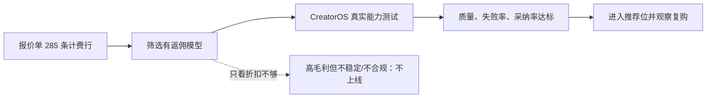

# OmniHi 全模型返佣收益测算与经营建议

> 日期：2026-08-14  
> 任务：T-830  
> 目标：覆盖报价单中的全部模型家族与计费行，识别能提高 CreatorOS 实际返佣收益的模型；不修改生产配置。

## 一句话结论

这份报价单确实远不止当前接入的 13 个文本模型：共覆盖 **98 个模型家族、285 条计费行/SKU**，其中包括 79 个文本模型、8 个图片模型家族、9 个视频模型家族和 2 个音乐模型家族。

若“目录价折扣”就是实际月末结算系数，真正值得优先关注的不是最贵模型，而是 **高返佣率 × 能通过 CreatorOS 真实能力测试 × 用户愿意持续使用** 的交集：

- `GPT 5.x Reverse`：账面返佣毛利率 75%，为全表最高；但必须先核验渠道来源、合规性、稳定性和模型真实性，未通过前不能面向用户主推。
- `Claude *-Reverse`：账面返佣毛利率 65%，同样属于高收益、高验证门槛候选。
- `GLM 5.2`：常规渠道中最高，为 40%；但当前真实测试的结构化输出不合格，只能按能力使用，不能直接做通用 Agent 默认。
- 当前已经验证三项文本能力都稳定的模型中，`GPT 5.6 Sol` 毛利率最高（25%）；`Claude Sonnet 4.6` 与 `Claude Haiku 4.5` 为 20%，更适合作为均衡和快速档。
- `MiniMax M3` 与 `Deepseek V4 Pro` 虽然当前全能力稳定，但目录结算都是 100 折，返佣为 0；继续占据默认或推荐位，会把调用量变成没有返佣的流水。

## 覆盖范围和口径

| 类别 | 模型家族 | 计费行/SKU | 本文计算方式 |
| --- | ---: | ---: | --- |
| 大语言模型 | 79 | 95 | 标准调用：4K input + 1K output tokens |
| 图像模型 | 8 | 142 | 每张图片，按全部分辨率/质量 SKU 汇总价格区间 |
| 视频模型 | 9 | 44 | 每秒视频，按全部模式/分辨率 SKU 汇总价格区间 |
| 音乐模型 | 2 | 4 | 每首歌曲/每次歌词生成 |
| **合计** | **98** | **285** | 全部计费行已纳入 |

外币统一按报价单写明的 **1 USD = ¥7.25** 换算。源文件：`Omnihi模型报价清单-智能体.xlsx`，SHA-256：`ac3291f3a4cf818039086b8b2a349053baa239c8c732de020333c269be440462`。报价单标注有效期 30 天，文件时间为 2026-08-09，因此本文只代表本轮报价快照。

核心公式：

- `返佣毛利率 = 1 - 目录价折扣`
- `文本标准调用目录消耗 = 4,000 × input price / 1,000,000 + 1,000 × output price / 1,000,000`
- `单次返佣 = 目录消耗 × 返佣毛利率`
- `净结算成本 = 目录消耗 × 目录价折扣`

这里没有计入缓存命中、超长上下文阶梯、推理 token、失败重试、退款、支持成本和额外月度返佣阶梯。它们没有完整数据，不能假装精确。

## 经营上先看这两张榜

### 返佣率最高的渠道组

| 返佣毛利率 | 模型组 | 经营判断 |
| ---: | --- | --- |
| 75% | GPT 5.6 Sol-Reverse、GPT 5.6 Terra-Reverse、GPT 5.6 Lina-Reverse、GPT 5.5-Reverse、GPT 5.4-Reverse | 账面收益极高，但必须先过来源、合规和稳定性验证 |
| 65% | Claude Opus 4.8-Reverse、Claude Opus 4.7-Reverse、Claude Opus 4.6-Reverse、Claude Sonnet 4.6-Reverse、Claude Haiku 4.5-Reverse | 账面收益极高，但必须先过来源、合规和稳定性验证 |
| 40% | GLM 5.2 | 有正向收益，仍需通过真实能力与质量门槛 |
| 30% | Deepseek V3.2 满血全参数、Deepseek V3.1 Terminus、Deepseek V3.1、DeepSeek V3 、DeepSeek V3 Turbo | 有正向收益，仍需通过真实能力与质量门槛 |
| 25% | GPT 5.6 Sol、GPT 5.6 Terra、GPT 5.6 Luna、GPT 5.5、GPT 5.4 Pro、GPT 5.4、GPT 5.4 Mini、GPT 5.4 Nano、GPT 5.3 Codex、GPT 5.3 Chat-latest、GPT 5.2 Pro、GPT 5.2 等 30 个 | 有正向收益，仍需通过真实能力与质量门槛 |
| 20% | Claude Sonnet 5、Claude fable 5、Claude Opus 5、Claude Opus 4.8、Claude Opus 4.7、Claude Opus 4.6、Claude Sonnet 4.6、Claude Opus 4.5、Claude Sonnet 4.5、Claude Haiku 4.5、Deepseek V4 Flash | 收益偏低，只在质量/能力明显胜出时保留 |
| 15% | Gemini 3.5 Flash、Gemini 3.1 Pro、Gemini 3.1 Flash-lite、Gemini 3 Flash-preview、Gemini 2.5 Pro、Gemini 2.5 Flash、Gemini 2.5 Flash-lite、Gemini 2.0 Flash、Gemini 2.0 Flash-lite、GLM 4.7、MiniMax M2.1、MiniMax M2 等 15 个 | 收益偏低，只在质量/能力明显胜出时保留 |
| 10% | GLM 4.7 Flash、MiniMax M2.7、MiniMax M2.5 | 收益偏低，只在质量/能力明显胜出时保留 |
| 0% | GPT 5.5 Pro、Deepseek V4 Pro、Deepseek V4 Flash 0731、MiniMax M3 | 无返佣，不应靠推荐位放量 |

### 每千次标准调用返佣贡献最高的 15 个文本模型

| 排名 | 模型 | 返佣率 | 单次目录消耗 | 单次返佣 | 每千次返佣 | 风险提示 |
| ---: | --- | ---: | ---: | ---: | ---: | --- |
| 1 | GPT 5.4 Pro | 25% | ¥2.175 | ¥0.5437 | ¥543.75 | 未做 CreatorOS 真实兼容验证 |
| 2 | GPT 5.2 Pro | 25% | ¥1.827 | ¥0.4567 | ¥456.75 | 未做 CreatorOS 真实兼容验证 |
| 3 | GPT 5 Pro | 25% | ¥1.305 | ¥0.3262 | ¥326.25 | 未做 CreatorOS 真实兼容验证 |
| 4 | GPT 5.6 Sol-Reverse | 75% | ¥0.3625 | ¥0.2719 | ¥271.88 | 未做 CreatorOS 真实兼容验证 |
| 5 | GPT 5.5-Reverse | 75% | ¥0.3625 | ¥0.2719 | ¥271.88 | 未做 CreatorOS 真实兼容验证 |
| 6 | Claude Opus 4.8-Reverse | 65% | ¥0.3262 | ¥0.2121 | ¥212.06 | 未做 CreatorOS 真实兼容验证 |
| 7 | Claude Opus 4.7-Reverse | 65% | ¥0.3262 | ¥0.2121 | ¥212.06 | 未做 CreatorOS 真实兼容验证 |
| 8 | Claude Opus 4.6-Reverse | 65% | ¥0.3262 | ¥0.2121 | ¥212.06 | 未做 CreatorOS 真实兼容验证 |
| 9 | GPT 5.6 Terra-Reverse | 75% | ¥0.1813 | ¥0.1359 | ¥135.94 | 未做 CreatorOS 真实兼容验证 |
| 10 | GPT 5.4-Reverse | 75% | ¥0.1813 | ¥0.1359 | ¥135.94 | 未做 CreatorOS 真实兼容验证 |
| 11 | Claude fable 5 | 20% | ¥0.6525 | ¥0.1305 | ¥130.50 | 未做 CreatorOS 真实兼容验证 |
| 12 | Claude Sonnet 4.6-Reverse | 65% | ¥0.1958 | ¥0.1272 | ¥127.24 | 未做 CreatorOS 真实兼容验证 |
| 13 | GPT 5.6 Sol | 25% | ¥0.3625 | ¥0.0906 | ¥90.625 | 当前三能力稳定 |
| 14 | GPT 5.5 | 25% | ¥0.3625 | ¥0.0906 | ¥90.625 | 未做 CreatorOS 真实兼容验证 |
| 15 | Claude Sonnet 4.5 | 20% | ¥0.3371 | ¥0.0674 | ¥67.425 | 未做 CreatorOS 真实兼容验证 |

高单次返佣不等于适合做默认。比如高价 Pro 模型能快速贡献返佣，也会更快消耗用户额度；若质量提升不足，会先带来流失和投诉。

## 当前 13 个已接入模型：结合真实兼容结果后的收益判断

| 模型 | 当前兼容结论 | 返佣率 | 每千次标准调用返佣 | 推荐动作 |
| --- | --- | ---: | ---: | --- |
| MiniMax M3 | 当前三能力稳定 | 0% | ¥0 | 稳定但零返佣，不占推荐位 |
| GPT 5.6 Luna | 受限：工具/结构化出现上游波动 | 25% | ¥18.125 | 按已通过能力使用，不能做通用默认 |
| GPT 5.6 Terra | 受限：普通/工具路由不稳定 | 25% | ¥45.313 | 按已通过能力使用，不能做通用默认 |
| GPT 5.6 Sol | 当前三能力稳定 | 25% | ¥90.625 | 可进入主推候选 |
| Claude Haiku 4.5 | 当前三能力稳定 | 20% | ¥13.050 | 稳定补充档；收益率一般 |
| Claude Sonnet 4.6 | 当前三能力稳定 | 20% | ¥39.150 | 稳定补充档；收益率一般 |
| Claude Opus 4.8 | 受限：结构化输出两次超时 | 20% | ¥65.250 | 能力受限且收益一般，后置 |
| Gemini 3.5 Flash | 当前三能力稳定 | 15% | ¥16.312 | 稳定补充档；收益率一般 |
| Gemini 3.1 Pro | 受限：当前协议下空流、无工具调用且结构化不合格 | 15% | ¥21.750 | 能力受限且收益一般，后置 |
| Deepseek V4 Flash | 受限：工具调用两次失败 | 20% | ¥1.200 | 能力受限且收益一般，后置 |
| Deepseek V4 Pro | 当前三能力稳定 | 0% | ¥0 | 稳定但零返佣，不占推荐位 |
| Kimi K2.6 | 当前三能力稳定 | 15% | ¥7.950 | 稳定补充档；收益率一般 |
| GLM 5.2 | 受限：结构化输出两次不合格 | 40% | ¥24.000 | 按已通过能力使用，不能做通用默认 |

据此，短期推荐结构应比此前只看报价时更谨慎：

1. **通用均衡档**：优先验证并考虑 `Claude Sonnet 4.6`。三能力稳定，返佣 20%，标准调用每千次贡献约 ¥39.15。
2. **高收益旗舰档**：`GPT 5.6 Sol`。三能力稳定，返佣 25%，每千次约贡献 ¥90.63；必须让用户明确选择，避免额度下降过快。
3. **快速低成本档**：`Claude Haiku 4.5`。三能力稳定，返佣 20%，比零返佣默认更健康。
4. **任务型高毛利档**：`GLM 5.2`。返佣 40%，只用于已经验证通过的聊天/工具场景；结构化任务不得默认路由。
5. **降权**：`MiniMax M3`、`Deepseek V4 Pro`。可作为稳定兜底，但 0 返佣，不占主推荐位。

## 全部 79 个文本模型测算

以下覆盖报价单中的全部文本模型名称。阶梯价模型用 4K input 所在的首档测算，并在“价格档”中标出档数；超长上下文不能直接套用本列。

| # | 厂商 | 模型 | 目录价 input/output（每百万 token） | 结算折扣 | 返佣率 | 标准调用目录消耗 | 单次返佣 | 10 元约调用 | 价格档 | 经营动作 |
| ---: | --- | --- | ---: | ---: | ---: | ---: | ---: | ---: | --- | --- |
| 1 | Anthropic | Claude Sonnet 5 | USD 2/10 | 80% | 20% | ¥0.1305 | ¥0.0261 | 77 次 | 单档 | 未验证；不因报价直接上线 |
| 2 | Anthropic | Claude fable 5 | USD 10/50 | 80% | 20% | ¥0.6525 | ¥0.1305 | 15 次 | 单档 | 未验证；不因报价直接上线 |
| 3 | Anthropic | Claude Opus 5 | USD 5/25 | 80% | 20% | ¥0.3262 | ¥0.0652 | 31 次 | 单档 | 未验证；不因报价直接上线 |
| 4 | Anthropic | Claude Opus 4.8 | USD 5/25 | 80% | 20% | ¥0.3262 | ¥0.0652 | 31 次 | 单档 | 能力受限且收益一般，后置 |
| 5 | Anthropic | Claude Opus 4.7 | USD 5/25 | 80% | 20% | ¥0.3262 | ¥0.0652 | 31 次 | 单档 | 未验证；不因报价直接上线 |
| 6 | Anthropic | Claude Opus 4.6 | USD 5/25 | 80% | 20% | ¥0.3262 | ¥0.0652 | 31 次 | 单档 | 未验证；不因报价直接上线 |
| 7 | Anthropic | Claude Sonnet 4.6 | USD 3/15 | 80% | 20% | ¥0.1958 | ¥0.0391 | 51 次 | 单档 | 稳定补充档；收益率一般 |
| 8 | Anthropic | Claude Opus 4.5 | USD 5/25 | 80% | 20% | ¥0.3262 | ¥0.0652 | 31 次 | 单档 | 未验证；不因报价直接上线 |
| 9 | Anthropic | Claude Sonnet 4.5 | USD 6/22.5 | 80% | 20% | ¥0.3371 | ¥0.0674 | 30 次 | 单档 | 未验证；不因报价直接上线 |
| 10 | Anthropic | Claude Haiku 4.5 | USD 1/5 | 80% | 20% | ¥0.0653 | ¥0.0130 | 153 次 | 单档 | 稳定补充档；收益率一般 |
| 11 | Anthropic-r | Claude Opus 4.8-Reverse | USD 5/25 | 35% | 65% | ¥0.3262 | ¥0.2121 | 31 次 | 单档 | 高毛利；先核验渠道来源、合规、稳定性和真实模型一致性 |
| 12 | Anthropic-r | Claude Opus 4.7-Reverse | USD 5/25 | 35% | 65% | ¥0.3262 | ¥0.2121 | 31 次 | 单档 | 高毛利；先核验渠道来源、合规、稳定性和真实模型一致性 |
| 13 | Anthropic-r | Claude Opus 4.6-Reverse | USD 5/25 | 35% | 65% | ¥0.3262 | ¥0.2121 | 31 次 | 单档 | 高毛利；先核验渠道来源、合规、稳定性和真实模型一致性 |
| 14 | Anthropic-r | Claude Sonnet 4.6-Reverse | USD 3/15 | 35% | 65% | ¥0.1958 | ¥0.1272 | 51 次 | 单档 | 高毛利；先核验渠道来源、合规、稳定性和真实模型一致性 |
| 15 | Anthropic-r | Claude Haiku 4.5-Reverse | USD 1/5 | 35% | 65% | ¥0.0653 | ¥0.0424 | 153 次 | 单档 | 高毛利；先核验渠道来源、合规、稳定性和真实模型一致性 |
| 16 | Google | Gemini 3.5 Flash | USD 1.5/9 | 85% | 15% | ¥0.1087 | ¥0.0163 | 92 次 | 单档 | 稳定补充档；收益率一般 |
| 17 | Google | Gemini 3.1 Pro | USD 2/12 | 85% | 15% | ¥0.1450 | ¥0.0218 | 69 次 | 2 档；input 200k toekns以下 | 能力受限且收益一般，后置 |
| 18 | Google | Gemini 3.1 Flash-lite | USD 0.25/1.5 | 85% | 15% | ¥0.0181 | ¥0.0027 | 552 次 | 单档 | 未验证；不因报价直接上线 |
| 19 | Google | Gemini 3 Flash-preview | USD 0.5/3 | 85% | 15% | ¥0.0362 | ¥0.0054 | 276 次 | 单档 | 未验证；不因报价直接上线 |
| 20 | Google | Gemini 2.5 Pro | USD 1.25/10 | 85% | 15% | ¥0.1087 | ¥0.0163 | 92 次 | 单档 | 未验证；不因报价直接上线 |
| 21 | Google | Gemini 2.5 Flash | USD 0.3/2.5 | 85% | 15% | ¥0.0268 | ¥0.0040 | 373 次 | 单档 | 未验证；不因报价直接上线 |
| 22 | Google | Gemini 2.5 Flash-lite | USD 0.1/0.4 | 85% | 15% | ¥0.0058 | ¥0.0009 | 1724 次 | 单档 | 未验证；不因报价直接上线 |
| 23 | Google | Gemini 2.0 Flash | USD 0.15/0.6 | 85% | 15% | ¥0.0087 | ¥0.0013 | 1149 次 | 单档 | 未验证；不因报价直接上线 |
| 24 | Google | Gemini 2.0 Flash-lite | USD 0.08/0.3 | 85% | 15% | ¥0.0045 | ¥0.0007 | 2225 次 | 单档 | 未验证；不因报价直接上线 |
| 25 | OpenAi | GPT 5.6 Sol | USD 5/30 | 75% | 25% | ¥0.3625 | ¥0.0906 | 28 次 | 2 档；input 272k toekns以下 | 可进入主推候选 |
| 26 | OpenAi | GPT 5.6 Terra | USD 2.5/15 | 75% | 25% | ¥0.1813 | ¥0.0453 | 55 次 | 2 档；input 272k toekns以下 | 按已通过能力使用，不能做通用默认 |
| 27 | OpenAi | GPT 5.6 Luna | USD 1/6 | 75% | 25% | ¥0.0725 | ¥0.0181 | 138 次 | 2 档；input 272k toekns以下 | 按已通过能力使用，不能做通用默认 |
| 28 | OpenAi | GPT 5.5 Pro | USD 30/180 | 100% | 0% | ¥2.175 | ¥0 | 5 次 | 2 档；input 272k toekns以下 | 零返佣且未验证，最低优先级 |
| 29 | OpenAi | GPT 5.5 | USD 5/30 | 75% | 25% | ¥0.3625 | ¥0.0906 | 28 次 | 2 档；input 272k toekns以下 | 有收益潜力，验证后再决定 |
| 30 | OpenAi | GPT 5.4 Pro | USD 30/180 | 75% | 25% | ¥2.175 | ¥0.5437 | 5 次 | 2 档；input 272k toekns以下 | 有收益潜力，验证后再决定 |
| 31 | OpenAi | GPT 5.4 | USD 2.5/15 | 75% | 25% | ¥0.1813 | ¥0.0453 | 55 次 | 2 档；input 272k toekns以下 | 有收益潜力，验证后再决定 |
| 32 | OpenAi | GPT 5.4 Mini | USD 0.75/4.5 | 75% | 25% | ¥0.0544 | ¥0.0136 | 184 次 | 单档 | 有收益潜力，验证后再决定 |
| 33 | OpenAi | GPT 5.4 Nano | USD 0.2/1.25 | 75% | 25% | ¥0.0149 | ¥0.0037 | 673 次 | 单档 | 有收益潜力，验证后再决定 |
| 34 | OpenAi | GPT 5.3 Codex | USD 1.75/14 | 75% | 25% | ¥0.1522 | ¥0.0381 | 66 次 | 单档 | 有收益潜力，验证后再决定 |
| 35 | OpenAi | GPT 5.3 Chat-latest | USD 1.75/14 | 75% | 25% | ¥0.1522 | ¥0.0381 | 66 次 | 单档 | 有收益潜力，验证后再决定 |
| 36 | OpenAi | GPT 5.2 Pro | USD 21/168 | 75% | 25% | ¥1.827 | ¥0.4567 | 5 次 | 单档 | 有收益潜力，验证后再决定 |
| 37 | OpenAi | GPT 5.2 | USD 1.75/14 | 75% | 25% | ¥0.1522 | ¥0.0381 | 66 次 | 单档 | 有收益潜力，验证后再决定 |
| 38 | OpenAi | GPT 5.2 Codex | USD 1.75/14 | 75% | 25% | ¥0.1522 | ¥0.0381 | 66 次 | 单档 | 有收益潜力，验证后再决定 |
| 39 | OpenAi | GPT 5.2 Chat-latest | USD 1.75/14 | 75% | 25% | ¥0.1522 | ¥0.0381 | 66 次 | 单档 | 有收益潜力，验证后再决定 |
| 40 | OpenAi | GPT 5.1 | USD 1.25/10 | 75% | 25% | ¥0.1087 | ¥0.0272 | 92 次 | 单档 | 有收益潜力，验证后再决定 |
| 41 | OpenAi | GPT 5.1 Codex | USD 1.25/10 | 75% | 25% | ¥0.1087 | ¥0.0272 | 92 次 | 单档 | 有收益潜力，验证后再决定 |
| 42 | OpenAi | GPT 5.1 Chat-latest | USD 1.25/10 | 75% | 25% | ¥0.1087 | ¥0.0272 | 92 次 | 单档 | 有收益潜力，验证后再决定 |
| 43 | OpenAi | GPT 5 Pro | USD 15/120 | 75% | 25% | ¥1.305 | ¥0.3262 | 8 次 | 单档 | 有收益潜力，验证后再决定 |
| 44 | OpenAi | GPT 5 | USD 1.25/10 | 75% | 25% | ¥0.1087 | ¥0.0272 | 92 次 | 单档 | 有收益潜力，验证后再决定 |
| 45 | OpenAi | GPT 5 Codex | USD 1.25/10 | 75% | 25% | ¥0.1087 | ¥0.0272 | 92 次 | 单档 | 有收益潜力，验证后再决定 |
| 46 | OpenAi | GPT 5 Mini | USD 0.25/2 | 75% | 25% | ¥0.0218 | ¥0.0054 | 460 次 | 单档 | 有收益潜力，验证后再决定 |
| 47 | OpenAi | GPT 5 Nano | USD 0.05/0.4 | 75% | 25% | ¥0.0044 | ¥0.0011 | 2299 次 | 单档 | 有收益潜力，验证后再决定 |
| 48 | OpenAi | GPT 5 Chat-latest | USD 1.25/10 | 75% | 25% | ¥0.1087 | ¥0.0272 | 92 次 | 单档 | 有收益潜力，验证后再决定 |
| 49 | OpenAi | GPT 4.1 | USD 2/8 | 75% | 25% | ¥0.1160 | ¥0.0290 | 86 次 | 单档 | 有收益潜力，验证后再决定 |
| 50 | OpenAi | GPT 4.1 Mini | USD 0.4/1.6 | 75% | 25% | ¥0.0232 | ¥0.0058 | 431 次 | 单档 | 有收益潜力，验证后再决定 |
| 51 | OpenAi | GPT 4.1 Nano | USD 0.1/0.4 | 75% | 25% | ¥0.0058 | ¥0.0015 | 1724 次 | 单档 | 有收益潜力，验证后再决定 |
| 52 | OpenAi | GPT 4o | USD 2.5/10 | 75% | 25% | ¥0.1450 | ¥0.0362 | 69 次 | 单档 | 有收益潜力，验证后再决定 |
| 53 | OpenAi | GPT 4o Mini | USD 0.15/0.6 | 75% | 25% | ¥0.0087 | ¥0.0022 | 1149 次 | 单档 | 有收益潜力，验证后再决定 |
| 54 | OpenAi-dd | GPT 5.6 Sol-Reverse | USD 5/30 | 25% | 75% | ¥0.3625 | ¥0.2719 | 28 次 | 2 档；input 272k toekns以下 | 高毛利；先核验渠道来源、合规、稳定性和真实模型一致性 |
| 55 | OpenAi-dd | GPT 5.6 Terra-Reverse | USD 2.5/15 | 25% | 75% | ¥0.1813 | ¥0.1359 | 55 次 | 2 档；input 272k toekns以下 | 高毛利；先核验渠道来源、合规、稳定性和真实模型一致性 |
| 56 | OpenAi-dd | GPT 5.6 Lina-Reverse | USD 1/6 | 25% | 75% | ¥0.0725 | ¥0.0544 | 138 次 | 2 档；input 272k toekns以下；报价表原文疑似 Luna 拼写 | 高毛利；先核验渠道来源、合规、稳定性和真实模型一致性 |
| 57 | OpenAi-dd | GPT 5.5-Reverse | USD 5/30 | 25% | 75% | ¥0.3625 | ¥0.2719 | 28 次 | 2 档；input 272k toekns以下 | 高毛利；先核验渠道来源、合规、稳定性和真实模型一致性 |
| 58 | OpenAi-dd | GPT 5.4-Reverse | USD 2.5/15 | 25% | 75% | ¥0.1813 | ¥0.1359 | 55 次 | 2 档；input 272k toekns以下 | 高毛利；先核验渠道来源、合规、稳定性和真实模型一致性 |
| 59 | Deepseek | Deepseek V4 Pro | RMB 3/6 | 100% | 0% | ¥0.0180 | ¥0 | 556 次 | 单档；目录价格已经是25折 | 稳定但零返佣，不占推荐位 |
| 60 | Deepseek | Deepseek V4 Flash | RMB 1/2 | 80% | 20% | ¥0.0060 | ¥0.0012 | 1667 次 | 单档 | 能力受限且收益一般，后置 |
| 61 | Deepseek | Deepseek V4 Flash 0731 | RMB 1/2 | 100% | 0% | ¥0.0060 | ¥0 | 1667 次 | 单档 | 零返佣且未验证，最低优先级 |
| 62 | Deepseek | Deepseek V3.2 满血全参数 | RMB 2/3 | 70% | 30% | ¥0.0110 | ¥0.0033 | 909 次 | 单档 | 有收益潜力，验证后再决定 |
| 63 | Deepseek | Deepseek V3.1 Terminus | RMB 4/12 | 70% | 30% | ¥0.0280 | ¥0.0084 | 357 次 | 单档 | 有收益潜力，验证后再决定 |
| 64 | Deepseek | Deepseek V3.1 | RMB 4/12 | 70% | 30% | ¥0.0280 | ¥0.0084 | 357 次 | 单档 | 有收益潜力，验证后再决定 |
| 65 | Deepseek | DeepSeek V3 | RMB 2/8 | 70% | 30% | ¥0.0160 | ¥0.0048 | 625 次 | 单档 | 有收益潜力，验证后再决定 |
| 66 | Deepseek | DeepSeek V3 Turbo | RMB 2/8 | 70% | 30% | ¥0.0160 | ¥0.0048 | 625 次 | 单档 | 有收益潜力，验证后再决定 |
| 67 | Zhipu Ai | GLM 5.2 | RMB 8/28 | 60% | 40% | ¥0.0600 | ¥0.0240 | 167 次 | 单档 | 按已通过能力使用，不能做通用默认 |
| 68 | Zhipu Ai | GLM 5.1 | RMB 6/24 | 75% | 25% | ¥0.0480 | ¥0.0120 | 208 次 | 2 档；阶梯-input 1-32K tokens | 有收益潜力，验证后再决定 |
| 69 | Zhipu Ai | GLM 5 | RMB 4/18 | 75% | 25% | ¥0.0340 | ¥0.0085 | 294 次 | 2 档；阶梯-input 1-32K tokens | 有收益潜力，验证后再决定 |
| 70 | Zhipu Ai | GLM 4.7 | RMB 4/16 | 85% | 15% | ¥0.0320 | ¥0.0048 | 312 次 | 单档 | 未验证；不因报价直接上线 |
| 71 | Zhipu Ai | GLM 4.7 Flash | RMB 0.5/3 | 90% | 10% | ¥0.0050 | ¥0.0005 | 2000 次 | 单档 | 未验证；不因报价直接上线 |
| 72 | MiniMax | MiniMax M3 | RMB 2.1/8.4 | 100% | 0% | ¥0.0168 | ¥0 | 595 次 | 2 档；阶梯-input 1-512K tokens | 稳定但零返佣，不占推荐位 |
| 73 | MiniMax | MiniMax M2.7 | RMB 2.1/8.4 | 90% | 10% | ¥0.0168 | ¥0.0017 | 595 次 | 单档 | 未验证；不因报价直接上线 |
| 74 | MiniMax | MiniMax M2.5 | RMB 2.1/8.4 | 90% | 10% | ¥0.0168 | ¥0.0017 | 595 次 | 单档 | 未验证；不因报价直接上线 |
| 75 | MiniMax | MiniMax M2.1 | RMB 2.1/8.4 | 85% | 15% | ¥0.0168 | ¥0.0025 | 595 次 | 单档 | 未验证；不因报价直接上线 |
| 76 | MiniMax | MiniMax M2 | RMB 2.1/8.4 | 85% | 15% | ¥0.0168 | ¥0.0025 | 595 次 | 单档 | 未验证；不因报价直接上线 |
| 77 | Moonshot Ai | Kimi K2.7 Code | RMB 6.5/27 | 85% | 15% | ¥0.0530 | ¥0.0080 | 189 次 | 单档 | 未验证；不因报价直接上线 |
| 78 | Moonshot Ai | Kimi K2.6 | RMB 6.5/27 | 85% | 15% | ¥0.0530 | ¥0.0080 | 189 次 | 单档 | 稳定补充档；收益率一般 |
| 79 | Moonshot Ai | Kimi K2.5 | RMB 4/21 | 85% | 15% | ¥0.0370 | ¥0.0056 | 270 次 | 单档 | 未验证；不因报价直接上线 |

## 图片模型：8 个家族、142 条 SKU 全覆盖

| 模型家族 | SKU 数 | 目录消耗/张（人民币区间） | 返佣率 | 返佣/张（区间） | 经营判断 |
| --- | ---: | ---: | ---: | ---: | --- |
| Nano Banana 2 文生图-R /AZ | 4 | ¥0.1250–¥0.1250 | 20% | ¥0.0250–¥0.0250 | 反向/AZ 渠道先核验来源与稳定性 |
| Nano Banana 2-图片编辑-R /AZ | 4 | ¥0.1250–¥0.1250 | 20% | ¥0.0250–¥0.0250 | 反向/AZ 渠道先核验来源与稳定性 |
| GPT image 2 文生图-R /AZ | 9 | ¥0.0750–¥0.1800 | 20% | ¥0.0150–¥0.0360 | 反向/AZ 渠道先核验来源与稳定性 |
| GPT image 2 图片编辑-R /AZ | 9 | ¥0.0750–¥0.1800 | 20% | ¥0.0150–¥0.0360 | 反向/AZ 渠道先核验来源与稳定性 |
| Nano Banana 2（text to image） | 4 | ¥0.3262–¥1.095 | 25% | ¥0.0816–¥0.2737 | 按质量/分辨率做明确 SKU，禁止模糊扣费 |
| Nano Banana 2（image to image） | 4 | ¥0.3262–¥1.095 | 25% | ¥0.0816–¥0.2737 | 按质量/分辨率做明确 SKU，禁止模糊扣费 |
| GPT image 2 文生图 | 54 | ¥0.0152–¥3.104 | 20% | ¥0.0030–¥0.6209 | 按质量/分辨率做明确 SKU，禁止模糊扣费 |
| GPT image 2 图像编辑 | 54 | ¥0.0152–¥3.104 | 20% | ¥0.0030–¥0.6209 | 按质量/分辨率做明确 SKU，禁止模糊扣费 |

当前 `GPT Image 2` 1024×1024 文生图的典型三档为：low 约 ¥0.0435/张、medium 约 ¥0.3843/张、high 约 ¥1.5298/张；结算 8 折，返佣率 20%。当前配置没有显式 `quality`，上线前必须让账单 SKU 与用户扣额可对账。

## 视频模型：9 个家族、44 条 SKU 全覆盖

| 模型家族 | SKU 数 | 目录消耗/秒（人民币区间） | 返佣率 | 返佣/秒（区间） | 经营判断 |
| --- | ---: | ---: | ---: | ---: | --- |
| Kling v3.0 Pro text to video | 2 | ¥1.568–¥2.352 | 10% | ¥0.1568–¥0.2352 | 返佣仅 10%，主要按质量和用户付费意愿选择 |
| Kling v3.0 Pro image to video | 2 | ¥1.568–¥2.352 | 10% | ¥0.1568–¥0.2352 | 返佣仅 10%，主要按质量和用户付费意愿选择 |
| Kling v3.0 Standard text to video | 2 | ¥1.176–¥1.764 | 10% | ¥0.1176–¥0.1764 | 返佣仅 10%，主要按质量和用户付费意愿选择 |
| Kling v3.0 Standard image to video | 2 | ¥1.176–¥1.764 | 10% | ¥0.1176–¥0.1764 | 返佣仅 10%，主要按质量和用户付费意愿选择 |
| Kling v3.0 4K text to video | 2 | ¥2.940–¥4.410 | 10% | ¥0.2940–¥0.4410 | 返佣仅 10%，主要按质量和用户付费意愿选择 |
| Kling v3.0 4K image to video | 2 | ¥2.940–¥4.410 | 10% | ¥0.2940–¥0.4410 | 返佣仅 10%，主要按质量和用户付费意愿选择 |
| Kling V3.0 动作控制 | 2 | ¥0.9135–¥1.218 | 10% | ¥0.0913–¥0.1218 | 返佣仅 10%，主要按质量和用户付费意愿选择 |
| Seedance 2.0 | 20 | ¥0.4620–¥6.221 | 10% | ¥0.0462–¥0.6221 | 返佣仅 10%，主要按质量和用户付费意愿选择 |
| Seedance 2.0 fast | 10 | ¥0.3720–¥0.9500 | 10% | ¥0.0372–¥0.0950 | 返佣仅 10%，主要按质量和用户付费意愿选择 |

当前 `Seedance 2.0 fast` 4 秒 480p 文生视频目录消耗为 ¥1.488，返佣约 ¥0.149；720p 为约 ¥3.197，返佣约 ¥0.320。视频不是高毛利品类，向上游重谈折扣比单纯推动更高分辨率更重要。

## 音乐模型：2 个家族、4 条 SKU 全覆盖

| 模型家族 | SKU 数 | 目录消耗/次（人民币区间） | 返佣率 | 返佣/次（区间） | 当前产品状态 |
| --- | ---: | ---: | ---: | ---: | --- |
| MiniMax Music | 3 | ¥0.2500–¥1.000 | 30% | ¥0.0750–¥0.3000 | 当前 CreatorOS 渠道配置未接入，不计入近期收入预测 |
| MiniMax Lyrics | 1 | ¥0.0500–¥0.0500 | 30% | ¥0.0150–¥0.0150 | 当前 CreatorOS 渠道配置未接入，不计入近期收入预测 |

## 真正提高收益的执行顺序

1. **先把全模型兼容矩阵跑完。** 报价单有 79 个文本模型，但当前只有 13 个进入 CreatorOS 真实测试；报价存在不等于 `/models` 当前可用，更不等于工具和结构化输出可用。
2. **把 Reverse 家族单独做风险池。** 它们有 65%–75% 的账面毛利，是最大收益机会，也是最大来源/稳定性风险；没有来源证明、账单一致性和持续压测，不面向 C 端。
3. **通用推荐位只放真实稳定模型。** 近期优先比较 `Claude Sonnet 4.6`、`GPT 5.6 Sol`、`Claude Haiku 4.5` 的采纳率、重试率和额度复购；不要让零返佣的 M3/DeepSeek Pro 继续吸走主流量。
4. **按能力拆路由。** GLM 5.2、Deepseek V4 Flash 等在部分能力有高毛利，但不能承担全部 Agent 任务；应按聊天、工具、结构化分别设置可用集合。
5. **优先谈判稳定且高消耗的模型。** GPT 5.6、Claude Sonnet/Haiku 已有真实能力证据，增加 5–10 个折扣点能直接转化为可兑现收益；比谈一个尚未上线的冷门模型更有效。
6. **建立真实经营指标。** 每个模型至少记录目录消耗、净结算、返佣、失败重试、首轮采纳率、退款/客诉与充值间隔。最终优化 `每个被采纳结果贡献`，而不是只优化 token 单价。

## 这份测算不能替代什么

- 不能替代 OmniHi `/models` 的实时库存；报价单是商业目录，不是可用性证明。
- 不能替代 CreatorOS 的流式、工具调用和结构化输出真实测试。
- 不能证明 Reverse/AZ 路由的来源、合规性或稳定性。
- 不能预测月利润总额；缺少真实调用结构、月活、充值率、缓存命中、失败重试和额外返佣阶梯。
- `Qwen ASR` 不在本报价单中，仍然缺真实人民币结算价，不能纳入盈利判断。

## 数据审计结果

- 源文件 SHA-256：`ac3291f3a4cf818039086b8b2a349053baa239c8c732de020333c269be440462`。
- 汇率：7.25，与四个工作表说明一致。
- 95 条文本计费行全部解析，归并为 79 个模型名称；阶梯价没有被误算成额外模型。
- 142 条图片、44 条视频、4 条音乐计费行全部归入各自模型家族，汇总数量与源表一致。
- 所有 79 个文本模型的标准调用成本均为正数；目录价折扣均成功解析。
- 报价表中的 `Claude fable 5`、`GPT 5.6 Lina-Reverse` 等名称按原文保留，疑似拼写问题没有擅自改成另一个计费模型。

后续每次上游更新报价，只要替换同结构 Excel 并重跑同一口径，就能得到新的全量排名；历史快照应按日期保留，避免月末返佣与当期目录错配。

