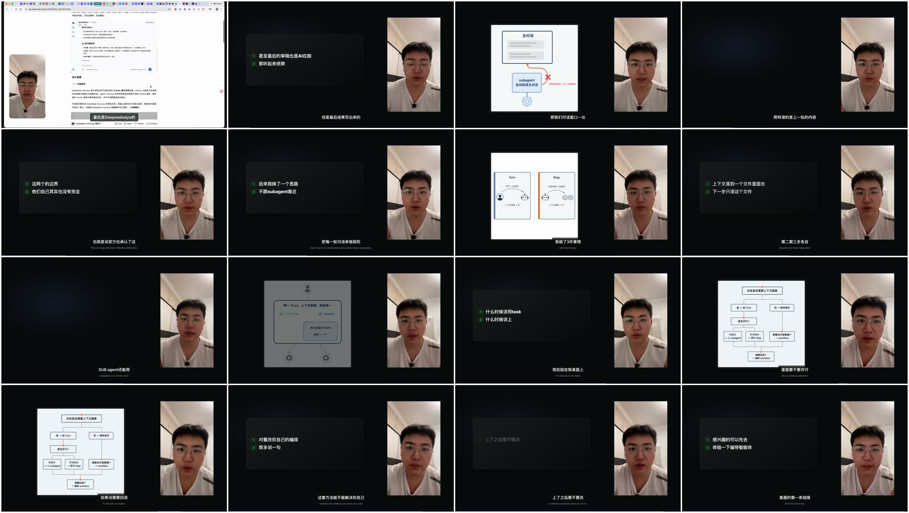

# 剪辑效果退化与成片“黑屏”根因诊断

> 任务：T-838  
> 日期：2026-08-14  
> 用户成片：`objkey-62e5771a-1694.mp4`  
> 范围：只读诊断，不覆盖、不重做成片，不把实现修复冒充已完成。

## 结论

用户体感成立，而且不是播放器、解码或视频拼接损坏。成片没有全画面纯黑帧；真正发生的是三层退化叠加：

1. **新内容动效没有进入本条成片。** 上游 `video.cards` 经口播可溯校验后实际留下 **0 张**信息卡；总导演为了让任务继续，确定性补了 **14 张**兜底卡。14 张全部是 `list + reveal`，`visualPlan=0`、Scene Graph=0。8 条 B-roll 的 `motion` 又全部是 `static`。因此这条片实际只有“深色清单逐条出现 + 静态图”，没有此前验收的可组合内容动效。
2. **横屏布局把“某场存在过一个视觉”误当成“整场每一秒都有视觉”。** 只要场景里有任意卡片或 B-roll，真人就整场固定在右侧 `500×804` 的窄条里，左侧约 69% 宽度永久预留为深色舞台。素材结束或卡片未生效时，舞台不会把真人拉回居中，也没有氛围底兜住，于是出现真实空舞台。
3. **质量门只验证技术成功，没有验证观看结果。** 本条任务的成片视觉审核记录是 `status=skipped`，原因是未配置视觉模型；确定性门只检查尺寸、码率、素材可读面积和人物遮挡，不检查深色占比、有效视觉覆盖或 Scene Graph 实际产出率。因而“可播放、无遮挡”被当成“成片成功”。

## 真实任务证据

对应决策任务为 `ai-task-b269a0a7-699`，渲染任务为 `ai-task-62e5771a-391`，产物采纳后成为用户给出的 MP4。

| 项目 | 实际值 | 结论 |
| --- | ---: | --- |
| 成片 | 157.27 秒，1920×1080，30fps，H.264 | 编码与封装正常 |
| 严格全帧黑场 | 0 段 | 不是视频流断帧或解码黑屏 |
| 场景 / 字幕 | 7 / 135 | 时间主轴存在 |
| 信息卡模型校验后 | 0 张 | 模型结果未通过口播可溯门 |
| 自动补位卡 | 14 张 | 全部 `list + reveal`，无 `visualPlan` |
| B-roll | 8 条 | 2 条短录屏、6 张静态图；全部 `static` |
| 左侧舞台亮度 | 157 个 1 秒采样中 102 个低于诊断阈值 35 | 约 65% 时间呈现为极暗舞台或低对比深色卡 |
| 左侧舞台变化 | 2fps 相邻采样中约 79% 的亮度变化低于 1 | 主舞台大部分时间近似静态 |
| 成片视觉审核 | `skipped` | 未配置视觉模型，只做确定性技术校验 |

亮度阈值只用于区分“用户感知到的极暗画面”，不做创作语义判断。

## 三类“黑屏”分别是什么

### 1. 真实空舞台：约 15.3 秒

- `0.05–3.37s`：第一场已有后续录屏，所以整场人物先被放到右侧；录屏尚未开始，左侧为空。
- `25.40–35.53s`：25 秒的兜底卡落在 21.40–25.40 秒静态图的有效窗内，被渲染器降成短标注后直接 `continue`；静态图结束后该卡不会再回来，造成约 10.1 秒空舞台。
- `84.48–86.33s`：两张静态图之间存在约 1.85 秒间隙，场景级布局仍保持右侧人物，左侧没有接力。

### 2. 看起来像黑屏的深色卡：约占主舞台 65% 的采样时间

根画布是 `#08090a`，兜底卡是接近黑色的 `#191a1b`。卡片本身面积不大、对比度低，外围仍是大片深色；即使画面技术上有两行文字，观看感受仍是“黑底上飘了一小块字”。

### 3. 静态素材承接：有画面，但没有“剪辑效果优化”

6 张生成图都是 `large_stage + static`，两段录屏合计只约 3.72 秒，也都是 `static`。接触表里可见的白色流程图是真素材，不是 Scene Graph 动效；卡片的 `reveal` 只在进场时逐条显示，随后长时间静止。

## 因果链

## 代码层对应点

- `video-decisions-runner.ts`：卡片内容不可溯时整张剔除；总导演再用相邻口播原句生成 `list + reveal` 兜底。
- `template.ts`：场景只要存在任意卡片/B-roll 就采用整场右人左舞台；卡片若落在 `large_stage` 素材窗内只渲染标注并直接结束该卡处理。
- `executor.ts`：视觉模型未配置时写入 `skipped`；即使配置，视觉审核也明确“不阻断出片”。

## 修复边界（本轮未实施）

这不是调亮背景色就能根治，至少要同时处理三处：

1. 信息卡全被可溯门剔除时，不能让确定性 `list` 补位伪装成内容动效成功；需要保留可诊断原因，并让语义模型重做卡片或明确降级。
2. 布局模式必须按**当前时间窗是否存在有效主视觉**切换；卡片与大图重叠时，应在大图结束后恢复卡片或补连续接力，不能把一次 `continue` 变成长空窗。
3. 成片 Gate 必须检查有效视觉覆盖、极暗空舞台时长、`visualPlan`/Scene Graph 实际命中率，并让视觉审核失败或未配置对用户可见；“编码成功”不能等同“成片可交付”。

实现会改变视频决策恢复、时间轴布局与交付 Gate，需作为后续 BUILD 任务单独修复并用这条 157 秒成片做真实回归。
