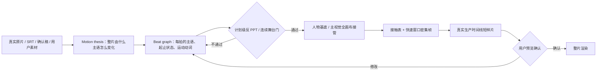

# 外部视频制作 Skill 学习与 CreatorOS 吸收结论

日期：2026-08-16
来源：[Pluviobyte/video-production-skills](https://github.com/Pluviobyte/video-production-skills)
研究版本：`e19f1f300eddbb4f73764e66849792ece94ff0b7`

## 大白话结论

我们之前的问题不是“动画数量不够”，而是没有在动手前把整条视频的运动主线定死。人物、横版主视觉、字幕和卡片各自成立，但没有共用一个舞台和注意力方向，最后就像几张卡拼在一起。

这个外部仓库最值得学的是三件事：

1. 先写一句整片怎么“动”的导演命题，再拆每一拍的视觉主语和状态变化；
2. 在写渲染代码前就拒绝 PPT 式方案，不等成片出来才发现全是卡片淡入；
3. 用接触表找问题、用真实时间线短样片验播放，不能拿几个漂亮截图或测试专用状态冒充成片正确。

## 四个外部 Skill 分别教了什么

| 外部 Skill | 可吸收方法 | 不直接照搬 |
| --- | --- | --- |
| `ai-motion-director` | motion thesis、beat graph、运动原语、双重反 PPT 门 | 不把 16:9、30–60 秒等默认值带入当前竖屏口播 |
| `reference-video-replica-qc` | 风格/视觉/逐帧声明分级；抽样定位、真实时间线和交付帧分别举证 | 当前任务不是像素复刻，不引入整套贴图回放或对齐工具链 |
| `dark-saas-magic-video` | 每个场景先有可读 hero frame，转场服务因果链 | 黑底、紫光、霓虹、魔术 UI 属于专用风格，不能成为 CreatorOS 默认 |
| `black-white-text-opener` | 文字出现与音效共用确定性时间合同，移动端可读性单独验收 | 用户已明确反对纯黑舞台/全屏盖层时，不使用黑底白字开场 |

## 无新规则基线测试暴露的真实漏洞

同样的竖屏症状交给未加载本次改进的执行者后，它虽然给出了人物比例、字幕字号、节奏与预览步骤，仍自然建议：

- 放大裁切横版用户素材以填满竖屏；
- 复制全屏动态模糊背景填空；
- 用固定“每几秒必须变化”和黑区面积阈值代替语义导演判断；
- 主要解决单帧版式，没有建立跨 beat 的视觉主语交接与回位。

这证明旧 Skill 即使有 `contain` 和静态背景规则，也没有把它们放进“导演方案必须先过”的入口门，所以后续方案仍会绕开老教训。

## 已写入我们的 Skill

本次把以下内容写入全局 `video-editing` Skill：

- 新增 `motion_direction.md` 作为 composition 前必备产物；
- 每个 beat 必填视觉主语、起止状态、运动动词、舞台形态、转场和回位；
- 竖屏默认只使用人物基底和主视觉全画布接管两种形态；人物 PiP 仅在用户明确要求，或人物反应/指示动作承担不可替代信息时作为有理由的例外；
- 横版素材继续 `contain`，剩余空间只用低成本静态氛围承接；
- 重点词由 AI 编导绑定真实字幕字符范围和时间段，代码不得猜词；
- 接触表必须看出状态推进，真实生产时间线短样片通过后才进入用户预览；
- 对标视频先声明是风格参考、视觉对齐还是逐帧声明；
- 用户认可的动效记录输入、时间合同、证据和限制，逐步形成可复用组件库。

## 技能前向验证

更新后用同一组原始症状做了两轮全新执行者测试：

1. 第一轮已经正确使用 motion thesis、beat graph、三种连续舞台、`contain`、静态承接、真实时间线和用户预览，但仍擅自发明黑区比例、素材宽度等通用硬阈值；
2. 补上“数字门必须有来源”后，第二轮不再用固定秒数机械切镜，也没有无来源的面积/宽度门。它把裁切、动态全片背景、PPT 关系卡、代码猜重点和跳过预览全部判成硬失败。

全局 Skill 的结构校验通过；新增引用文件存在且能从主 `SKILL.md` 直接路由。

随后用户实看进一步否定了“素材/PPT 出现时人物自动缩成小窗、结束后精确回位”。因此最终吸收结论不再把 PiP 当稳定默认舞台：连续性来自逐拍单一主语、明确切点和声音承接，不来自人物框的几何表演。

## 许可证与复用边界

研究版本中未发现 LICENSE 文件。因此本次只转化通用方法，没有复制外部仓库的源码、脚本、素材、示例帧或专有文案，也没有安装其 Skill。若以后要复用其代码或资产，需要先取得明确许可或补齐许可证判断。

## 对 T-856 的直接验收变化

T-856 不能再以“几何测试通过、加大字幕、增加动画”结束。代表性短样片必须同时出现人物、横版主视觉、中英文字幕和 AI 重点词，并证明：

- 同一视觉主语能跨 beat 交接，切回人物时布局自然复位；
- 接触表不是互不相关的海报墙；
- 用户素材完整可见，没有裁切、拉伸或动态全片背景；
- 手机预览中英文可一遍读清；
- 用户确认短样片后才允许整片重渲。
