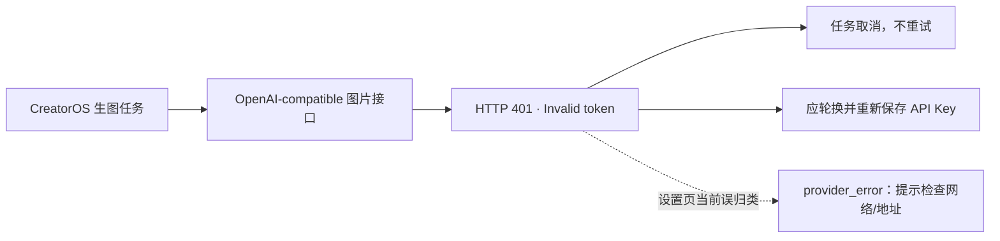

# dudu 文生图不可用：脱敏诊断

日期：2026-08-17
任务：T-877
范围：只读安全日志、当前适配器与无网络单测；未读取或记录 API Key，未发送真实生图请求。

## 结论

当前失败的第一原因是运行时使用的凭据被上游拒绝。请求已经进入 OpenAI-compatible 图片接口，
上游连续返回 HTTP 401，错误分类为 `authentication`，脱敏消息为 `Invalid token`。这不是网络
不可达、完整 endpoint 被重复拼接、模型响应格式不兼容或 `n` 被字符串化。



安全日志不记录 endpoint、模型名和 Token 正文，且当前应用没有开启官方 CLI 连接，因此不能证明
运行时保存的 Token 与用户在聊天中贴出的 Token 是同一份；能确定的是：实际执行时携带的凭据被
上游判为无效或无权限。聊天中已暴露的 Token 必须立即作废并换新，不能继续复用。

## 同一次故障链证据

| UTC 时间 | 任务 | 路径 | 结果 |
| --- | --- | --- | --- |
| 07:06:03 | `ai-task-32c67e5c-797` · `asset.generate` | `images/generations` 纯文生图 | HTTP 401，`Invalid token`，不可重试 |
| 15:20:32 | `ai-task-5b4809a2-1790` · `cover.generate` | `images/edits` 参考图封面 | HTTP 401，`Invalid token`，不可重试 |
| 15:45:11 | `ai-task-5b4809a2-2427` · `cover.generate` | `images/edits` 参考图封面 | HTTP 401，`Invalid token`，不可重试 |
| 15:47:26 / 15:47:33 | `settings.models.test` · `image.generate` | 设置页真实最小生图 | 两次被泛化记录为 `provider_error` |

纯文生图的 `images/generations` 已经单独出现 401，因此即使 dudu 后续不支持 `images/edits`，也不能
解释当前首要失败；必须先恢复鉴权。换新 Key 后，参考图封面若再返回 404/405/4xx，才继续判断
该供应商是否支持 `images/edits`。

## 请求装配核对

当前适配器对用户提供的形状有确定性覆盖：

- 完整 `…/v1/images/generations` 会原样使用，不会再追加 `/v1/images/generations`；
- 纯文生图发送 JSON：`model`、`prompt`、数字 `n: 1` 和安全映射后的 `size`；
- 认证头为 `Authorization: Bearer <token>`；
- 有参考图时改走 `…/v1/images/edits` multipart，并省略会被编码成字符串的可选 `n`；
- HTTP 401/403 在适配器层会分类为 `authentication`，不会盲目重试。

本地零网络回归：

```text
ai-worker multimodal-openai-images: 12/12 passed
frontend settings-model-test-wrap: 28/28 passed
```

## 次要产品缺陷

`settings.models.test` 的文本模型测试会用 `isAuthenticationFailure` 区分鉴权错误，但
`image.generate` 分支的 catch 当前丢弃原错误，统一记录 `provider_error`，并给用户“检查网络和
接口地址”的泛化提示。这不会造成 401，却掩盖了真实原因。已登记 T-878，等待按独立实现任务修复。

## 用户下一步

1. 立即在 dudu 后台作废聊天中暴露的旧 Key并新建一枚；
2. 在 CreatorOS 的“图片生成”模型配置里重新保存新 Key，provider 保持 OpenAI-compatible；
3. 先运行一次“测试连接”。如果仍失败，保留新的测试时间点，不要在聊天中粘贴完整 Key；
4. 测试连接通过后再重试原文生图任务。旧失败任务不会自动恢复。
