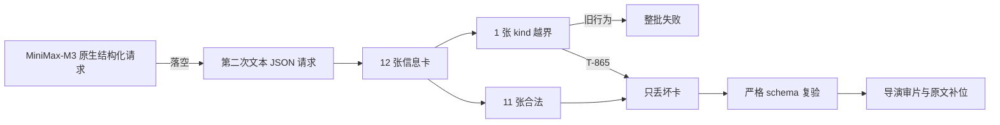

# video.cards 结构化输出局部失败诊断与修复（T-865）

## 结论

这不是稿件损坏，也不是 `kind` 合法枚举写错。真实失败是：MiniMax-M3 的原生结构化请求
没有产出可验收对象，系统随后又发起了一次文本 JSON 请求；第二次响应已经能解析成对象，
但第 12 张卡的 `kind` 越过六值协议，旧代码因此把整批信息卡和整条 `video.decisions`
一起判失败。

根因是恢复策略漏接：项目已有“创作候选局部恢复”，但 `video.cards` 没声明
`creative-partial`，runner 也没传信息卡专用 normalizer。最近 `visualPlan` / Scene Graph
增加了更多枚举面后，MiniMax-M3 的偶发枚举漂移开始稳定暴露这个缺口。

## 真实证据链

- 账号：`acct-ae1a8346-9`；项目：`project-016270fc-398`。
- 任务：`ai-task-32c67e5c-1139`，类型 `video.decisions`，请求时间
  `2026-08-17T07:16:25.383Z`，约 65 秒后以 `cancelled` 终态结束，结果候选为 0。
- 第一步 `video.scenes` 正常：`path=structured`、`modelCalls=1`。
- 第二步 `video.cards` 失败：`path=text_fallback`、`modelCalls=2`；这证明文本兜底是一次
  新模型请求，不是复用首响应。
- 最终 Zod 路径为 `cards[11].kind`，允许值为
  `stat/quote/list/compare/code/image`。
- 安全日志按设计不保存完整模型原文，因此无法诚实恢复该字段当时的具体非法字符串；不能把
  测试夹具里的 `diagram` 冒充真实值。
- 当前模型配置中 `video.cards` 没有专属模型，实际继承默认
  `minimax / MiniMax-M3 / anthropic-compatible`，温度为 0.6。
- 最近 57 条 `video.decisions` 中有 29 条成功、15 条待确认、13 条取消；其中 2 条明确是
  同类 schema 枚举失败。另一条发生在 `2026-08-16`，越界字段是
  `cards[*].visualPlan.relation`，随后重试成功。当前项目自身也曾在 `2026-08-15` 成功完成
  `video.decisions`，所以模型重试“可能碰巧成功”，但不能作为根治方案。
- 失败发生在本机开发包（源冻结点 `fdd6d7ab`）。该调用链从该冻结点到修复前当前 HEAD
  没有差异，因此不是安装包落后造成的单点问题，当前源码同样受影响。

## 修复边界

1. `video.cards` 正式声明为可局部恢复的创作候选。
2. runner 在严格动态 schema 前调用 `normalizeVideoCardsOutput`：
   - `kind` 等关键协议非法：只丢该张卡；
   - `motion` / `visualPlan` 非法：只删除可选能力，保留可溯卡片正文；
   - 不把未知枚举猜成合法枚举，不补写任何模型没有表达的事实。
3. 归一化后仍由原静态 schema、动态时间/场景 refine、正文可溯门和导演审片共同验收。
4. 不增加模型重试。首响应只是单卡越界且其余结构完整时，可以直接恢复，避免第二次计费请求；
   无法恢复时仍然失败，绝不假成功。

## 验证

- RED：新增真实失败形状后，runner 收不到 `normalizeObject`，定向套件为 `1 failed / 86 passed`。
- GREEN：backend 定向 `87/87`；ai-worker 相关 `35/35`；新增首响应恢复回归 `21/21`。
- ai-worker 全量：`49 files / 383 tests` 全绿。
- ai-worker 与 backend TypeScript 类型检查通过。
- boundary-scan：无新增违规，5 条存量基线不变。
- 未调用真实模型、未产生计费、未重跑或修改用户任务/项目/模型配置。

全量 backend 套件与全量 ai-worker 套件并行执行时，若干既有数据库/并发用例因机器负载超时；
停止并行负载后，ai-worker 全量已独立复跑全绿。本任务直接相关 backend 套件已独立全绿，不能把
那次环境超时记成产品断言通过。
