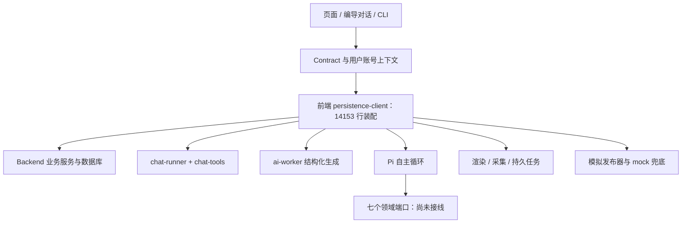

# CreatorOS 架构、无效代码与 Agent 需求审查

日期：2026-09-04（用户时区）；任务：T-914；代码基线：`a9d28da7`。审查对象为当前 monorepo 的 frontend、backend、contract、ai-worker、mcp-server 与桌面构建脚本；没有扩展审查 Growth 等其他仓库。

## 结论

应该优先启动重构。最需要处理的是**正式能力与实际执行不一致、装配过度集中、任务运行状态分裂**。删除未使用变量能减少噪声，但不能修复这些问题。

“真正的 Agent”不是从零开始：Pi 0.80.7 已安装、已注册三个 executor，但七个业务端口仍全部未接线。即使补齐端口，当前工具结果桥接还会让模型只看见摘要、看不见检索结果和正文；会话也仍是内存态。因此不能把“引擎有实现、测试通过”当成“自主业务已交付”。

建议把重构定义为：**统一业务工具和执行事实，使 Agent 能读到真实结果、连续完成任务、可靠停止与恢复；同时把旧模拟路径和重复入口从正式装配中退出。**具体实现范围见 [T-915 SPEC 草案](../superpowers/specs/2026-09-04-agent-runtime-refactor.md)，尚未独立评审或确认新增架构范围。

## 审查方法与边界

- 全仓跟踪文件清点、CodeGraph 强制重建索引、调用者查询、`rg` 动态装配回查；重点沿公开 contract → transport → service → executor → SDK 查证。
- 跟踪的 TS/TSX/MJS/Rust 文件中，排除 `.test.`、`.spec.` 与 `orchestrator/process/` 后为 1,095 个文件、284,532 行。此口径仍含 fixtures 与脚本，不等于纯业务有效代码量。
- 跑标准类型检查、Agent 测试、CLI/MCP 测试、架构与语义门卫、孤儿扫描、全局 reconcile；额外启用 TypeScript 未使用符号检查。
- 没有改产品代码，没有调用真实付费模型或发布接口，没有操作用户项目数据，没有跑完整 macOS/Windows 安装包旅程。这里的“全面”指覆盖所有包与关键架构面，不是逐行证明 28 万行代码无缺陷。
- 现象分成：已证实的实现问题、潜在风险、待退役候选。名称含 legacy/mock、文件很长或文本搜索零引用，本身不构成可删除证明。

## 现有架构与应收敛的位置

大白话：业务房间已经分开了，但电线、开关、部分业务逻辑仍挤在前端的一个巨大配电箱里。Agent 已放进去，连接业务的线还没接完。

## 按影响排列的发现

### A-01：正式发布服务绑定模拟发布器，能形成伪外部事实

**已证实，优先处理。** `frontend/src/server/persistence-client.ts:2655` 无测试条件地注入 `createMockPublisher()`；`backend/src/modules/publishing/platform-publisher.ts:68` 生成 `mock:<platform>:<publicationId>` 与 `mock://` URL，remove 只改内存 Map。

`publishing.service.ts:559` 在 transition 到 published 时调用该端口并写 published/externalId/externalUrl；到 removed 时调用模拟 remove 后写 removed。`publishing.transport.ts:247`、`contract/src/operations/publishing.ts:96` 暴露 transition，`contract/src/cli-policy.ts:243` 也登记了它。因此这不是仅供测试引用的孤立 mock。

**影响**：满足状态机前置条件的公开操作可能把“未在平台发生”的发布/下架记录成成功。没有据此断言用户当前 UI 的手工登记流程也是假发布；`register` 与 `transition` 必须分别验证。

**改法**：明确“手工登记已发布”和“真实代发布”的不同操作语义；正式环境缺实际发布适配器时该能力不可报告成功。保留真实手工登记能力。验收需走 dispatch/CLI 的完整链路，不能只用 MockPublisher 的 service 测试。

### A-02：Pi 三类业务共七个端口全部未接通

**已证实，Agent 启动的直接阻断点。** `persistence-client.ts:9978` 起，webSearch、webRead、knowledgeWrite、listTargets、runCollection、searchMaterials、organizeMaterials 均抛 `AgenticPortNotImplementedError`；`:10010` 已创建 Pi，`:10023` 起仍注册 research/collect/material。

这解释了旧 T-340 为什么仍存在。应复用当前真实搜索、网页读取、候选、采集和素材 service，不另造第三套业务工具。未接能力须在开始前可判断，而不是先花模型 token、等调用时才发现无法执行。

### A-03：Pi 工具把证据放在 details，模型只看到“搜到几条”

**已证实的协议链问题。** `backend/src/modules/execution/agentic/pi-engine.ts:257` 附近，custom tool 的 `content` 仅包含 summary，实际 `result.data` 放在 `details`。research-adapter 的检索 URL、摘要和网页正文都放 `data`，summary 只写“联网检索到 N 条”“正文 N 字”。

核对安装的 Pi 0.80.7：pi-agent-core `dist/agent-loop.js:529` 将 content/details 分别存储；pi-ai `dist/api/openai-completions.js:839` 只从 `toolMsg.content` 提取模型工具消息正文，不序列化 details。故 OpenAI Chat 协议下，模型下一步看不到搜索 URL 或网页正文。内存 outputs 有数据并不能补上模型输入。

受控探针已复现：`detailsHasUrl=true`、`modelContentHasUrl=false`，模型可见内容仅“联网检索到 1 条”。见 [探针原始输出](evidence/t914/agent-contract-probe.log)，使用静态端口，无真实联网。

**改法**：统一工具结果契约，显式包含模型可见的有界正文、来源、真实 ID、分页游标与结构化错误；宿主诊断单独存储。验收直接捕获下一轮 provider 请求，断言 URL/正文确实进入模型上下文，而不只断言 execute 被调用。

### A-04：Pi 预算在 turn_end 才检查，与“执行前硬顶”不一致

**代码可证实；超额程度待受控重现。** `pi-engine.ts:564` 起在 `turn_end` 回调调用 `beginStep()`、`chargeTokens()`，而 `toPiCustomTool.execute` 没有执行前预算检查。`loop-control.ts:71` 的 beginStep 本意是“开一步前询问”。恢复时即使 checkpoint 已耗尽，Pi 仍先 prompt。统计仅取 usage.input/output，未在这里合并 cacheRead/cacheWrite。

**影响**：不能承诺零越界步数/调用预算；多工具一轮与缓存计数还需明确口径。Token 无法精确预知，设计应区分预留上限、实际结算和明确允许的单次误差，不能写不可能兑现的绝对费用硬顶。

### A-05：引擎结束原因没有上升到统一任务状态

**已证实。** `agentic-executor.ts:188` 起，不论 final.stopReason 是 completed、llm_error、aborted 或预算耗尽，都写 `agentic-result.json` 并 return；`run-execution-task.ts` 收到返回值后统一 harvest + recordCandidate，并记录“完成…待确认”。这是“有诊断文件”等同于“有可采纳结果”的风险。

同一处 `engine: deps.engine.name` 固定报告 pi，即使 Pi 已转 deterministic，顶层 metadata 仍是 pi。内部文字警告不等于机器可用的真实运行时标识。

受控假引擎返回 llm_error 后，executor 确实正常 return 且产生 JSON；见同一探针输出。这证明 executor 的行为，不冒充真实模型故障旅程。

**改法**：结果契约分清完整候选、部分可用候选、失败诊断与取消；保留有价值的部分产物，不能因质量问题直接整单删除。记录 actualEngine 与降级原因，外层状态消费同一契约。

### A-06：检查点只是计数恢复，不是工作恢复

**已证实。** `agentic-executor.ts:135` 只读 stepsUsed/tokensUsed；`pi-engine.ts:541` 使用 `SessionManager.inMemory()`，执行输入不恢复消息、已读来源或工具账本。异常 checkpoint 也只有两个计数。

**影响**：不能据此宣称重启后从原工作位置继续；也不能证明不会重复抓取或重复副作用。现有通用持久任务有租约和重试能力（`persistent-task.service.ts`），但其 kind 列表不含 agentic，不能把两套恢复能力混为一谈。

**改法**：会话/任务/尝试三者分开标识，以服务端持久工具执行账本、幂等键和项目作用域恢复；消息续接与预算续接都需要。优先复用现有数据库与 service，不新建平行事实库。

### A-07：确定性兜底仍调用 LLM，却忽略 LLM 决策

**已证实。** `deterministic-engine.ts:50` 固定顺序执行只读工具再执行副作用工具；`:76` 每步问 LLM 是否调用，返回 text 未被用于决定工具或参数。注释明确说仅为了验证 model-config。

这是验证脚手架进入正式 fallback 的典型。它会消耗 token，但并不提供用户期待的自主选择。应将验证引擎留在测试；正式降级改为有明确业务目标、确实可完成的既有流程，并如实报告能力变化。

### A-08：前端 composition root 仍承载超大运行时职责

**已证实的结构债务，不把行数直接等同于故障。** persistence-client 14,153 行；chat-tools 5,130 行；chat-runner 3,097 行；intelligence.service 5,359 行。前端 intelligence-workbench 4,683 行、settings-interactive-region 3,677 行、production-workbench 3,184 行、ai-copilot-content 3,177 行。

`buildPersistence` 集中实例化数据库、各模块、任务分派、搜索/采集、Agent、定时器和初始化。CodeGraph 确认 Pi 和旧 copilot 的生产调用者均归该函数。导航性能修复不能替代拆开初始化与能力装配职责。

**改法**：backend 持有应用装配与模块工厂；宿主提供路径、密钥访问、浏览器、时钟等适配端口；前端只持 route/transport 与 UI。按状态责任拆页面，不能只将原大文件切片再循环 import。保留模块化单体，不因“重构”机械升级成微服务。

### A-09：生产 transport 对未匹配能力仍回落 mock

**已证实存在 fallback，实际命中操作集合待全量覆盖核对。** `persistence-client.ts:13889` 未列入 PERSISTED_OPS 的 endpoint 走 mock；`:14139` 项目 UnsupportedOperationError 走 mock；`:14146` 无属主操作最终也走 mock。

**影响**：未来新增或漏注册 contract 时，可能成功调用演示存储而非真实服务。当前不能据此断言所有页面都在显示假数据。

**改法**：正式装配默认拒绝无属主操作；mock 仅由独立测试/演示 composition 显式选择。建立所有 ENDPOINTS 与唯一真实 handler 的双向覆盖检查。

### A-10：canonical 默认用户客户端仍在生产源码中存活

**已证实存在错误上下文路径；未证明用户数据泄漏。** `contract-client.server.ts:42` 固定 canonical 用户；`:69` 导出默认 client。项目详情 `page.tsx:85` 的 slug 解析确实调用它；多数 feature 保留可注入的 defaultClient。最终页面还有真实账号校验，因此不能把 slug 路径直接描述为已发生泄漏。

`frontend/eslint.config.mjs:94` 对此只有 warn。应让 RequestContext/client 成为必填参数，生产代码不再允许隐式演示身份；兼容旧 slug 的读取同样传当前上下文。跨账号回归不能被删。

### A-11：新旧对话入口并存，能力与生命周期不相同

**已证实。** `/api/chat` → runChatStream 是工具流式链；`persistence-client.ts:5461` 的 `ai.conversations.messages.create` 另触发 `runCopilotAssist`，后者是 assembleCreativeContext + 文本 llm + appendAssistantMessage，没有同样的工具循环。CodeGraph 仍有调用者，不能直接认作死代码。

**改法**：盘点外部 CLI/MCP、旧调用者后，统一消息提交契约与执行入口；保留历史数据兼容。旧入口若保留，应调用同一个 runtime，不再维护第二种“助手”。

### A-12：门卫绿色的覆盖面与名称不一致

**已证实。** boundary-scan 返回 0，但允许 5 条基线：4 条 SDK 引用中含 `@ai-sdk/react` 和纯类型，另 1 条跨 repo 引用在 integration test。与此同时 R1 只查 `frontend/src/server/modules`，R2 scopeDirs 不含 `frontend/src/server`，所以巨大 composition root 和 server/ingestion 不计入这些违规。

应校准“服务端业务/模型推理”与“浏览器 UI transport/type”的边界，不为把数字清零而删除合法 useChat 或测试。contract 上层依赖和 worker 写库限制也应有真实检查，而非只留架构文档补充条款。

### A-13：工程控制面已有大规模漂移

**已复测。** reconcile 返回 210 errors / 1 warning：旧模块缺 write_set/verify、自治文字与执行配置不一致、历史 SPEC receipt 引用失效、旧看板缺验收列、已有前端 receipt 在后续代码变动后失效。不能把 210 个错误写成 210 个产品 bug。

LED-024 告警进一步单独执行：`verify-t794-motion-card-preview.mjs` 因缺 `chromium_headless_shell-1223` 退出；本次可确定的是**验收环境不完整**，不能由此判定动效代码回归。

orphan-scan 是需求追踪检查，不是源码死代码检查：返回 0，但 100 warnings，含未追踪 FR 与 PLANNED 行。本次 context-compile T-914 因缺 task binding 被拒绝，因此未派发并行工作，也未绕过进入产品实现。

根因修复已登记 T-916。修复时不补造历史 PASS、不降低门槛掩盖失败；以当前源码重验相关范围。

## 无效代码：可清理候选与不可误删项

| 对象 | 证据 | 建议 |
|---|---|---|
| 未使用局部函数/导入/参数 | backend 额外 noUnused 检查 13 条 TS 诊断；frontend 编译程序 131 条（含共享包与测试，不能相加） | 小范围逐项清理，初始化有副作用的表达式须保留语义 |
| formatThesisNodes、nextVersionNumber | 编译器确认未读取，分别在 creative-context.ts:1320、artifacts.repository.ts:158 | 高置信清理候选 |
| `@anthropic-ai/claude-agent-sdk` | ai-worker/package.json 仍声明；三个产品源码树未找到实际 import | 依赖退役候选；删除前查打包、动态加载、锁文件与许可证闭包 |
| PiNotInstalledError / PiStreamFnBuilder | 源码仅定义及 barrel 再导出，无生产消费者 | 清除兼容导出的候选，先核对包出口使用者 |
| ingestionMockSource | persistence-client.ts:2744 创建后只 `void` | 无有效业务用途的装配候选，移到测试 composition |
| knowledge.classify | route、runner、设置目录仍存活；未找到当前 UI 发起调用 | 退役候选，先确认外部调用与旧 skill 配置迁移，不能直接删 route |
| experience 目录 | `/experience` 已重定向，但 review 和 knowledge 仍 import 类型/组件 | 保留仍使用部分，迁到真实属主后再清残留 |
| copilot-runner / MockPublisher | 有实际正式装配调用 | 属于需替换的活债务，不属于可以直接删除的死文件 |
| 旧路由、provider 拼写兼容、合法降级 | 可能服务历史项目、渠道与已安装客户端 | 必须有调用与历史数据证据，不能按 legacy 标签删 |

原始 noUnused 输出见 [backend-unused.log](evidence/t914/backend-unused.log) 与 [frontend-unused.log](evidence/t914/frontend-unused.log)。它们是额外严格扫描的失败结果，标准 typecheck 本次通过。

受控探针可重跑：`pnpm --filter @creatoros/backend exec tsx ../docs/research/evidence/t914/agent-contract-probe.ts`。探针只用临时目录和假工具结果，结束删除自身临时输出。全局对账原始输出归档于 [reconcile.log](evidence/t914/reconcile.log)。

## 旧 Agent 需求盘点

| 原任务 | 历史意图 | 当前事实与承接 |
|---|---|---|
| T-256 | 受控自主运行时、白名单、预算、适配器 | 地基存在，可复用 |
| T-313 | Pi 接入与真实调研循环 | Pi 已接；60 项相关测试通过；真实业务闭环未成立 |
| T-340 | 调研三端口真实接线 | 当前仍未接，直接阻断 research |
| T-314 | Pi 全产品地图、记忆与技能进化 | 旧 SPEC 可作为输入，需与 8 月后的契约重新对齐 |
| T-315 / T-316 / T-337g | 记忆工具、项目会话续、转录留证 | 现 Pi 白名单仅 7 工具，SessionManager 仍 inMemory |
| T-317 / T-318 / T-335 | 偏好采纳、skill diff/回滚、用户 skill | 现有上下文与 override 可复用；不能据其存在宣称 Pi 全闭环已实现 |
| T-319 | 可选 MCP client | 产品已有对外 MCP server；这是被别人调用，不等于 Pi 已接入外部 MCP |
| T-324 | 网页/自动化/剪辑全面接管，真 bash/fs 沙箱自纠 | 2026-07-15 因临发布与改动风险冻结，专项 SPEC 未写；用户本次要求重新盘点并考虑启动 |

上述历史证据在 `docs/tasks/T484.md:1072` 起与 7 月 12/14 日两份 Pi SPEC。旧 SPEC 明确不替换编导对话主循环，也禁止改运行中 app 源码；若本次要统一对话 runtime，需要显式更新旧决策，不能以“恢复旧任务”偷偷扩大范围。

## SDK 与 Agent 的关系

不能将“使用 Vercel AI SDK”直接等同于“不是真 Agent”。官方已提供 ToolLoopAgent，支持多步工具循环、上下文和停止条件；Pi 提供可嵌入会话与工具扩展。真正要验的是行为能力与维护成本，而非包名。来源：[AI SDK Agents](https://ai-sdk.dev/docs/agents/overview)、[ToolLoopAgent](https://ai-sdk.dev/docs/reference/ai-sdk-core/tool-loop-agent)、[Pi SDK 官方说明](https://github.com/earendil-works/pi/blob/main/packages/coding-agent/docs/sdk.md)（本次在线核对；线上新 API 不等于仓内 0.80.7 API）。

本项目已投入 Pi，建议先用**同一真实业务契约**验证 Pi 的收益；结构化生成和模型适配可以继续复用 AI SDK。若需要统一对话，则比较 Pi 接管与 AI SDK Agent 的同任务表现、模型兼容、恢复、取消、体积和实现复杂度后形成 DEC，而不是先升级依赖再找理由。

## 重构顺序与验收原则

这是依赖顺序，不是削减范围或拆成多个产品版本：

1. 明确真实能力、作用域与发布语义，登记基线和恢复门；排除 mock 成功路径。
2. 提取业务工具与应用装配，拆开引擎相关巨型文件；保留现有 service/contract/存量数据。
3. 接通 Agent 领域工具，修结果可见性、预算、真实引擎标识、终态和持久恢复。
4. 按确认范围接对话、记忆与 skill；统一入口并退役重复实现。
5. 在隔离包验证完整业务旅程、跨账号、故障恢复与上一版本成功样例后，才替换默认运行时。

验证至少覆盖：搜→读→追加检索→有来源候选→采纳；素材列表→语义选择→候选→采纳→渲染；失败后有界恢复；取消不再调用工具；重启不重放写入；旧项目和旧配置兼容；受管/自配模型；macOS/Windows 包实际加载 Pi 与各工具。

## 本次验证记录

| 检查 | 本次结果 | 不能代表什么 |
|---|---|---|
| CodeGraph index / callers | 完成 | 不覆盖所有动态协议消费者 |
| backend / ai-worker / contract 标准 typecheck | 通过 | 不证明运行时业务有效 |
| frontend `tsc --noEmit` | 通过 | 未重新执行 next typegen 或 next build |
| mcp-server typecheck / 测试 | 通过；4 文件、38 测试 | 未调用运行中的用户应用 |
| Agent 目录测试 | 8 文件、60 测试通过 | 使用 faux / 失败网络等，不是生产模型成功闭环 |
| boundary / semantic | 通过；物理边界 5 条存量 | 不表示没有架构债务 |
| orphan | 0 errors / 100 warnings | 不是死代码检测，也不是完整产品验收 |
| reconcile | 失败：210 errors / 1 warning | 配置/证据漂移不能全算产品缺陷 |
| LED-024 preview 单独核查 | 缺 Playwright 指定浏览器可执行文件 | 未完成动效画面验收 |
| noUnused 额外检查 | backend 13、frontend 程序 131 条 TS 诊断 | 含测试/共享文件；不等于 144 个可删文件 |

本次仅交付审计与需求草案。没有宣称完成重构、真实 Agent 验收、独立评审或发布。
