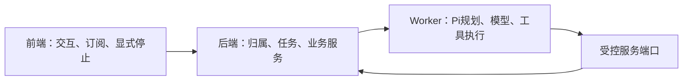

# 执行架构拆分与消融记录

本轮按用户授权直接删除旧实现；局部依赖消融与运行文件构建已执行，未运行全量测试、真实模型或用户数据。不是业务验收 PASS。

## 本轮实际改变

- 删除旧聊天流执行器与独占恢复包装，准备逻辑按类型、上下文、工具定义、回合装配拆开；旧模块2364行，四个准备模块合计826行。
- 删除三套宿主 Agent 注册及其 Pi/确定性回退装配，研究、素材和采集决策统一交独立 Agent Worker。采集实际消费者仍沿原服务；状态查询使用新观察序号，避免重复读到缓存的 pending。
- 删除宿主整批转写循环；来源、音频提取、ASR、后处理、工件和终态各有明确模块。原账号登录浏览器暂保留窄桥，不能称浏览器资源已全部迁入 Worker。
- 页面断线只解除订阅，用户点击停止单独提交原任务取消命令。
- 相对8f6ec97c，业务实现新增1435行、删除3521行，净减2086行；另有旧执行专用测试清理，不混入业务代码减重数字。

## 同条件聊天准备模块消融

用同一工作树、同一entryPoint与构建选项运行两次，仅在对照组通过内存覆盖恢复438ae928之前的聊天实现；不修改真实工作树，不执行应用。第三方依赖固定external。

| 指标 | 保留旧实现 | 移除旧实现 | 变化 |
|---|---:|---:|---:|
| 构建输出字节 | 1,389,181 | 1,311,410 | -77,771（约5.6%） |
| 解析输入模块数 | 275 | 260 | -15 |

复现：`node docs/research/evidence/t915/run-chat-preparation-ablation.mjs`。完整依赖贡献记录见 `docs/research/evidence/t915/chat-preparation-ablation.json`。这些数字只适用于该模块的依赖构建，不是整包压缩率，也不是AI响应延迟。

## 运行交付与保留项

Worker运行文件已成功生成；聊天正式入口的ESM依赖构建完成，未执行应用。第一次Worker构建暴露本地Whisper原生依赖不可内联，已改为复用现有桌面依赖闭包的external加载，随后构建完成。

备用模型自动切换、登录浏览器物理迁移、其它仍有真实调用的宿主任务和运行性能仍待推进/实测。未据代码行数删除用户业务能力，未把构建成功当业务验证。
