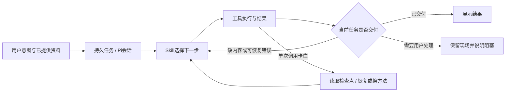

# T-922 Agent Loop 对照审查

2026-09-08。CreatorOS 候选 7dce6a8c；参考工程 `/Users/zyongzhu/Workbase/nomifun-desktop` HEAD e27bd5de，读取的是当前工作树，不推定无未提交修改。用户要求学习参考工程，确认是否代码主动中断以及为何没有基于意图持续交付。本轮只读产品代码，未运行模型或业务数据，未修改参考工程。

## 结论

CreatorOS 的中断不全是模型不聪明：代码存在步数强制收尾、重复工具强制收尾、Pi 自动恢复关闭、整项截止时间及失败终态。此前 Worker 隔离与局部修复有效，但没有把所有入口变为以任务交付为终点的会话循环。主聊天仍走 AI SDK streamText，独立 agentic 任务才走 Pi；不能称 Vercel 全下线或全部任务已是 Pi。

## CreatorOS 已证实的主动停止点

| 位置 | 真实行为 | 影响 |
| --- | --- | --- |
| `ai-worker/src/runtime/chat/chat-model-stream.ts:27,30,47` | streamText，maxRetries=0，stepCountIs(maxSteps) | 主聊天仍是有限工具步循环；SDK 重试委托外层，不能据此称完全无重试 |
| `ai-worker/src/runtime/chat/chat-loop-policy.ts:5–14,132–136` | 默认6步、配置上限12；重复工具+参数或末步强制 toolChoice:none | 即使任务未交付也禁止进一步工具；同参重读/重试被一并阻断 |
| `ai-worker/src/execution/chat-worker-run.ts:170–186` | 调上述入口；stop直接映射completed，其他非授权结束映射partial | 模型说完一轮和业务真正完成没有独立完成判断 |
| `ai-worker/src/runtime/agentic/pi-engine.ts:552,560–577,592–609` | SessionManager.inMemory；步数准入；关闭 autoRetry、autoCompaction；token耗尽abort；一次prompt后waitForIdle | 宿主有账本恢复，但未继承完整 Pi 会话恢复；不能简单打开SDK重试绕过账本 |
| `backend/src/modules/execution/worker-supervisor.ts:138,149` | 整项deadline到达cancel | 单次恢复仍可能被外层整项截止强行终止 |
| `backend/src/modules/execution/execution-worker-outcome.service.ts:24–48` | 可重试拒绝进入retry_wait；调用预算或截止不足则failed | 已有自动重试，但在资源门处分支到终态，不是持续任务恢复 |
| `backend/src/modules/intelligence/intelligence-generation-bridge.ts:33,58` | 16 calls / 1,000,000 tokens / 600,000ms，冻结deadline | 内容雷达不是无限期Agent任务 |
| `backend/src/modules/intelligence/topic-preview-runner.ts:241–276` | 排除持久挂起后，异常写阶段失败并finish failed/blocked | 最终落到截图手动重试形态；不能把每次异常都说成尚会自动继续 |

独立只读审查还确认：`frontend/src/server/persistence-client.ts:8283` 为 agentic 设置8次调用/20,000 tokens/10分钟；`backend/src/modules/ai-runtime/agentic-business-execution.service.ts:60–62` 只允许压低该预算；`backend/src/modules/ai/execution-agentic-candidate.service.ts:97,109,126` 将部分产物落为partial并清除retryAt，没有自动补齐队列。故仅放宽底层节点仍会被外层停止。

以上证明机制存在，不证明某条截图具体命中了哪一个门。最新日志未能定位截图任务，不能补造运行证据。

## nomifun 当前生产路径值得借鉴的机制

路径均相对参考工程：

1. `crates/backend/nomifun-ai-agent/src/factory/pi.rs:22–33`：生产构造路径直接选择 Pi。`apps/pi-sidecar/package.json` 固定 pi-coding-agent 0.83.0。未把仓库残存旧 Rust 引擎代码当成当前主路径。
2. `crates/backend/nomifun-ai-agent/src/manager/pi/agent.rs:670–709`：等待 agent_settled；遇 MaxTokens且无错误、无未结工具、未开始收尾，向同一会话发送“继续尚未完成任务”。原任务保留，避免重复有副作用操作。常量位于36–43，最多3次续跑；判断见1261–1269。
3. 同文件959–970：auto_retry_end失败记录provider_error，成功清除；不把恢复过程中一次错误永久认定为失败。1180–1215同样在后续成功响应清除旧供应商错误。
4. `apps/pi-sidecar/src/nomifun-gateway.ts:158–193`：工具调用120秒，resetTimeoutOnProgress=true；持续有进度可延长等待。工具错误交回Pi；Rust事件投影 `agent.rs:1030–1110` 保持工具错误事件，不因单个isError直接finish整个回合。
5. `manager/pi/model_config.rs:75–92,170–173`：写入启用的自动压缩配置，为长会话预留上下文；会话恢复与检查点由Pi适配器承接。
6. 包内 `apps/pi-sidecar/dist/runtime/docs/rpc.md:841–842` 区分 agent_end（一次底层循环结束，仍可能有重试/压缩/续跑）与 agent_settled（恢复队列已安定）。此语义也与宿主代码消费agent_settled一致。

限制必须如实保留：参考工程不是无限重跑。最大截断续跑3次；工具仍有超时；包内settings文档声明瞬时错误Agent重试默认3次；鉴权、传输中断和续跑失败仍可结束。未做真实模型测试，默认文档不等于当前用户机设置。参考实现也未证明普通stop时会独立验证全部用户意图已交付。

## 应迁移的架构与工作范围

应继续 T-915 的统一 Pi 方向，而不是再给多个短节点各加一层无限while：

- 把主聊天、雷达转选题等入口交给同一个持久任务协调层；结构化节点仍可作为工具实现，schema失败是工具结果，不能直接等同整个意图失败。
- 移除固定第6步禁工具、同参调用一刀切收尾；只用明确的写入幂等与真实无进展证据控制重复。语义完成判断归配置Skill/模型，代码核对产物存在、ID和归属。
- 接通Pi会话自动压缩、暂态恢复与截断续跑，统一经过宿主账本，避免SDK重试和宿主恢复重叠提交。
- 单次请求采用可观测进度/卡死检测；整项任务deadline不能直接冒充业务失败。预算耗尽、需要登录或供应商状态未知应保留进度并给真实状态，不能无声假完成。
- 区分“底层回合结束”“正在恢复”“等待用户”“交付完成”；成功通知只跟真实交付，避免模型一段话结束就刷已完成。

上述为代码对照得到的迁移建议，本轮没有修改产品运行逻辑；需在 T-915 更新执行/完成状态契约后实现，不能据审查把迁移标成完成。
