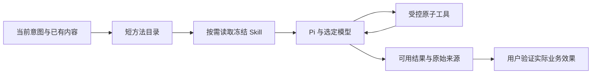

# T-932 糯米饭执行链对照：为什么增加检索提示仍不等于自主交付

## 当前结论

用户提供的理想结果是按问题整理有来源、有阅读价值的文章清单，并展示必要执行过程。T-931 仅完成搜索适配与方法注入，未证明此业务行为达标；保留其技术修复，不把它当成完整验收。

糯米饭当前源码同时支持 Pi 与 Codex；截图中的具体模型、引擎尚未确认。不能把截图效果归因于 Pi，也不能假定 CreatorOS 与它使用相同模型。

| 对照点 | 糯米饭当前源码 | CreatorOS 当前源码 | 落地判断 |
|---|---|---|---|
| 执行引擎 | `factory/codex.rs` 启动本机 Codex app-server，指定模型/推理档位；`factory/pi.rs` 独立绑定 Pi 模型 | `chat-worker-run.ts` 只接受 Pi，底层模型由供应商配置决定 | 框架、模型和宿主规则分别对比，不承诺接 Pi 就等于 Codex 效果 |
| 方法发现 | `factory/support.rs:prepare_summon_context` 把选中伙伴技能挂入 `.codex/skills` 或 `.nomi/skills`，提示需要时读取 SKILL.md；Codex 可使用其原生技能机制 | `chat-assembly.ts` 把工具介绍称为技能清单；research.plan 全文直接拼入 system，无通用按需方法读取工具 | 应提供方法目录与受管只读加载，并与工具目录分开；不能靠继续堆全文规则 |
| 工具权限 | 两引擎均通过签名 Gateway 获取业务能力，按会话权限发放；不是无限制调用 | 按 surface/项目阶段裁工具，有只读项目服务；保留特殊按钮强制调用和特殊顺序 | 权限边界保留，页面/历史业务流程不能无条件代替当前意图；迁移须逐条识别真实权限与产品偏好 |
| 输出约束 | Codex developer instructions 与知识/伙伴上下文组合，能力真实来自 Gateway | `chat-assembly.ts` 全局 honestyBlock 含“只有指针权”、禁止推演方法论、雷达登记引导等业务策略 | 将语义方法迁回可配置 Skill；宿主仅保留权限、归属、真实写入和执行状态边界 |
| 完成语义 | Codex adapter 也有停止和缺 final 恢复，非无限执行；缺 final 恢复明确禁止重复副作用 | `chat-worker-run.ts:189` 以 finishReason=stop 记 completed；`chat-pi-loop.ts` 续跑主要处理空输出和长度截断 | 协议终态与用户目标达成分开；不可用字符串猜测语义成功，更不能强制重复有副作用工具 |

## 确定的迁移合同

沿用用户此前指定的 Pi 方向，不因截图直接新增 Codex 引擎。方法目录、按需加载、主提示瘦身、结果交付约定可以独立迁入现有架构。具体实现须经独立评审，避免再次以临时提示补丁替代整个执行合同。

1. **方法与工具分离。** Skill 管理继续是唯一可编辑来源。聊天拿到短目录，模型按意图读取本轮冻结的完整方法；不从另一个账号或当前可变版本补旧任务。工具只返回真实操作结果，不把“搜索命中”描述为“素材已交付”。
2. **取消全局创作限制。** 允许基于读到的证据做引用、解释、合理推演和建议，并明确事实与推演；保留禁止伪造来源/数字。公开资料任务不以私人凭证、项目绑定或雷达注册作为前置。
3. **原子能力与上下文。** 继续由已验证 service port 读当前主题、稿件、知识与素材，允许模型决定先查知识还是上网；工具输出过长应给可继续读取的窗口，不把摘要当全文。
4. **交付检查。** 方法明确当前任务的交付物（例如文章清单、价值说明、原始链接）；模型发现未满足意图时继续工作。执行状态仍诚实报告模型终态，不能把 stop 或有一张卡当业务验收通过。另加语义监督会增加模型调用，需要先确认收益，不能默默给所有任务加第二套循环。

## 尚未确定及未执行

- 截图对话的引擎/模型已向用户询问，未把源码支持当成该会话使用证据。
- 不确认同模型之前，不能通过截图断言根因完全来自模型或宿主代码。
- 本轮只完成源码对照和迁移合同，未改产品代码、未重打包、未执行付费模型。
- 任务包编译提示 T-932 缺 task binding，尚未派发代码代理；既有全局对账欠债仍由 T-916 跟踪，不能伪造评审/流程通过。
- 糯米饭 `docs/features/pi-runtime/BUSINESS.md` 仍写“Pi唯一”，与当前 Codex factory 源码及架构文档不一致；本次以实际 factory/manager 为准，不照搬过时文档。

主要源码：

- `/Users/zyongzhu/Workbase/nomifun-desktop/crates/backend/nomifun-ai-agent/src/factory/codex.rs`
- `/Users/zyongzhu/Workbase/nomifun-desktop/crates/backend/nomifun-ai-agent/src/factory/pi.rs`
- `/Users/zyongzhu/Workbase/nomifun-desktop/crates/backend/nomifun-ai-agent/src/factory/support.rs`
- `/Users/zyongzhu/Workbase/nomifun-desktop/crates/backend/nomifun-ai-agent/src/manager/codex/agent.rs`
- `backend/src/modules/ai-runtime/chat-assembly.ts`
- `backend/src/modules/ai-runtime/effective-skill-snapshot.ts`
- `ai-worker/src/execution/chat-worker-run.ts`
- `ai-worker/src/runtime/chat/chat-pi-loop.ts`
