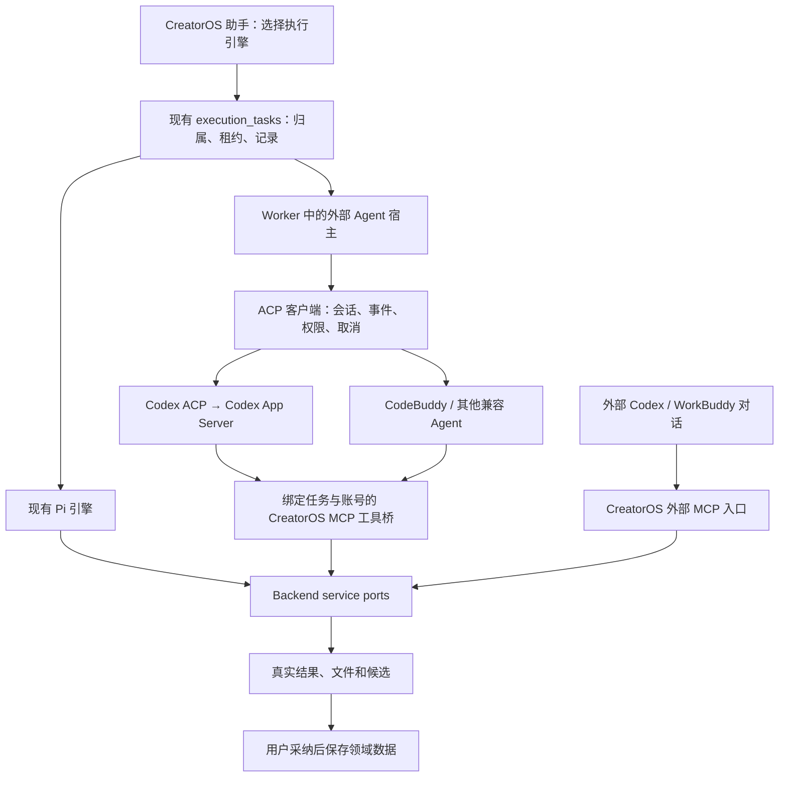

# CreatorOS 接入本地与外部 Agent 调研

日期：2026-09-27。任务：T-1016。状态：调研结论与设计建议；未实现、未通过产品验收，待确认后形成实施契约与独立架构评审。

## 1. 建议

**建议 CreatorOS 增加“外部 Agent”能力：用户在现有助手中选择本机 Codex 等执行引擎；同时允许用户在 Codex、WorkBuddy 中调用 CreatorOS。**

这两种入口共用项目、工具、候选和执行记录。产品保留创作流程和数据管理，外部 Agent 负责理解目标、规划、调用工具。已有的 Pi 引擎继续可选，每个任务只选择一个 Agent 循环。接入本地 Agent 不等于模型离线运行，也不能承诺自动解决提示词、工具或模型质量问题。

技术建议是 **ACP 宿主 + 受控 MCP 工具桥**。Codex 采用当前维护的 `@agentclientprotocol/codex-acp`，其内部使用官方 App Server；CodeBuddy 使用官方 ACP 入口。Codex 原生 App Server 是需要更完整专有能力时的适配选项，不在初始实现中同时维护两条 Codex 主路径。WorkBuddy 的外部操作入口可走 MCP；由 CreatorOS 主动调用 WorkBuddy 则单独核实其官方开放平台约束。

## 2. ChatCut 已经怎么做

ChatCut 官方 Desktop 文档明确支持两个方向：在产品内选择检测到的本地 Agent，以及由外部桌面 Agent 经本地 MCP 操作打开的项目。其本地选择器处理安装、登录和连接状态，使用所选 Agent 的账号与额度。值得借鉴的是选择即连接、项目可视化和人工编辑并存。[官方 Desktop 文档](https://chatcut.io/docs/desktop-app)

此外，ChatCut Agent Plugin 使用托管连接；官方支持文档列有 Codex、Claude Code、WorkBuddy。它与 Desktop 本地连接是不同入口。[Agent Plugin](https://chatcut.io/docs/agent-plugin)

公开仓库能确认插件由宿主配置、MCP 配置和 Skills 构成，可借鉴“共用业务 Skill、少量宿主适配”的组织方式；不能据此声称 ChatCut Desktop 内部使用 ACP，公开资料未在本轮证实这一点。[公开插件仓库](https://github.com/ChatCut-Inc/agent-plugin)

WorkBuddy 安装指南采用远程 MCP Bearer 头，授权和刷新需要另行处理。这说明跨宿主的登录能力不完全相同；CreatorOS 应把配对、过期、重连做成连接管理功能。[ChatCut WorkBuddy 指南](https://chatcut.io/workbuddy)

## 3. 已落地协议与接入选择

| 对象 | 公开证据 | CreatorOS 建议 | 本轮验证程度 |
| --- | --- | --- | --- |
| Codex | 官方 App Server；维护中的 ACP 适配器 | ACP 适配器承载本地 Codex，锁定兼容版本 | 官方文档、适配器说明、包依赖、本机 CLI/schema |
| CodeBuddy CLI | 官方 `codebuddy --acp`，默认 stdio | 进入通用 ACP 连接器 | 官方文档；本机 PATH 未找到，未运行 |
| WorkBuddy 桌面作为调用方 | ChatCut 官方已提供 WorkBuddy MCP 接入说明 | 提供 CreatorOS MCP + 业务 Skills 的连接入口 | 接入方式文档证据，未实连 |
| CreatorOS 调用 WorkBuddy 本地助理 | 官方 Open API：在线状态、发消息、读历史 | 独立的 WorkBuddy 连接器，先核清会话绑定和停止语义 | 官方正文已读取；未注册应用/调用 |
| Claude Agent | 官方 Agent SDK，开源 ACP 适配器 | 可复用 ACP 宿主，认证与分发方式单独确定 | 官方文档与适配器说明，未实连 |
| 其他 Agent | ACP 版本及能力协商 | 通过兼容性验证后加入选择器 | 不能仅凭名称承诺全部支持 |

### ACP 管对话，MCP 管工具

ACP 定义宿主与 Agent 间的初始化、会话、消息、进度、权限请求和取消；恢复等能力需要协商。宿主可以在创建会话时传入工作目录及 MCP 服务配置。[ACP 概览](https://agentclientprotocol.com/protocol/v1/overview)、[会话协议](https://agentclientprotocol.com/protocol/v1/session-setup)

MCP 负责给 Agent 提供工具和上下文。它本身不足以完成产品内的 Agent 选择、会话生命周期和任务恢复，需要配合上面的宿主层。[MCP 架构](https://modelcontextprotocol.io/docs/2026-07-28/learn/architecture)

Zed 已用 ACP 在统一面板中承载外部 Agent，并明确区分宿主设置与 Agent 自己的认证、模型和权限配置。这是可参考的已落地宿主设计。[Zed External Agents](https://zed.dev/docs/ai/external-agents)

### Codex：正式接口存在，但仍要锁定协议版本

App Server 提供 thread/turn、流式事件、授权及中断，适合产品集成；本机命令仍标注 experimental。默认 stdio 适合本机子进程；本方案不依赖实验 WebSocket。动态工具也是实验能力，通用业务工具优先走 MCP。[官方 App Server](https://developers.openai.com/codex/app-server/)

当前维护的 `agentclientprotocol/codex-acp` 将 ACP 翻译为 App Server 调用，支持权限事件和客户端 MCP；旧 `zed-industries/codex-acp` 已归档并指向新仓库。[当前适配器](https://github.com/agentclientprotocol/codex-acp)、[旧仓库迁移说明](https://github.com/zed-industries/codex-acp)

本轮读取新仓库 main 的 `package.json`：版本字段 `1.13.1`，依赖 `@openai/codex:^0.157.0`；本机 Codex 是 `0.144.5`。这不是已验证的兼容组合，也不代表 main 已发布。正式实现须选定发布版本、固定依赖及校验，不能默认覆盖 `CODEX_PATH` 就兼容。[包定义](https://github.com/agentclientprotocol/codex-acp/blob/main/package.json)

### WorkBuddy：三条路径要区分

1. **WorkBuddy 调用 CreatorOS**：采用 MCP 工具接入，最接近 ChatCut 插件体验。
2. **CreatorOS 调用 WorkBuddy 本地助理**：官方平台提供 OAuth 授权后的在线状态、消息发送、历史增量查询和审批回答。请求经过 WorkBuddy 服务，本轮未找到其本地助理取消、按项目新建独立会话或多设备选择的完整契约；不能承诺等同本地 ACP 子进程。
3. **CreatorOS 调用 CodeBuddy CLI**：官方文档明确提供 `--acp`，可做独立运行引擎；不据此推断能复用 WorkBuddy 桌面订阅、内部会话或私有安装包中的 CLI。

WorkBuddy 文档中的 ACP 通道对应云端任务，采用 SSE/POST 双通道，不能当成本机 stdio。开放平台要求第三方应用及应用密钥；客户端不能内置该密钥，若无公开客户端授权方式，需要受信服务端完成交换。这是额外的服务依赖。上述能力已读官方正文，但均未实连。[WorkBuddy Open API](https://open.workbuddy.cn/docs/openapi)、[CodeBuddy CLI](https://www.codebuddy.cn/docs/cli/cli-reference)

### Claude 与开源复用

Claude Agent SDK 提供可编程 Agent 循环，ACP 适配器已有工具权限和 MCP 对接。官方 SDK 文档明确第三方提供 claude.ai 登录/额度需要事先批准，否则采用所述 API 认证方式；不能把其他产品已有集成推断为 CreatorOS 自动获得相同资格。[官方 SDK](https://code.claude.com/docs/en/agent-sdk/overview)、[Claude ACP](https://github.com/agentclientprotocol/claude-agent-acp)

Codex ACP 与 Claude ACP 的许可证均已核实为 Apache-2.0；直接复用时保留其许可和声明。ChatCut 公开插件适合学习接口和组织方式，本轮没有确认足够的代码再分发许可，不直接搬入产品。[Codex ACP LICENSE](https://github.com/agentclientprotocol/codex-acp/blob/main/LICENSE)、[Claude ACP LICENSE](https://github.com/agentclientprotocol/claude-agent-acp/blob/main/LICENSE)

## 4. CreatorOS 当前基础与缺口

本轮按现有源码核查，不把 T-1004 至 T-1013 待办当成已实现。

| 已有基础 | 接入时要补的能力 |
| --- | --- |
| `execution_tasks`、worker supervisor、取消与私有 IPC | 在同一任务权下增加外部运行时会话和进程生命周期 |
| Pi 会话循环、冻结上下文、工具回执绑定 | 运行引擎选择；独立记录外部回执，不能伪造成 Pi 模型回执 |
| `mcp-server/` 的 stdio MCP、CLI 分发与 contract 工具生成 | 给嵌入引擎提供绑定任务/项目/账号的窄工具桥 |
| 当前全量 CLI 接口有 apply、幂等键等控制 | 服务端持久授权与工具范围约束；模型自己填 apply 不是人工同意凭证 |
| 领域 service 的归属、候选和采纳能力 | 外部引擎沿用相同业务边界；无法通过直接写库绕开 |

关键源码入口：

- `ai-worker/src/runtime/chat/chat-pi-loop.ts`：明确 Pi 拥有当前工具与会话循环。扩展引擎需要变更此架构约束并评审，不能在 Pi 循环内再套完整 Agent 循环。
- `contract/src/internal/chat-worker.ts:6` 将当前 executionEngine 限定为 Pi；`ai-worker/src/execution/agentic-worker-run.ts:111` 也拒绝非 Pi 引擎。需要明确新分支与契约，不能只改下拉框。
- `backend/src/modules/execution/agentic-tool-binding.ts:26` 校验内部模型回执；外部工具调用要有独立真实来源契约。
- `backend/src/modules/execution/model-worker-dispatcher.ts`、`worker-supervisor.ts`：宿主进程、任务租约、停止与通信的复用位置。
- 当前 supervisor 使用 Node `fork` 和私有 IPC。应让它监督我方外部引擎 worker，再由该 worker 管理 Codex 等子进程，不能将现有 entryPath 直接换成 Codex 二进制。
- `ai-worker/src/execution/worker-runtime.ts`：外部运行时执行适配位置，SDK/协议客户端不进入前端 UI。
- `mcp-server/src/server.ts:24`、`tools.ts:179`：MCP 装配及 contract 生成工具。
- `mcp-server/src/connection.ts:19`：目前连接声明 `access: "full"`；不可直接当作任务级最小权限授权。
- `mcp-server/src/cli.ts:525` 已有 `creatoros mcp serve`；`frontend/src/app/api/v1/dispatch/route.ts:316` 重新检查账号归属。外部入口已有代码基础，但本轮没有验证安装版 MCP 注册与调用全链路。
- `frontend/src/server/persistence-client.ts:4850`：codegraph 定位组合函数后以源码确认的 dispatcher 装配调用；不是把新 Agent SDK 放进页面的依据。

## 5. 建议架构与交互

下面是待评审方案，非当前运行状态。

### 用户看到的流程

1. 设置中显示“本机 Agent”：可用、未登录、未安装、版本不兼容；已授权且兼容的 CLI 由应用自动启动，用户无需开终端。首次安装或登录才进入对应流程。
2. 助手输入框选择执行引擎和当前项目；业务账号独立显示。Codex 登录账号与抖音等业务账号不能混为一项。
3. 发送“读取这个账号全部作品并总结”后，由所选引擎调用同一采集/查询工具，显示真实进度、已读数量、工具失败与产物。全部作品仍须由分页终态及总量对账确认。
4. 已保存授权在原范围内持续生效。CreatorOS 自身连接凭据自动重建；外部 Agent 按其官方机制认证，登录失效或提供方要求交互时再引导用户。新增范围、授权撤销另行处理。长期授权偏好和短期技术凭据生命周期分别管理。
5. 用户在原对话查看、修改、采纳结果；停止只取消该任务，切换页面不结束任务。更换引擎在新会话中进行，明确可携带的用户确认上下文。
6. 外部 Agent 用户在连接页一键配置/复制配置并检查连接，通过 MCP 操作 CreatorOS；安装器合并配置，提供可撤销配对和故障诊断。

### 实施契约必须覆盖

- **会话绑定**：持久化 executionId、运行引擎/协议版本、外部 session/thread/turn ID、CreatorOS 归属、项目、业务账号、工作目录与授权范围。恢复时重新校验，不能用“最近一个会话”猜测。
- **权限**：内嵌会话工具由宿主注入；服务端根据绑定对象读当前真值。外部引擎不能持有 CreatorOS 管理凭据或直接访问数据目录。cwd 不是沙箱；独立工作目录还需要 Agent 原生沙箱、受控文件/终端端口或 OS 隔离配合。
- **外部 MCP 的采纳权限**：同样区分读取、生成候选、人工采纳。现有全量工具含 `ai.tasks.confirm`、`projects.scripts.acceptCandidate`，不能把模型填写 apply 当成用户同意；采纳须绑定对应范围的真实用户授权证据，不能只约束内嵌入口。
- **认证来源**：现有 `backend/src/modules/execution/child-env.ts` 使用环境变量白名单。适配器明确登录来源并按需注入，不能为解决认证失败改成继承整个宿主环境。
- **真实回执**：外部 toolCallId 以运行引擎+会话+轮次命名空间记录，再绑定真实业务调用和幂等键。保留现有 Pi 校验器，新建外部回执契约，不能删除旧校验让外部请求混入。
- **任务循环**：一个任务一个驱动引擎，复用唯一调度和停止权。禁止嵌入的 Agent 通过聊天入口递归创建同一任务；对子任务建立可追踪关系。
- **取消恢复**：收到取消请求不等于已经停止；等待确认，超时终止本任务进程树并回收资源。断线先读取回执与状态；写操作结果未知时不自动重发。无停止/恢复能力的提供方需明确显示限制。
- **产物与显示**：文本、计划、工具、权限请求、最终结果按事件类型渲染；推理事件不进入用户答案。先验证结构与归属再呈现候选，不依赖模型手写 JSON 冒充卡片。
- **提示词**：沿用 Agent 自身运行机制，注入 CreatorOS 的身份、业务 Skill、当前任务与工具规范。错误说明围绕失败动作、已有结果、重试/恢复选择；真实故障仍需如实报告，不能用禁词掩盖问题。
- **成本**：区分外部 Agent 配额与 CreatorOS 生图/转写等业务服务消耗；没有金额数据标记“未提供”，不造零费用。
- **跨平台**：程序路径与参数数组启动、stdout 专用于协议、stderr 脱敏，限制消息大小/队列/在途请求。Windows 子进程树、中文/空格路径、升级后路径变化纳入验收。

与 T-1004（契约）、T-1006（工具网关）、T-1007（文件/进程权限）合并设计，并给 T-1011/1012/1013 增加外部引擎交互与安装验收；这些任务当前仍为待办。本方案完整范围不以另一套调度器绕开现有迁移。

## 6. 实施验收清单（本轮未执行）

| 场景 | 必须看到的证据 |
| --- | --- |
| 自动启动、已有登录、未安装、版本不匹配 | 启动/握手真实回执，UI 给出准确下一步，无重复进程 |
| 同时两个项目/业务账号 | 分别读取真实数据；跨账号工具请求被服务端拒绝 |
| 采集全部作品、多页、部分失败 | 终止游标、数量对账、明细失败与断点恢复，不把首屏当全部 |
| 候选生成与采纳 | 候选可看可改；采纳前原稿不变，版本冲突可解释 |
| 长期授权、超范围、撤销 | 合法调用自动执行；超范围无法靠模型填参数放行；撤销及时生效 |
| MCP 失败、进程崩溃、协议坏帧 | 有错误码和恢复路径；已有产物保留，日志无凭据 |
| 停止、断线重连、重启恢复 | 原 taskId 可追溯；无重复写入、无残留工作进程 |
| 结果未知/通知乱序/重复事件 | 幂等落账、无重复候选，不把“已发送”当完成 |
| 未提供费用/模型推理事件 | 未知费用准确显示，内部推理不混入最终答复 |
| Mac/Windows 安装版及旧 Pi 入口 | 完整公共链路回归，原合法任务仍可完成 |
| WorkBuddy 主动调用 | 明确设备/会话对应关系及停止策略；未补齐时不得宣传功能等价 |

## 7. 本轮真实检查记录

- 已读取官方页面与项目源码；WorkBuddy 网页阅读工具报 Internal Error，改用 Python 标准库读取同一官方 HTTPS 页面正文成功，未读取任何用户凭据。
- 已运行 `codegraph index --force --quiet .`，并查询 `createModelWorkerDispatcher` 调用者，再用源码核对；索引完成退出码 0。
- `command -v` 找到 `/opt/homebrew/bin/codex` 和 `/opt/homebrew/bin/claude`；PATH 未找到 `codebuddy`、`workbuddy`，不代表桌面应用一定未安装。
- `codex --version` → `codex-cli 0.144.5`；`codex app-server --help` 确认 stdio 和 schema 导出命令。
- `codex app-server generate-json-schema --out <临时目录>` 退出码 0，生成 267 个 JSON 文件，含 `thread/start`、`thread/resume`、`turn/start`、`turn/interrupt`、`item/tool/call`、`account/login/start`。只验证协议定义存在，未调用这些方法。
- 未启动模型任务、未安装适配器、未修改全局配置、未做真实采集或发送 WorkBuddy 消息。不能把本轮调研当作已经接通或端到端验收通过。
- 独立源码与报告审查完成，已修正外部采纳授权、第三方认证续期范围和环境变量白名单说明；`git diff --check` 通过。`pmem sync` 完成；全局 `reconcile` 退出码 1，仍有 30 errors / 1 warning（既有边界、历史评审和教训检查，T-916/T-1015 承接），不属于本次未改运行时的调研交付，未宣称全绿。详见 `evidence/t1016-reconcile.txt`。

## 8. 需要确认的产品方向

建议确认“现有助手增加可选外部引擎，同时提供外部 MCP 操作入口”；以通用 ACP + 受控 MCP 为实现主线。Codex/CodeBuddy 属于本机引擎路径，WorkBuddy 作为外部调用方与被调用助理分别定义能力，不强行使用相同完成度标签。确认后再冻结完整服务契约、权限矩阵和验收范围，进行独立评审。
