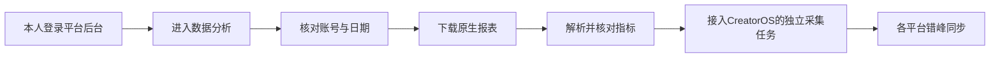

# 微信创作者后台：公众号导出已实测，视频号待登录核验

日期：2026-10-09。任务：T-1108。补充此前 [T1107 官方接口研究](2026-10-09-wechat-creator-data.md)，不改其原有证据或结论。

## 大白话结论

可以研究采用“用户登录自己的后台，自动进入数据分析并下载平台原生报表”的方式。公众号这次已实际下载并解析两份报表；视频号助手当前官方入口确认有数据中心和作品数据下载能力，登录后的具体导出仍待本人完成微信登录。

| 平台 | 真实入口与导出位置 | 本轮核验程度 |
| --- | --- | --- |
| 公众号 | [公众平台](https://mp.weixin.qq.com/) → 数据分析 → 内容分析 → 已发表内容 → 下载数据明细 | 使用浏览器已有授权登录，HTTP 200 下载成功，二进制 XLS 解析通过 |
| 公众号 | 数据分析 → 用户分析 → 用户增长 → 详细数据表格 → 下载表格 | HTTP 200 下载成功，Excel兼容表格解析出31天关注变化 |
| 视频号 | [视频号助手](https://channels.weixin.qq.com/login.html) → 当前登录页介绍的数据中心 | 当前官方页面确认可查看视频、直播、粉丝及下载作品详细数据；登录页已交给用户，未读取本人账号后台，未导出文件 |

这证明公众号原生导出路线在本机一次会话中可用，尚不等于CreatorOS已接入或长期定时运行稳定。

图中前五步是接入前的核验流程；本轮公众号沿用页面默认日期范围，未操作日期筛选或接入最后两步。

## 公众号已经拿到的真实文件

当前浏览器公众平台已有用户账号登录。进入真实侧栏后，内容分析和用户分析都存在原生导出链接，不依赖第三方插件，也没有配置AppSecret或调用公众号开放API。本轮未确认账号主体或认证类型，不能泛化承诺所有账号具有相同后台权限。

### 内容分析

页面路径为 `/misc/appmsganalysis`，导出动作来自当前页面“下载数据明细”链接，其动作名为 `download_summary_tendency`。日期范围沿用页面默认的 **2026-09-09 至 2026-10-08**。

本机文件：`/Users/zyongzhu/CreatorOS-local-acceptance/wechat-browser-export-20261009/公众号-内容分析数据.xls`。

- 45,056字节；HTTP 200；原生响应文件名以 `.xls` 结尾。
- 文件确为OLE/BIFF二进制XLS，可用 `xlrd` 解析，不是登录错误HTML。
- 表头包括：日期、渠道、阅读人数、分享人数、跳转阅读原文人数、微信收藏人数、发表篇数，以及来源部分的传播渠道、发表日期、内容标题、阅读人数、阅读人数占比。
- 工作表范围243行×16列；其中阅读趋势有240条非空日期记录，分享等趋势有30条非空日期记录。不能把工作表总行数当成文章数量。

这些是“人数”指标。该份趋势报表不证明能导出全部单篇文章的点赞、完读率、时长等详情；详情仍需另行核对应的真实页面或导出。

### 用户增长

页面路径为 `/misc/useranalysis`，原生入口为“下载表格”。日期范围沿用页面默认的 **2026-09-08 至 2026-10-08**，首尾均包含，共31天。

本机文件：`/Users/zyongzhu/CreatorOS-local-acceptance/wechat-browser-export-20261009/公众号-用户增长数据.xls`。

- 7,401字节；HTTP 200；响应文件名 `user_analysis.xls`，类型 `application/vnd.ms-excel`。
- 实际容器是Excel兼容HTML表格，平台使用 `.xls` 扩展名；它不是二进制BIFF文件。按真实表格解析取得31条日期记录，数值列合法。
- 表头为：时间、新关注人数、取消关注人数、净增关注人数、累积关注人数。没有导出用户明细身份或把用户属性页代签为已测。

因此未来导入器需识别真实格式，不能仅根据 `.xls` 扩展名选择同一种解析器。

### 自动化遇到的实际问题与恢复

第一次在内容分析页点击“下载数据明细”，它打开了短暂的新窗口。预先订阅原页面下载事件，但 `waitForEvent("download", {timeout:120000})` 实际超时。不能将这次“点击后等待下载”的调用写成成功。

检查页面后，改为读取**当前页面实际提供的原生导出链接**，通过同一已登录页面的 `page.fetch(..., {saveAs, timeout:120000})` 接收文件，内容和用户两份报表都成功。没有复制Cookie、猜测后台端点或绕过平台登录。二进制接收与文件解析才是本轮可复核的成功证据。

这是浏览器授权会话中的后台原生导出方式。实施时可以处理下载新窗口/事件，或接收页面现有导出链接的响应；应先核对真实账号与日期，文件落地和解析成功后才将任务标为成功。

## 视频号目前证据到哪一步

本轮实际打开当前 [视频号助手登录页](https://channels.weixin.qq.com/login.html)，页面的数据中心介绍明确包含视频、直播、粉丝数据及作品详细数据下载。这里证明的是**当前官方入口对下载能力的说明**，不是本人账号导出实测。

该页面需要用户完成微信登录。首次呈现扫码流程，后续观察到微信快捷登录入口；页面仍未进入本人数据中心。本轮已使用浏览器技能的 `handOff()` 将页面交给用户，只有用户确认登录后才恢复同一任务空间继续操作。

[2021年腾讯官方视频号运营培训](https://training.tencentads.com/uploads/202108/0rhYyjKh_vk9HWG.pdf)曾展示普通短视频指标与表格导出；这只作为历史补充，当前字段、下载格式、日期跨度、分页和可用账号范围都需要登录后核验。2024年互选合作视频或公众号流量主广告报表资料不能代替普通视频/文章/粉丝报表实测。

视频号下一步是在用户登录后进入数据中心，实际下载一份普通作品报表，对照页面与文件核查播放、互动和关注等真实字段。没有登录或没有对应权限时，保留待验证，不把空结果写成0或声称流程跑通。

## 对CreatorOS的接入建议

优先研究后台原生导出，可以保留平台本身提供的字段、日期和口径，适合自己的或已授权的账号。公众号本轮浏览器导出没有要求用户配置开放API凭据，但仍依赖账号实际后台权限。

接入时应复用现有采集任务、真实账号身份和跨账号组保护；每个平台保留独立登录环境和采集适配，错峰执行，同一任务保留在途限制与原ID恢复。周期同步需要继续验证session失效、浏览器重启、文件重复导入与日期完整性，不能承诺保存一个Cookie字符串即可永久运行。

本轮没有改产品能力表、数据库、真实账号、已有计划或登录凭据，没有导入CreatorOS或触发发布。原始报表与截图只保留在本机用户目录；仓库仅保存脱敏字段、哈希、路径与核验结论。详见 [T1108 核验记录](evidence/t1108-browser-export.json)。

## 验收边界

本轮验收为：两个公众号文件真实下载和解析、当前官方入口观测、文档/JSON检查、独立事实核查。公众号证明一次授权会话的导出；视频号保留登录后待验证。此前T1107关于API认证范围的结论保持不变，后台导出不是开放API授权。

产品源码、依赖及全局Gate运行环境未改。沿用T1106实际全局对账失败基线及T1107范围外旧欠债记录，本轮不以只读研究完成声明产品全绿。
