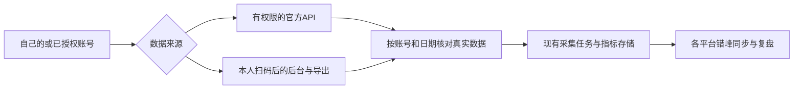

# 视频号与公众号创作者数据：可获取，但需要分开接入

日期：2026-10-09。任务：T-1107。范围：官方资料与源码只读调研，未登录或采集任何真实账号，未修改产品能力。

## 给用户的结论

自己的账号或已授权账号可以研究接入。公众号有较完整的官方数据接口；视频号已有账号和限定场景直播数据接口，2021年官方资料确认助手后台曾提供普通短视频作品指标与导出，当前本人账号的字段和导出仍待实测，自动化应研究沿用扫码登录后读取后台的方式。两者都不能直接复用抖音的接口和Cookie。

| 场景 | 已核实的数据来源 | 建议路线与确认程度 |
| --- | --- | --- |
| 企业主体已认证公众号/服务号 | 官方接口提供文章阅读、互动、阅读质量、关注者数据 | 优先官方授权API；资料能力已核实，具体账号权限和实调用待验证 |
| 个人主体或未认证公众号 | 官方公众平台支持扫码登录；上述数据API的适用范围不包含这类账号 | 授权后台读取/平台提供的导出功能作为候选；本人账号页面、可导出的字段和自动化稳定性未实测 |
| 视频号账号/部分直播场景 | 官方视频号助手API提供账号粉丝数与限定场景的直播分析 | 有对应开放能力及场次范围时用API；不是所有视频号默认拥有该权限 |
| 视频号普通短视频 | 2021年腾讯官方培训资料确认助手后台曾有播放、点赞、转发、评论、收藏及表格导出 | 候选为扫码后读取当前后台/导出表格，字段和导出待实测；本轮未确认通用开放API |
| 他人的创作者数据 | 本轮官方接口均基于所属账号或授权账号 | 只能另核公开内容实际展示的指标；不能拿自己的登录态读取他人的私有播放、完读、阅读来源、粉丝画像 |

上表“候选”是技术接入建议，不代表CreatorOS现在已经支持。

## 公众号：新接口已比旧接口完整

官方文档目前将公众号（原订阅号）和服务号分开。具体数据接口适用表同时列出这两类，但只允许企业主体已认证账号调用；个人主体、未认证账号不能仅凭AppID或扫码登录得到同样API权限。[公众号介绍](https://developers.weixin.qq.com/doc/subscription/guide/)、[新发表内容详情与适用范围](https://developers.weixin.qq.com/doc/service/api/wedata/news/api_getarticletotaldetail)。

建议采用当前的新发表内容接口，旧 `getarticlesummary`、`getarticletotal` 页面已标停止维护。[旧每日图文接口的迁移提示](https://developers.weixin.qq.com/doc/service/api/wedata/news/api_getarticlesummary)、[旧群发总数据的迁移提示](https://developers.weixin.qq.com/doc/service/api/wedata/news/api_getarticletotal)。

| 接口 | 可核数据/含义 | 必须保留的日期边界 |
| --- | --- | --- |
| `getarticleread` | 各篇每日阅读人数、来源 | 单次查询1天，最晚昨日 |
| `getarticleshare` | 各篇每日分享人数 | 单次查询1天，最晚昨日 |
| `getbizsummary` | 账号每日内容概览：阅读、分享、两种点赞、留言、收藏、发表篇数等 | 单次日期跨度最多30天，最晚昨日 |
| `getarticletotaldetail` | 文章ID、标题、链接、互动、阅读后关注、送达率、完读率、平均阅读时长、跳出位置等 | 按发表日期查询1天；每篇从发表日起最多统计30天，返回各统计日的累计数据 |
| `getusersummary` / `getusercumulate` | 每日新增/取消关注、关注渠道、累计关注者 | 单次最多7天，数据存储起点2014-12-01 |

新四项发表内容接口的数据起点为2025-11-01，之前日期不可用；按官方建议在次日8点以后获取前一天数据。部分响应有 `is_delay`，延迟应回读原日期，不把空列表当成作品被删或累计数归零。[每日阅读](https://developers.weixin.qq.com/doc/service/api/wedata/news/api_getarticleread)、[每日分享](https://developers.weixin.qq.com/doc/service/api/wedata/news/api_getarticleshare)、[账号概览](https://developers.weixin.qq.com/doc/service/api/wedata/news/api_getbizsummary)、[文章详情](https://developers.weixin.qq.com/doc/service/api/wedata/news/api_getarticletotaldetail)、[关注者增减](https://developers.weixin.qq.com/doc/service/api/wedata/user/api_getusersummary)、[累计关注者](https://developers.weixin.qq.com/doc/service/api/wedata/user/api_getusercumulate)。

不能把阅读人数当成阅读次数、分享人数当成分享次数。`zaikan_user` 与 `like_user` 分别为爱心赞和拇指赞，要分开保存。详情的 `ref_date` 是发表日，`stat_date` 才是累计截止日；这里的30天也不是文章终身总量。

认证账号API走 `access_token` 或第三方授权的 `authorizer_access_token`。文章接口属于权限集7，关注者接口属于权限集2。自管AppID/AppSecret还需要API IP白名单、token集中管理及可能的管理员确认；桌面用户动态IP使这条路未必适合直接分发。第三方授权需要相应平台资质与装配，不能把扫码后台登录直接转换成第三方API授权。[服务端调用说明](https://developers.weixin.qq.com/doc/subscription/guide/dev/api/)、[稳定token](https://developers.weixin.qq.com/doc/service/api/base/api_getstableaccesstoken.html)。

对于个人主体账号，官方[公众平台登录页](https://mp.weixin.qq.com/)已有扫码、账号选择及手机确认流程。候选方案是用户在本机完成该流程后，受管浏览器保留独立登录环境，只读取该账号页面实际提供的数据。后台页面字段、导出入口、session寿命和重启恢复需要本人授权账号实测；本轮没有证据承诺个人号可拿到上表所有API字段。

## 视频号：官方账号/直播API与普通短视频后台分开

当前[账号信息接口](https://developers.weixin.qq.com/doc/channels/api/channels/leadslive/api_getfinderattrbyappid.html)返回真实视频号唯一标识、昵称、粉丝数，第三方权限集为160；[直播大屏数据接口](https://developers.weixin.qq.com/doc/channels/api/channels/livedashboard/api_getlivedata.html)返回观看、曝光、人均观看时长、新增关注、评论人数、分享人数及渠道/画像等，权限集为176。接口要求视频号助手相应开放场景开关，权限不足会明确返回错误。拿到token本身不能证明场景权限。

直播大屏是以真实直播 `export_id` 查询，不是普通短视频统计。其配套[直播列表](https://developers.weixin.qq.com/doc/channels/api/channels/livedashboard/api_getlivelist.html)的官方说明只覆盖电商直播间；非电商普通直播是否能通过其他真实场次入口使用大屏接口，本轮没有实调用证明。不能仅凭大屏字段表承诺采集所有直播。

[留资直播数据接口](https://developers.weixin.qq.com/doc/channels/api/channels/leadslive/api_getfinderlivedatalist.html)限定2023-09-21起且留资挂载至少1分钟的场次，不能拿它代表所有普通直播。[经营整体数据接口](https://developers.weixin.qq.com/doc/channels/api/channels/compass/api_getfinderoverall.html)包含成交金额等电商数据，短视频成交金额不等于短视频播放量。直播、留资、电商与普通短视频必须分别定义数据口径。

腾讯广告[2021年视频号运营培训](https://training.tencentads.com/uploads/202108/0rhYyjKh_vk9HWG.pdf)记载助手后台曾提供作品指标与表格导出。这证明当时存在该数据源和路线；当前本人账号字段与导出入口仍待实测，资料中的运营者数量、粉丝窗口及界面也不能当成2026年的现行限制。本轮检索当前官方视频号API目录未确认普通短视频播放/互动全量经营接口，结论是“未确认”，不是断言微信绝无此接口。

因此普通短视频建议先核[视频号助手](https://channels.weixin.qq.com/login.html)的本人扫码、账号身份、作品分页、详情和表格导出，再选择页面可见数据或同一授权会话实际返回的数据做适配。后台内部请求不是微信承诺稳定的开放API，需要原始样本、分页完整性与失效恢复证据。Cookie、账号身份和平台动态session可能共同参与鉴权，不能承诺保存一个Cookie字符串即可永久后台运行。

视频号助手的开发凭据有自己的业务类型，[官方获取AppID说明](https://developers.weixin.qq.com/doc/oplatform/developers/dev/appid)给出的入口位于助手直播管理的开放能力；[调用说明](https://developers.weixin.qq.com/doc/oplatform/developers/dev/guide)要求不同业务类型token隔离，不能直接复用公众号或小店token。[第三方调用规则](https://developers.weixin.qq.com/doc/oplatform/Third-party_Platforms/2.0/Before_Develop/call_interface)还要求账号本身有权限并且已将对应权限授予第三方。

## CreatorOS现状与接缝

基于本树源码 `1e10a99d` 只读核对，微信两个平台目前仍是手动登记，扫码和自动采集未装配。这次调研不改变能力表。

- `frontend/src/server/persistence-client.ts:4604` 明确将 `wechatVideo` / `wechatOfficial` 的绑定与采集标为不可用；`:4633` 的新采集sourceAdapters只装配小红书/快手，抖音另有原路径。
- `backend/src/modules/platform-account/account-binding.service.ts:21` 的扫码阶段只支持抖音、小红书、快手。微信要增加独立的平台身份读取、staging到正式profile交接与凭据适配，保留原账号组/任务所有权保护。
- `backend/src/schema/platform-collection.ts:111` 已有作品实体，`:141` 起有按来源、时间窗、可用状态存储的指标快照，可复用真实ID、分页、去重、partial和失效恢复结构。具体指标扩展必须以原契约为准，不强行压成同一“播放量”。
- `backend/src/modules/ai-runtime/collection-bootstrap.ts:71` 的默认计划目前只配置三平台。微信除了新模板，还需补完整的能力准入与实际采集装配，不能仅添加一个cron就宣布可采集。

建议使用现有 `execution_tasks`、采集服务端口、浏览器profile唯一所有者和统一调度器。公众号官方数据在8点后错峰读取昨日及需要更新的文章窗口；视频号与其他平台错开入队，并受资源队列约束。时间是候选接入原则，尚未冻结新增默认时间或修改用户已有计划。

`contract/src/resources/platform-capabilities.ts:123` 当前正式作品指标有PV类count keys与累计/区间窗口，但缺独立阅读UV、两类点赞、率和时长；账号概况目前只支持累计粉丝，不能装入每日新增/取消或每日阅读。作品层的 `follower_gain` 不能代替账号每日新增。有限日期API返回也不能被标成完整作品目录。

阅读人数、两种点赞、30天累计、完读率、秒/分钟时长、关注增减和直播指标需要保留各自语义；当前通用字段不足的部分应在实施SPEC中扩展契约。普通阅读公开页、本人后台与API返回作为不同来源保存，缺失值保留不可用/未知，真实零才写0。

## 实施前最小核验与本轮证据

真正接入之前，以用户选定的本人账号验证：扫码后读真实身份；获取作品清单与至少一篇/场的指标；对照后台或导出文件的口径；重启后仍为同一账号；session过期/权限不足只恢复原任务；跨账号组拒绝；平台错峰且一个采集能力只允许一个在途任务。公众号分别验证个人主体后台路线与认证账号API路线，不能互相代签。

本轮通过公开HTTP获取官方文档，无Cookie请求；专用web抓取工具对微信开发文档失败，随后从同一官方URL取得HTTP200正文并解析。元数据、正文SHA和源码定位见 [来源核验记录](evidence/t1107-official-sources.json)。原始公开文档在本机临时目录，不包含真实账号资料。只读源码核查与独立事实审查的结论记录于同一证据文件。

产品/类型/数据库/测试输入未变，本轮无需伪造TDD或真实账号E2E。检查本轮文档、JSON、链接和独立审查；沿用T1106实际全局对账失败证据，范围外欠债仍登记在T1106-related-gates及T1101-global-gates，不以调研完成声称产品全绿。
