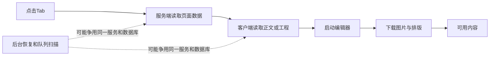

# Tab切换卡顿：当前源码分析

日期：2026-10-24。任务：T-1071。源码基点：`9c585dd4d`，分析时工作树含其他会话未提交内容。本轮未修改产品代码、安装客户端、真实数据或后台任务。

## 结论与证明边界

有明确优化空间。当前代码把页面读取、附属数据整理、客户端再次读取和原生编辑器初始化放在用户看到内容之前，形成多段等待；其中存在可消除的重复查询、无关全列表读取和隐藏编辑器启动。后台持续扫描是另一条可能放大所有页面延迟的路径，需要安装版同步采样才能确认占比。

下文区分源码事实与因果推断：源码能证明哪些工作发生、先后顺序及规模增长路径，不能给出当前用户客户端的耗时占比。两项受控探针验证依赖顺序，不是数据库、浏览器绘制或安装版性能测量。不承诺提速倍数。

## 已确认的具体问题

### 文章接口重复读取同一份归属链和全部历史版本

- `backend/src/modules/articles/articles.service.ts:222`：`getArticle`先调用`anchor`、`listVersions`，随后调用`documentFor`。
- 同文件`:102`：`documentFor`再次调用`anchor`和`listVersions`，最后才从历史版本中挑当前稿。
- 同文件`:92`：每次`anchor`又读取作品、文章锚点和artifact。
- `backend/src/modules/artifacts/artifacts.repository.ts:428`：`listVersions`会先验证artifact，再`select()`全部历史版本行，没有分页或正文列裁剪。

这是一次文章读取内部的确定性重复工作；历史正文越多，重复传回服务层的数据越多。建议在单次请求里复用已经验证的锚点及版本行；若再拆“当前正文”和“历史摘要”读取，应由原后端owner提供端口。保留每次请求的用户/组/作品归属校验与版本一致性，不能靠删历史或绕过校验提速。

### 文章先经过完整定位中心读取，挂载后才开始读取文章正文

- `frontend/src/app/(creator)/projects/[projectId]/article/page.tsx:39`起：`getProject → listOutputs → getPositioningCenter → 返回ArticleWorkbench`。
- `backend/src/modules/positioning/positioning.service.ts:289`：定位读取包含profile、活跃访谈、最多200条声明历史及当前声明；文章页最终只使用当前声明的少数字段。
- `frontend/src/features/article/article-workbench.tsx:222`、`:243`：挂载后的effect才调用`getArticle`，初始`state/draft`为null。

这形成“服务端等完附属定位数据，客户端再取正文”的两段等待。建议让正文与必要元信息尽早启动，定位仅提供所需轻量投影；不要让可选定位历史挡住文章可用内容。是否将正文直接传入页面，需要结合所有权、刷新及草稿保留测试确定。

### 默认文章预览同时挂载隐藏的第二个原生编辑器

- `frontend/src/features/article/article-workbench.tsx:480`：非Doocs版式渲染NoteRelay，同时在`extraDelivery`中渲染`DoocsArticleEditor deliveryOnly`。
- `frontend/src/features/article/doocs-article-editor.tsx:247`：`deliveryOnly`只把原生编辑器移到屏幕外并隐藏；仍创建`NativeEditorSurface`，`onReady`仍执行正文初始化。
- `frontend/src/features/reference-editors/native-editor-surface.tsx:86`起：挂载会创建ShadowRoot内容、加载CSS和原生模块并执行`module.mount`。

因此“只为导出”的编辑器在打开文章时已经启动。模块下载可能命中浏览器缓存，但新实例的mount和正文初始化仍发生。建议在用户需要该导出能力时再初始化，并保留真实导出功能和反馈；具体主线程占用需performance profile量化。

### NoteRelay逐张下载图片，全部结束后才加载正文

- `frontend/src/features/reference-editors/noterelay/noterelay-editor.tsx:32`起：`for...of`中每张图依次`await 下载地址 → fetch → blob`，整个循环结束才`active.request('load',正文与版式)`。
- 同文件`:25`、`:46`：图片Blob缓存属于组件实例，卸载清空。
- 当前仅视频有跨路由常驻宿主；文章/图文工作面未提供相同会话宿主，因此正常切离后再进入会重新走组件初始化。实际是否由路由缓存保留服务端结果，与客户端实例是否重建应分开测量。

受控运行当前组件初始化回调：三张图下载最大并发为1，最后一张`blob`完成后才出现`native:load`；零图直接`native:load`。建议先分离正文可用与图片就绪，核对原生协议能否增量填图；若协议要求整批加载，可先用有界并发降低总等待。缓存必须按账号组、作品及精确素材文件版本隔离并控制内存。不能简单缓存任意下载URL或无限常驻页面。

### 脚本首屏被完整素材抽屉、发布包等附属读拖住

- `frontend/src/features/draft-workbench/draft-workbench-data.ts:573`：顺序为项目、脚本artifact、脚本/论点、准备状态，再读取发布包/素材/封面/转写状态，之后盲预测和审核报告，全部结束才返回VM。
- 同文件`:452`：`readAmmo`先读取全部关联素材分页，再每8个一批获取知识或素材详情；图片额外读取预览地址，文档还带`extractedText`。
- 同文件`:338`：发布包先查作品和发布列表，再为每条发布读取版本。

现有`Promise.all`只是在若干组内并行；完整VM仍受最慢附属读限制。有M个图片素材时，`readAmmo`除关联分页外，还会发出M次素材读取及M次预览地址读取，批间串行。建议保留稳定工作台框架，让脚本正文先可用，素材抽屉/发布包等分区加载；提速不能靠解除8并发限制暴力冲击本地库。

### 明确ID仍先拉项目列表；视频常驻并没有消除服务端准备链

- `frontend/src/app/(creator)/projects/[projectId]/page.tsx:110`：已有项目ID仍调用首100个项目列表，只用于ID/旧slug兼容。
- `frontend/src/app/(creator)/projects/[projectId]/production/page.tsx:78`、`:145`起：先项目列表解析，再项目详情、作品列表、脚本、制作状态与分场列表，返回Entry后才进入客户端会话接入。
- `frontend/src/features/production/production-editor-entry.tsx:38`起：通过effect接入常驻宿主；已有视频实例的保留不等于上游服务端读取免执行。

受控执行当前视频页面，明确`projectId=p/outputId=v`、无脚本详情分支，得到`listProjects → getProject → listOutputs → listArtifacts → getOutputProduction → listSegments`，端口最大并发1。真实有脚本时会增加读取，端口内部也可能有多次SQL。建议明确ID直接走归属验证后的by-id路径，只对旧slug做兼容回退；将独立的附属读移出关键等待链。重复读取可考虑当前请求内去重，不能把全局长TTL当替代。

## 全站共同慢点候选：后台恢复与前台读取共享资源

- `frontend/src/server/persistence-client.ts:7317`：恢复协调器间隔2000ms，注册12条lane，其中平台采集自身有60秒节流。
- `backend/src/application/recovery-wake.ts:46`：定时唤醒所有lane；已有每lane在途去重，不能误报成无限重叠泄漏。
- `backend/src/modules/execution/model-worker-dispatcher.ts:494`、`:604`：每轮包含租约恢复及领取检查；默认间隔1000ms，为上轮完成后再安排，不是固定每秒必执行一次。
- `frontend/src/server/persistence-client.ts`将这些消费者与页面读取服务装配到同一db；本地PGlite路径见该文件`:1216`及`backend/src/db.ts`。

推断：后台扫描可能增加前台等待，能够解释不同页面一起慢或耗时波动，但本轮没有测到“当前点击期间哪条lane阻塞多少毫秒”，不能定为唯一或最大根因。推荐在同一进程记录请求、SQL等待/执行、lane活动及事件循环延迟；再依据数据设计空闲退避/定向唤醒/前台调度。不能直接关闭恢复、缩短合法任务期限或删除历史队列。

## 排除误判与优化顺序

顶部Tab使用真实Link，`prefetch=false`见`project-stage-stepper.tsx:159`；`project-workspaces.ts:22`起在有作品时直接生成文章/图文/视频深链。入口重定向存在，但通常不是顶部Tab的主链。盲目把所有预取打开会重新制造后台读取负担，可后续验证少量、按意图的预热。

共享layout在正常同项目客户端导航中可以保留；不能因为其中有读取，就声称每次Tab都会重跑整个根layout。`resolveSession`已有当前React服务端请求内缓存；它不等于所有自定义业务端口都自动去重。已有页面展示缓存也不能证明这些工作面已接入。

视频常驻和隐藏可见性保护仍存在。历史`BROWSER_ACCEPTANCE.md`记录六步工程GET从12次降至0次、同一原生句柄保留，但那是10月7日旧环境测量，不能签收10月24日安装版。当前聚焦回归结果另见证据记录。

建议顺序：先消除同一次文章读的重复工作、延后隐藏导出编辑器及去掉明确ID的全列表探测；随后缩短正文首屏等待链，改善图片加载和工作面会话保留；同时补安装版分段测量，再按实测处置后台争用。会话保留方案必须验证未保存稿件、跨组隔离、隐藏停止播放、内存回收及原保存/导出能力。

安装版验收至少记录同一项目A→B→A重复样本的点击到反馈、RSC、正文接口、编辑器ready和图片完成分段时间及P50/P95，并分别观察暖态、首次打开及多图/多历史项目。目标值需写回实施SPEC；本报告不虚构已达到的毫秒数。

## 证据与复现

- 探针：`node docs/verification/t1071/2026-10-24-source-audit/probe.mjs`。
- 原始结果及输入源码SHA-256：同目录`probe-result.json`。
- 当前聚焦回归：`pnpm -C frontend exec vitest run src/features/reference-editors/project-video-session-host.test.tsx src/components/navigation/project-stage-stepper.highlight.test.tsx --retry=0 --maxWorkers=1`，2个文件、11项通过（4.30秒）；仅证明这些行为断言，不代表浏览器/安装版旅程。运行存在Node的`--localstorage-file`警告，未隐去。
- 探针使用TypeScript内存转译，业务读取、React hooks、图片下载、原生编辑器都为受控桩，不访问真实数据库或网络；证明的是依赖顺序，不证明真实渲染性能。
- 代码调查已完成；T-1071继续进行中，产品修改、安装版定因及完整验收未完成。
- 收尾：`pmem sync`成功；`git diff --check`通过。quick只读对账最终exit1，22项错误/17项告警，涉及看板体积与其他任务审核回执，未将全局写成通过；完整输出`reconcile-quick-final.log`。最初把诊断说明追加进旧SPEC导致本任务审核hash失效，已撤回该纯说明增补，改由看板链接这份研究报告；原已审产品SPEC及产品写集不变，最终对账不再报告T-1071回执错误。初次失败输出保留`reconcile-quick.log`，不据此完成父任务。
