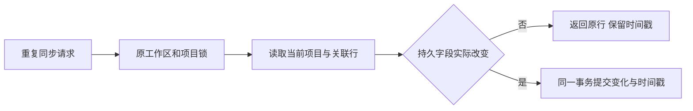

# T-1433 重复发布同步的项目版本调研

2026-10-28，用户要求逐项修复接手剩余问题，密钥及新 Mac 包暂时不动。依据已独审的 `docs/features/t1433-project-noop-timestamps.md` 实施，只修改限定后端项目模块和隔离测试。

## 源码事实与选择

| 位置 | 已确认行为 | 本次选择 | 未采用的办法及原因 |
| --- | --- | --- | --- |
| projects.service.ts 的 markPublished | 阶段已满足目标时不再更新阶段，但仍无条件更新项目 updatedAt；相同资料 mergePublishedWork 仍会调用它 | 使用现有工作区父锁，在同一事务当前项目/阶段快照上生成最小变化；有实际阶段变化或项目缓存变化才写项目 | 仅在锁外加相等判断会使用过期快照；删除 updatedAt 会丢失真实版本变化；放宽候选 CAS 会允许旧候选覆盖新内容 |
| projects.repository.ts 的 normalizeVisiblePlatformWork | 已公开发布记录和 hidden=false 项目仍重复写入；缺省 hidden 被补成 false | 在原父锁/事务内重读当前发布及真实父链；按行判断字段变化；仅将明确 hidden=true 改为 false | 用外部读取结果决定写入会受并发归属变化影响；给缺省 hidden 补 false 会制造没有业务变化的 JSON 差异 |
| Windows 两条历史项目 updatedAt 差异 | T1406 MAIN_MERGE 和 T1403 GATES 仍记录原因未定，当前仓库没有足够原请求/采集事件证明调用来源 | 保留历史 FAIL 与未定根因，只报告本次可重现源码修复 | 不把当前静态写入路径追认为旧 Windows 现场已证实根因，也不修改原时间戳来让对账通过 |

## 测试依据

原项目 service 和 ingestion 合并夹具使用固定 now；旧重复采集断言主要证明不新增项目，没有区分无变化写入。本次新用例单独使用可推进时钟，保留全部旧断言。

首次新增9项在原代码真实执行：8失败、1通过、76因筛选跳过。失败明确对应重复写入时间戳或新增 hidden:false；跨账号/引用不匹配用例通过。第一次修复后同样9项全部通过。随后新增两个真实 PostgreSQL trigger 故障注入用例，检查阶段与项目、发布与项目的事务回滚。

命令、完整输出、最终回归与精确源码摘要见 `../verification/t1433/`。测试使用独立内存 PGlite，未读写用户数据库、未调用模型或平台服务，未安装或构建 Mac 包。源码受控验证不代表 Windows 历史现场复验完成。
