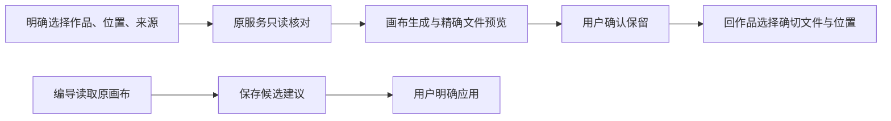

# Canvas 39b 独立复核（窄范围）

结论：39b 当前冻结包可由主代理窄合。没有发现本包新的协议阻断；不代表全局 Gate、真机、完整发布或真实供应商通过。

冻结 patch SHA256：fdab20535c7ef7e89a11d30468db1e18ff2625c6541b42d645aefd26886375d3。
冻结 manifest SHA256：66bfe94490d39ddb5a10d8f4d9c558cff83f8baf5159a4617652488acbbc7400。
39 文件逐个校验，0 漂移；基于作者 full 临时副本重盖全部冻结文件后执行，不写共享工程。

人能理解的结果：从作品组合选择真实稿面、位置和来源，画布会重新核对身份。画布生成结果必须由用户确认后才能用于作品。编导聊天只保存可审核建议，用户应用后才改变正式画布。丢回复恢复仍查原请求；账号、位置或页面变化后晚到结果不会回写。

当场独立结果：
- ui-frozen22-independent.log：4 文件，22 PASS。覆盖原 editor、historical exact picker、上下文 scope、编导结果卡；保存/保留失败恢复、取消/账号/卸载晚到、原本地 Copilot 打开路径。
- original-public-frozen2-independent.log：2 PASS。原 persistence + 真实隔离 PGlite/原 Worker + 本地供应商 fixture：图生成 byte/call/confirm/historical selector→Moments source:null；原 Pi chat SSE→read/propose→strict public list→用户 apply。没有用户凭据修改，不称真实供应商。
- host-frozen9-independent.log：9 PASS，90 skipped。原旧工具定义/hash/参数不变、无 Canvas 旧 global/plain dispatch 仍可用、每次 executionRef 受控重新 read、单画布 frozen scope、schema/version/effect 漂移拒绝、取消零 owner 操作。
- carry-frozen2-independent.log：独立新增 2 PASS，7 skipped。无 Next router 宿主的独立 MaterialsPanel 能用且无无效跳转；carry GET 在途卸载后零缓存/零导航；同组合返回 ownerVersion 变化拒绝且保选择。

静态范围：原 Proposal DTO 只剥离私有 appliedCanvasJson，不放宽 strict schema；每次 read/propose 使用原受控 owner/context，原 proposal effect 账本，不增正式 AI writer；Materials onOpenCanvas wrapper 提供实际路由，完整 composition/member/ownerVersion/target/source 对比与账号 cache guard；原 ACK 恢复、late 活跃 guard、项目/账号根装配保持。

明确保留：作者广测既有 26 FAIL，不在本报告宣称已修或全绿。真浏览器、最小窗口、键盘和完整作品往返由主代理继续。参考图拖入只写 referenceAssetId，原生成口冻结当前文件；若拖入历史节点，历史显示的 fileId 不自动成为参考 fileId，需要如实说明当前版本语义或后续明确协议，尚无本报告独立红证据。

最初 UI harness 缺 Vite fs allow 的 bootstrap error 单独保存为 ui-fs-bootstrap-error.log（0 tests），不是产品红。补好 harness 后当场 22 PASS。
