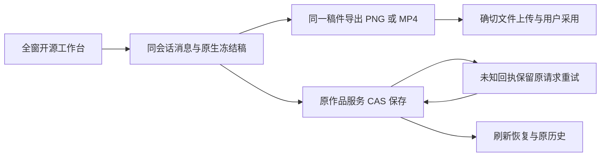

# 完整开源工作台 Host 前端独立复核

结论：**PASS（限定本轮 Host 接线、异步状态与保存/导出契约，修正后）**。完整编辑器放在既有 Dialog 全窗工作面，原生 UI 保持上游实现；稿件、确切素材文件和成片继续通过现有作品服务保存。此结论不代表真实浏览器、最低窗口、安装版或原生 PNG/MP4 编码验收全部完成。

大白话：用户编辑的那一份稿子，必须与导出的图片/视频是同一份。保存结果还没确认时，重试沿用原请求和原文件，不能返回后悄悄换成另一份。



## 已发现并修正的问题

- 图文先取 snapshot 再 export 会把旧 JSON 配给新图片；现在使用 export 返回的 document 保存同次导出稿。
- 图文未知回执重试曾重复上传生成新 exactfile；现在保留冻结稿、导出结果、已上传 assetId/assetFileId 和父层原 CAS 请求，确认成功才清空。
- 视频已有成片时曾绕过原覆盖确认；现在沿用 delivery 的明确替换确认与执行保护。
- 同 session 重复 ready 曾重复 load，可能覆盖正在编辑的内容；实际 Frame 已去重初始化。
- 视频手工保存未知后导出曾把新 MP4 与旧待确认快照混配；现在第一次操作只恢复原保存，下一次导出用新冻结稿与已确认 revision 保存。
- 原生竖版画布曾被登记为默认横版尺寸；现在向既有 delivery 传同次 export.document.settings.canvasSize。旧调用不传尺寸仍保留原默认；比例的等价数字表达无需额外门槛。
- 初始稿未改动时保存未知仍可直接返回，导致稳定请求丢失。视频返回、历史/恢复与 Escape 现在保护 saveRequest/pendingExport；图文返回、放弃与 Escape 保护 pendingSave。
- StrictMode cleanup 后 alive 永久 false 会使 load/busy 无法恢复；mount setup 已重新设置活性并创建新的 AbortController。

初始三项缺口、手工未知保存与导出混配，以及返回出口包含当场红测和修复后复测。其余未采集修复前红测的项目不补记为历史 TDD。实际红测日志保留在同目录 `adapter-frontend-review-red.log`、`adapter-frontend-review-mixed-red.log`、`adapter-frontend-review-return-red.log`。最后一个日志记录并发修复后的图文出口 1 FAIL / 11 PASS；视频出口之前实际观察到 1 FAIL / 10 PASS，已汇报主会话，未另留冻结日志。

## 当场验证及证据级别

2026-10-02 22:03:04 从仓库根执行，实际退出 0：

```sh
pnpm --filter creatoros-frontend exec vitest run --config ../docs/research/evidence/t1042/complete-editors/adapter-frontend-review.vitest.config.mts
```

结果 **1 文件 / 12 项 PASS**，日志 `adapter-frontend-review-test.log`，用例 `adapter-frontend-review.test.tsx`。覆盖：同次图片稿与采用、未知回执复用 exactfile、已有成片覆盖确认、实际 Frame 错 session/source 与卸载迟到回包、StrictMode 初始化、未知保存原请求重试、重复 ready、手工未知保存到下一次导出 CAS、实际制作入口切换作品的迟到读回、实际 delivery 900×1200 元数据，以及视频/图文未知保存的返回保护。

大部分用例使用机械 Frame/export/上传端口夹具；其中消息 Frame、ProductionEditorEntry 和 useProductionDelivery 使用实际实现。Blob 内容是测试夹具，不是可解码的真实 PNG/MP4。Dialog 在该组用例中是机械夹具，Escape 行为按本轮代码复核确认，未把它记成真实 Radix 浏览器测试。

代码同时复核了 origin/source/session/requestId 消息匹配、在途请求卸载拒绝、旧 scope 回复隔离、owner CAS 与媒体精确 pair、图文 card/cover target 接线、旧工程显式替换和历史恢复，以及原生未知字段 JSON 保留。媒体导入走现有上传/完成/关联端口，未引入第二套作品库或账号库。

## 仍需完整集成验收证明的边界

- 主会话正验收全窗 Dialog 的真实布局；1280 最低窗口四区可用、键盘及滚动体验，本组机械测试不能证明。全窗布局复跑本组 12 项通过。
- 上游 bridge 必须从同一份冻结 document 生成图片/视频并返回对应 document；源码代理重建包、原生可打开 PNG/MP4 和浏览器刷新还原由主会话及上游适配代理验收，本组仅证明 Host 正确消费该契约。
- 当前读取原生历史素材采用整体 hydration；确切文件不可读会使工作面尚未 ready，原 owner 文档仍保留。缺素材的可编辑恢复与安全降级未被本组用例覆盖，不能宣称完整旧素材族已验。
- 视频素材库当前仅读取第一页 100 件；更多素材的可访问路径不在本组验收证据内。
- 本轮未运行全局 reconcile、安装版或发布任务，没有修改控制面、生产代码或生成主控 receipt。

## 复核源码 SHA-256 锚

- `frontend/src/features/reference-editors/reference-editor-frame.tsx`: `70fc5b2ac3ea6c2ed44efc8ca5af56684d9c1382adf9d42a94d67ab5b2199a9b`
- `frontend/src/features/reference-editors/reference-editor-media.ts`: `5d7a95ca0ce9703720f580881e6b24b0a746b5c112ce44137074155310cbec83`
- `frontend/src/features/reference-editors/graphic-design-workbench.tsx`: `769592e1d62ec1083bd6573e01e420a718ec0616276a220ab5845731742cdd3f`
- `frontend/src/features/reference-editors/video-reference-workbench.tsx`: `d0b3e333f710509424851cae3c0c4dd9bf1c1f7bca513432e5206566888f9c45`
- `frontend/src/features/production/production-editor-entry.tsx`: `ac999188bdcc19b4a8309365d36a472f2d1f1f6d8316d651c9e8e868ca1e92cb`
- `frontend/src/features/projects/graphic-post-workbench.tsx`: `8a51e55e0c44ce92365bc833a5d5351b4aa86807ffa4979102c3c922cd4d4479`
- `frontend/src/features/production/use-production-delivery.ts`: `d09222fc6a1b7a5ad325d2409a1cb27d9759cbb43d6b4de20a7a4f486f57b8ea`
