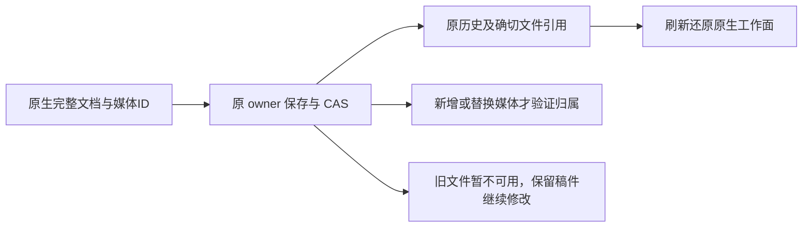

# 完整工作台契约与 owner 实现独立复核

结论：**PASS（本次新增契约与 owner 范围，修正后）**。原生文档沿既有作品服务保存、读取、CAS、幂等和历史恢复可以成立；本结论不代表完整工作台浏览器集成、PNG/MP4 导出或安装版验收完成。

## 查出的缺口与修正后结果

初次静态检查指出：视频 checkReferenceMedia 每次检查全部旧引用会使仅改标题/字幕的合法保存失败；v3 没有专门的 HyperFrames 渲染拒绝说明；原旧转换入口只拦 v2，可把 v3 当作旧工程转换成没有可见片段的 v2。主会话随即修复。本轮没有保存这些修复前的行为红测，不补记为 TDD 红测 PASS。

当前复核结果：

- **旧素材暂不可用仍能保存**：视频按同工程、同 mediaId、同 assetId/assetFileId 精确前值跳过未改媒体的重新引入检查；图文按同 target 再核媒体ID和确切pair。新增/替换引用继续校验。视频恢复以已归属的正式历史版本作为前值；原稿 JSON 保留。
- **v3 不提交收费渲染**：renderEditor 明确提示在开源剪辑工作台导出，或恢复原方案继续生成。隔离内存库调用确认创建任务计数为 0。previewEditor 同样提供对应提示。
- **原旧转换不覆盖 v3**：prepare 和 adopt 均明确拒绝 current v3，提示先从历史恢复原方案。按当下真实 revision 的隔离调用确认阻断，未静默生成空 v2。
- **旧普通配置更新不删除工程**：repository.updateProduction 原子保留数据库 videoEditingPlan，配置缺失该字段仍保留 v3；旧保存、确认、素材删除等入口不得覆盖当前 v3。旧 v1/v2 路径回归通过。
- **原生媒体与未知层保留**：契约保存完整 JSON、锁定编辑器提交和真实 mediaId/exactfile 引用；原生未绑定 mediaId、重复mediaId及图层临时/外部 src 被拒绝。未知原生扩展对象可保存读回。大小上限按机械文档长度校验，不判断创作内容。

## 当场验证

2026-10-02 独立复跑，命令实际退出 0：

- `pnpm --filter @creatoros/contract exec vitest run tests/reference-editor.test.ts`：1文件，3项 PASS。
- `pnpm --filter @creatoros/backend exec vitest run src/modules/production/production-editor.integration.test.ts src/modules/graphic-posts/graphic-posts.integration.test.ts src/modules/production/production-conversion-owner.test.ts`：3文件，38项 PASS。
- `backend/node_modules/.bin/tsx docs/research/evidence/t1042/complete-editors/adapter-owner-repro.mts`：隔离 PGlite 内存库、明确机械媒体端口，不访问用户库或用户媒体；输出见同目录 `adapter-owner-repro.log`。该探针是程序 owner 调用，不冒充浏览器或真实供应商旅程。

探针观察到：UNCHANGED_UNAVAILABLE_MEDIA_SAVE=PASS；NATIVE_HYPERFRAMES_TASKS=0；普通配置更新后 editorVersion 仍是3；v3 旧转换按正确当前 revision 返回明确原稿恢复提示。

## 源码锚

- `contract/src/resources/reference-editor.ts`: `f20ae0226e0792de342ace3bf5f484e0c4cf2e2b3b258126b411bda303672119`
- `contract/src/resources/graphic-posts.ts`: `b2bff7dd46fcfe871d33821dc597f82d41dc515c42a14528dfbe33f899a95cac`
- `contract/src/resources/production-editor.ts`: `d28e310c8b65c2ca4f8089024e9bfb6afef51a4ff8b05b218611da9f5f9b47d2`
- `backend/src/modules/production/production.service.ts`: `1a541713d592449d9c55b8783cc817316dfb0cb74ad66b5e529afe9804c6f775`
- `backend/src/modules/graphic-posts/graphic-posts.service.ts`: `ec044028fa814cc48470b1554e5d812caec652b8b6e859099759d3c8875e2c66`
- `backend/src/modules/production/production-conversion.service.ts`: `267ea51f50682233ee3520486c70bc57c658d8c315be74af5bf9ce5d1601e290`

后续工作台实际消息校验、临时 File 还原、异步导出快照/CAS、两作品晚回复、最低窗口和真实可打开 PNG/MP4 仍由完整集成验收证明。本轮不以 owner 夹具覆盖这些结果。
