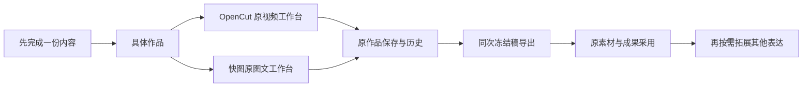

# 完整开源工作台接入：本轮实际验收

当前主任务是集成成熟工作台并运行。已接入 CreatorOS 隔离开发环境（原作品公共服务 + 原 Asset + 原版本/CAS/成果），没有从零重写时间轴、画布和属性编辑器。原完整脚本工作台保留。T-1042 的全部跨功能/客户端验收尚未完成，本报告不代表客户端发行通过。

| 采用 | 官方仓库 / 上游固定提交 | 实际采用范围 |
| --- | --- | --- |
| 视频 | https://github.com/OpenCut-app/opencut-classic / cf5e79e919144200294fb9fed22a222592a0aeea | 原素材、播放器、属性、时间轴、撤销及渲染；独立同源静态工作台，临时内存工程；宿主拥有正式保存与素材 |
| 图文 | https://github.com/ikuaitu/vue-fabric-editor / b3bdcfb0bd6d8f98e7483cf561ac03ba56c0d889 | 原三栏编辑器、Fabric 文字/图片/图层/撤销/属性/PNG；按现有封面和 cardId 保存原生设计 |

试过 clawnify/OpenCut，但该提交仅 README 声称 MIT、缺 LICENSE，且导出依赖私有云服务，所以未采用。官方 OpenCut 全站 Next build 有上游类型故障；本次保留完整编辑核心，机械修正协议/导航叶子后单独构建，没有把全站构建失败记为通过。出处、完整可重建源、锁和所有保留依赖声明见 reference-editors/README.md。MPL MediaBunny、LGPL SoundTouch 的精确对应源随包提供，不称全部 MIT。

## 当场浏览器旅程

使用 CUA 的实际页面/文件选择/点击/拖动，测试独立本地库与本地素材目录；没有使用实际账号素材或发布。fixture-owner.json 记录本轮公开服务创建的真实作品 ID。

- 图文：从具体作品点“编辑封面” → 原生文字图层输入中文 → 保存 → 刷新重开保留中文 → 插入 PNG，经现有上传/Asset/作品关联成功后进入图层 → 调整图片位置 → 导出并采用 → 原图文 imageUses 固定 cover exact file，设计保留源图片 exact file → 正式下载端口读回可打开的 900×1200 PNG。实际导出与图层对应；截图 graphic-integrated.png。已将图片原生拖动至文字上方，再次采用并读回最后保存的精确封面文件，不用截图代替导出。
- 视频：进入指定 video output → “导入素材”上传带声音的 2s MP4 → plus 加入时间轴 → 点击播放器预览 → 添加文字片段、中文输入并失焦提交 → 拖移文字起点、裁剪右边为2s → 保存 → 刷新重新加载源文件、两轨及中文 → 导出 MP4 → 原成果服务采用 → output.primaryAssetId 真实读回 → 下载精确成果文件并 ffprobe / 解帧。
- 成片实际为 H.264 640×360、AAC、2.089796s，解出的0.5s帧有中文字幕（video-export-frame.png）。video-export.mp4 可直接打开；不以接口200代替可用视频。
- 视频 1440×900 和900×600：素材导入、播放器、主轨/字幕轨、保存/导出可见；窄素材栏隐藏辅助视图/排序图标，导入按钮完整。图文900×600主操作可见，原面板可收起，收起后画布可编辑。截图名称带窗口尺寸。
- IAB 的 download 事件对本轮 Blob 下载等待超时；宿主导出与采用成功，采用后的 exact file 通过正式公开下载端口读回并验证。没有将该超时写成浏览器下载落盘通过。

## 实际检查

| 检查 | 结果 / 证据 |
| --- | --- |
| 导出冻结、失败解锁、内容变化基线 | OpenCut isolated 5 tests /39 assertions PASS；快图导出辅助2项 PASS，源包锁定归档；不冒充真实浏览器 |
| 契约保存原生JSON、真实引用、拒绝远程/临时图片地址 | 3/3 PASS；contract-final.log |
| 后端编辑版本、旧方案历史、exact文件、账号/作品/CAS及转换守门 | 37/37 PASS；backend-final.log |
| 独立Host复核 | 12/12 PASS；host-final.log，adapter-frontend-review.md；有真实红测记录。包含冻结稿对应、未知回执不重传、旧成片确认、StrictMode、ready去重、晚回包/切作品、返回保护、真实尺寸 |
| 原入口和图卡保存回归 | 5/5 PASS；entry-regression-final.log |
| LED-047 | 159/159 PASS；led047-final.log |
| Frontend tsc | 退出0；frontend-types-final.log（空日志） |
| 源码独立重建 | root 从归档临时解压/锁定安装成功4.37s；曾真实hash失败，确证Tailwind扫入旧dist，限定src后清洁/重复构建字节相同。source-rebuild-video.log、source-rebuild-consistency.json；未声称跨平台位复现 |
| 两包hash /源归档 | node frontend/scripts/build-reference-editors.mjs --verify PASS；reference-editors/manifest.json |
| orphan | 0 errors /100 warnings，orphan-final.log |
| 全局 boundary | FAIL：live-chat-session.ts 的 ai、@ai-sdk/react 尚在前端，boundary-final.log；本轮原生工作台未引入这两个SDK |
| 全局 semantic | FAIL：video-decisions-runner.ts 未调用 material.match Skill；semantic-final.log |
| 全量 backend tsc | FAIL：当前合并工作区的 AI、转换/粗剪/视频素材等测试类型欠账，backend-types-final.log。不能称全量类型通过 |
| 全仓 reconcile | 退出1，35 errors /1 warning；reconcile-final.log。根因沿 T-1026、T-1027、T-916 登记，见 global-checks.md |

## 仍未验收的范围

没有将真实模型生成、编导操控新的原生文档、跨表达完整发布审核、旧素材已不可读时继续编辑、素材库100条后的分页、明确版本冲突后的完整恢复交互、Windows/macOS客户端实包记为通过。T-1042 整体验收保持未完成；本轮主任务“完整开源工作台集成并跑起来”的核心编辑/保存/导出/采用已经有实际证据，后续改造应沿这些原生工作台继续。
