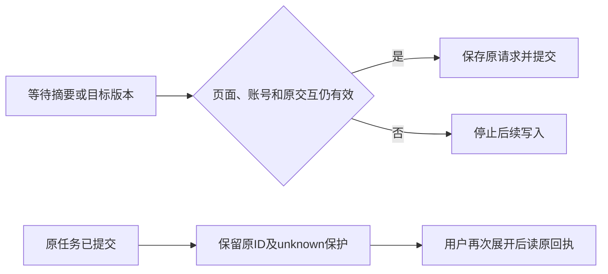

# T1043 互转生命周期 3 文件独立窄审

结论：lifecycle3 可窄合。冻结文件 SHA 0 漂移，patch SHA256 8a077674a5b110037ad74594d523033771e56d6cb3f6c2ca7d49940ff7108b6a 匹配。
实际冻结运行原12+独立2=14 PASS，日志 lifecycle14-independent.log。

用户关闭互转面板、切换账号或离开作品后，迟到的读取和摘要不再提交转换/采用或写缓存。已经发出的任务保留原请求；只保存来源新版本不会自动另起转换。

静态核对 account/project/output/sourceType 完整 keyed 实例；mounted、真实当前 account 与 serial 在 digest/owner GET/POST 后逐步检查；关闭令旧 token 失效；原 cache key、完整 adoption body、clientRequestId 和 unknown 条件没有新增默认或重写。

独立新增 trace：target GET在途关闭再展开，晚到旧owner零adopt/零采用cache；原convert请求仍完整。用户再次明确采用才读取并使用 fresh-target-version。另保存 source 新version 保留原conversion body/候选，零自动POST。

本报告为真实 React 组件的延迟客户端回归，不是完整浏览器、真实供应商或整个任务完成。后续task继续/取消和真实 sourceVersion 行内读方案已前审，无新公开契约、无精确映射则无控件；实际新增实现待另审。
