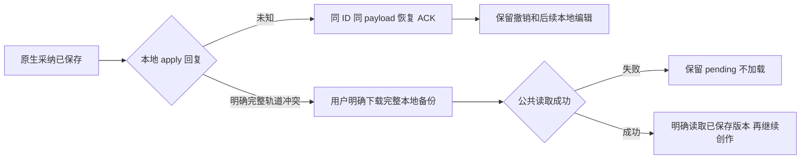

# T-1046 独立验收报告

验证对象是实施 agent 的真实源码独立副本；没有修改生产主树或实施 agent 文件。固定来源/测试 SHA 见 `/tmp/t1046-independent/snapshot-sha-final.json`。

当前结果：26 项独立测试通过（限定本报告列出的验证范围，非全项目全绿）。其中 backend 12 项、真实 OpenCut Core/Command/bridge 5 项（26 assertions）、host 候选面板/影响汇总/完整工作台 9 项。未发现新增阻断。

## 已验证的反例

- 完整场景：保持主轨触点不变，只改变独立图层的任意参数，sceneDigest 必须变；错误/缺失/重复确认 ID，以及当前 revision + rebind 配旧字幕影响摘要，公共采纳全部拒绝。完整比较 editor、productionEditVersions、productionMediaRequests，确认零写入。
- 原实例：删除第一段不删除同 media 的第二实例，保留主轨 image、未删除间隙、另一 scene 和独立字幕/BGM/旧分离音频。
- 时间：48000 源 tick 准确落到原生 120000 网格；无法精确表示的 1/1001 源格点只供复核，wholeclip 仍合法；unsafe end tick 在任何输入改写前拒绝。
- 连续局部采纳：第一 token 拆出 child，第二 token 按冻结实例真实剩余源区间采纳，wholeclip 最后只移除该原实例真实残段，第二 media 实例保持。
- rich 内容：倍速、动画、效果的局部切点只供复核，同片段完整删除仍有效。
- source/ASR proof：普通公共 save 无法新建、删除或修改 nativeSources/sourceTranscripts 内的 probe/ASR proof；拒绝时无版本/请求落库；合法 metadata 保存仍可完成。
- 公共旧请求重试：采用后继续手工保存，重试原 adoption request 只返回原 receipt，不覆盖后来 owner revision/plan，不新增版本/采纳记录。
- bridge 全字段 before：仅独立 audio 未知参数发生变化，同主轨仍拒绝 apply，零 command 并保留本地输入。
- bridge request 并发/replay：同 ID 同 payload 并发只执行一个真实 Command；Undo 后同请求只返原 ACK，不触发重写/Redo；同 ID 不同字段 payload 拒绝。
- Command 场景边界：active B 时应用 A，随后修改 B；Undo/Redo A 保留 B 编辑、当前 scene 和 playhead。
- bridge 入口：错误 origin/window/session、超长 request ID 拒绝。
- host：重叠建议 union 只闭合四秒，字幕/BGM 显示完整；跨 scene 不能确认；改变所选集合撤销旧确认，重新确认后 body/confirmation 的 ID 集合严格一致；fresh GET sceneDigest 变化而 touch 未变时零 adopt；unknown ACK 缓存原 body 和摘要，恢复同一 ID。

- 新入口：null 新工程及旧 v2 进入原生新稿不抛异常；旧方案明确确认 replace 后保存原生 v3。
- typed bridge409：下载备份带 output/project/baseRevision 和完整本地 plan/mediaRefs；文件中未保存文字改动保持。公共 GET 失败不清 pending、不 load、不允许保存；第二次用户明确备份并成功读取后恢复保存、prepare 生成。
- unknown apply ACK：模拟原命令已经生效但回复丢失，随后 Undo 和本地独立文字修改；恢复原剪辑回执只重投同 ID/同 payload，保留 Undo 后当前内容，无备份/新增剪辑写；prepare 随后保存本地修改到原 receipt revision 之后。
- 回执契约：完整 workbench 测试回执不含 outputId，使用真实 public version 的 productionId 边界。

## 实际运行证据

| 范围 | 运行位置/命令 | 结果/日志 |
| --- | --- | --- |
| backend | `/tmp/t1046-independent-work/backend`：`pnpm exec vitest run --config independent.vitest.config.mts` | 3 files / 12 PASS；`/tmp/t1046-independent-backend-final.log` |
| upstream | `/tmp/t1046-independent-ui/apps/web`：`/opt/homebrew/bin/bun test src/embedded/__tests__/independent-native-bridge.test.ts` | 5 PASS / 26 assertions；`/tmp/t1046-independent-bridge-green-final.log` |
| host | `/tmp/t1046-independent-work/frontend`：`pnpm exec vitest run --config independent.vitest.config.mts` | 2 files / 9 PASS；`/tmp/t1046-independent-host-final.log` |

## 证据边界

公共 rough 原链使用测试现场生成的 MP4 和真实 ffprobe，经真实预约、Worker 调用账本和结算；供应商响应为本地 SSE fixture，只验证协议和合法领域落库，不是实际 AI 创作效果。ASR proof 负向测试的已登记 proof 通过内部仓库作为明确 fixture 置入，不算真实 ASR 成功。host 用真实 React 面板，但 API mock；bridge 用真实 Command/Scenes/Replay，实现 core 环境与浏览器对象为 fixture，不算 CUA。实际模型调用、ASR、浏览器剪辑/导出和用户可用性需 ROOT 真机验收，不能用本报告替代。

初次 helper fixture 少了 text trim 字段导致 setup 失败，后来修正；不是产品 TDD 红测。首次 host 配置 merge 导致误扫描其他全量测试，已中止后用单文件明确范围重跑，最终报告只计上表指定测试；不宣称全项目测试通过。

新增入口与恢复验证经历现场真实 RED：旧冻结 host 的 null/v2 render 抛 Zod，typed409 后旧“保留本地重新核对”路径 prepare 永久 pending。原始 RED 见 `/tmp/t1046-independent-workbench-red.log`。ROOT 明确接受“用户下载完整本地备份后显式读取当前版本”的 typed409恢复路径，实施 agent 修正后独立复核上述9项 PASS。期间测试 fixture 的 mediaRefs/source revision 不完整导致过 setup 失败，修正后才认定产品故障；不将 fixture 失败当产品 RED。
