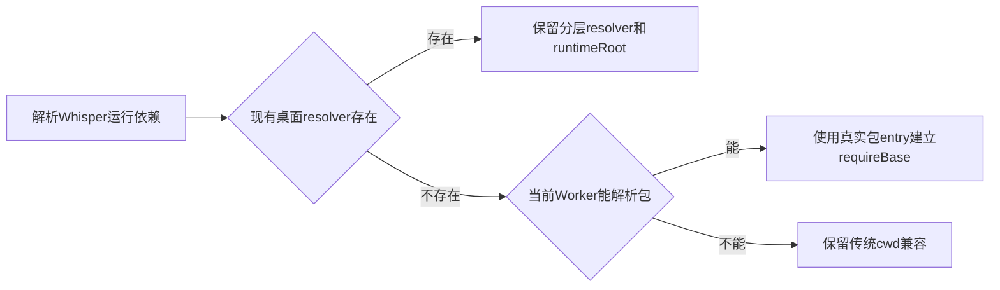

# T-1046 第3轮独立增量合同评审

结论：PASS，无新增阻断。仅审查SPEC新增运行装配段，不重开已销账的原生粗剪确认与bridge问题。JSON明确使用已有历史所要求的`recheck`，原REV-001/REV-002保持第2轮全部字段及销账证据。

新增锚点：`SPEC-LINE:47:3c61a41acaeab97a`。

- 原`resolveWhisperWorkerRuntime`在无桌面resolver时固定`cwd/package.json`；eval子Worker通过该基址require `@xenova/transformers`。新增Worker模块真实解析路径可解除frontend cwd与ai-worker依赖归属错配，不改变ASR输入、模型选择、时间码或settlement。
- 桌面分层resolver必须继续优先，在创建eval Worker后按原路径加载resolver及runtimeRoot。无resolver路径才采用Worker解析出的实际包entry作为requireBase；传统cwd作为最后兼容路径。Node path/createRequire沿用当前平台路径，不引入shell拼接或独立模块通道。
- 依赖仍位于ai-worker/runtime。`ai-worker/scripts/build.mjs`正式CJS保持`@xenova/transformers` external；桌面传统拷贝包与分层resolver已有既定依赖布局。修复不将重模型依赖搬入frontend页面，不使worker直连库，不更改超时/未知调用或原失败回执。
- 现场只读Node解析：`createRequire(frontend/package.json).resolve('@xenova/transformers')`返回`MODULE_NOT_FOUND`；ai-worker基址resolve返回实际pnpm包`src/transformers.js`；以该实际entry建立createRequire，再resolve包名，结果完全一致。没有加载模型或访问真实音频。

实施验收仍需frontend cwd红→绿、Worker可用/不可用、桌面resolver优先及加载失败、传统路径回归；重建正式CJS后经原公共转写成功。主代理报告的143ms失败与14.133秒真实推理为其现场证据，本轮未重跑，不冒充独立模型验证。原过期/未知任务不得通过改库延期或假恢复。
