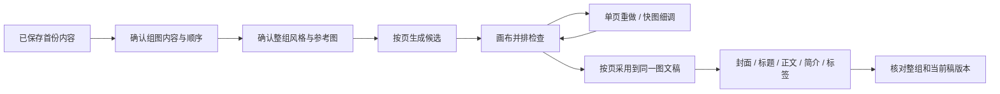

# T-1047 现有画布、组图与工作流只读审计

2026-10-02，仅静态读代码，不调用模型、不读取用户媒体或凭据，不代表真机 E2E。

## 结论

用户的判断与代码相符：画布已能文生图、单张参考图生图、候选确认、并排比较、加入项目素材及返回原作品。快图适合最后文字/图层细调。真正缺的是“这是一套图”的计划与执行：每页说什么、共同风格依据、按页生成、单页重做、保持其他页不变、按序采用和审核。当前“生成下一张图卡”每次基于整篇正文，让模型独立选一个想法，没有明确第几页，所以不能算组图工作台。

此图为建议流程，不是已实现事实或小红书官方硬规则。

## 已有能力及真实证据

|能力|证据|复用方式|
|---|---|---|
|图文稿正式owner、版本、明确每页ID|contract/src/resources/graphic-posts.ts:8 imageUses assetId/assetFileId/order/role/cardId；:24 cardBriefs cardId/title/body/sourceRefs；:32 document；backend/src/modules/graphic-posts/graphic-posts.service.ts:151 校验顺序、封面数与cardId归属|组图仍在原图文Artifact版本，不另建与稿件割裂的真相|
|图卡文字语义生成与用户采纳|graphic-posts.service.ts:293 generateTextCandidate；:431 adoptTextCandidate，核对base/current，采纳后创建Artifact版本；ai-worker/src/runtime/graphic-post-text.ts / prompt/templates/graphic-post-text.ts覆盖cardBriefs|组图结构先由Skill产候选、用户改/确认，不让AI直接写稿|
|图文封面/图卡真实生成、确认、采用|frontend/src/server/persistence-client.ts:3065装配createGraphicPostMediaAdapter；:3355 combineGraphicPostResultAdapters；backend/src/modules/creative-results/graphic-post-media.adapter.ts:116 enqueue，:166 read，:203 adopt；唯一generated_asset和确切file首次冻结，confirmTask后createVersion|不是仅text-only adapter，root已有真实媒体wrapper；但每个任务只一张图片|
|画布文生图/单张参考图生图|contract/src/resources/creative-canvas.ts:9生成节点；frontend/src/features/creative-canvas/infinite-canvas-node.tsx:43生成模式、:45参考图，支持拖图；canvas-editor.tsx:166 generate保存后generateCanvasNode|直接复用生成/比较区域，不需要重做生图画布|
|参考图和任务血缘精确冻结|backend/src/modules/creative-canvas/creative-canvas.service.ts:231 getReference，:238冻结referenceAssetId/referenceFileId/referenceChecksum/canvasOwner，:246 inputRevision/inputDigest/inputJson；ai-runtime/asset-business-execution.service.ts:82 exactfile读取并checksum核验|整组参考图应继承这条精确文件链，防止素材改版后串图|
|候选确认、历史、素材库、项目材料|canvas-editor.tsx:178 keepResult→getCanvasGenerationMaterial→getTask→confirmTask→再读正式结果→createMaterialLink；:199 history下载/并排比较；backend/src/application/generation/creative-canvas-root.ts:23装配原AI/Asset服务，核验已保存原文件|保留原候选/确认/正式文件机制，不能用临时URL当采用结果|
|作品→画布上下文及返回|frontend/src/features/projects/work-materials-panel.tsx:32 enterCanvas明确member、ownerVersion、target和source；creative-canvas/work-canvas-context.tsx:10存session handle，:24进入后重核账号/项目/版本/用途，:36返回原组合|已有归属校验与返回，但不会自动把原稿生成节点，也不会一键送回cardId|
|采用/替换到具体图卡|projects/work-materials-client.ts:19读取真实cardBriefs/cardId；backend/src/modules/work-compositions/graphic-materials.ts:7 createGraphicMaterialPorts readTarget/writeTarget区分cover/card；work-materials.service.ts:30 change锁原成员/CAS/exactfile/关联/回执|复用原attach/replace服务给“采用到第3页”，避免现在只追加无页ID|
|首份内容→图文的冻结血缘|backend/src/modules/creative-results/conversion-source.service.ts:46验原output，:62读取图文/cardBriefs，:91冻结整稿/选区，:129生成output_version/sourceOutputId/versionId/selectionDigest；output-conversions.service.ts使用原owner/result ledger|每页sourceRefs继承来源版本，避免扩展表达丢依据|
|封面/标题/简介/标签/组合审核|projects/work-review-panel.tsx:24图文title/body/summary/tags/cover范围，currentFingerprint/basis_updated；work-materials.service.ts:88 dependencies对真实target变化标needs_review|已有审核基础，但没有逐card图片选择及整组视觉语义保证|
|快图单页细调|reference-editors/graphic-design-workbench.tsx保存nativeJSON/mediaRefs，冻结导出；projects/graphic-post-workbench.tsx:154按cover/cardId选design，:157 saveDesign采用确切文件|保留作“调整这张图”能力，不当图文主工作台|

## 确认的关键缺口

1. 图卡文字与图片生成未连接。GraphicPostResults.generateCard（graphic-post-results.tsx:257）只提交kind:image_card/clientRequestId。graphic-post-media.adapter.ts:148读整篇title/body/summary，没有cardBriefs/cardId。createGraphicCardBusinessAdapters（backend/src/application/generation/creative-post.ts:103）图文要求targetSectionId为undefined；仅公众号选section。adopt（graphic-post-media.adapter.ts:230）追加imageUses，无cardId。连续生成可能重复选题/跳页。
2. 当前graphic.card-brief Skill专门单张无字配图。ai-worker/src/prompt/templates/graphic-card-brief.ts:13明确“只为正文设计一张说明性图卡”，输出仅imagePrompt/altText、优先无字画面。适合正文配图，不能替代每页标题/正文/版式/叙事顺序的组图策划。需组策划与页执行语义，不能循环旧模板冒充整组。
3. 没有系列共同输入。canvas doc只有nodes/edges/viewport；graphic doc为fields/imageUses/cardBriefs/designs/sourceRefs/ruleSnapshotRef。未见seriesPlan/sharedVisualProfile、统一样式版本、首图视觉基准、角色参考、整组连贯性评价。共同prompt/单图参考只能改善一致性，不能保证，需要候选比较和用户核对。
4. 没有明确按页候选/重做身份。UI只存一个coverResult/cardResult；“重新生成图卡”没有pageId/其他页保护/单页替换。retryFrozen仅failed/cancelled原任务重试，不等于用户反馈后重做同页。canvas generate单节点，busyNode限制同一时刻提交。需要组manifest/per-card candidate，但沿原Execution，不造第二执行器。
5. 底层通用生图是单图/单参考。ai-worker/src/runtime/multimodal-factory.ts:66 GenerateImageOptions仅prompt/aspectRatio/referenceImage一张bytes；:117 GeneratedAsset仅assetBytes；multimodal-openai-images.ts:63 response遇到首个有效图片即返。无多结果数组、n、reference set、seed等契约。可以编排原每页任务；不能宣称当前API原生一次生成多图。
6. 图文媒体链未接参考图。creative-post.ts:122 __coverContext强制referenceAssetId:null；generateCard UI无参考；graphic media adapter只允许visualRequirements规则。画布已有参考链，但必须补原owner页上下文和exactfile绑定。
7. 回画布转场交互仍重。workContext仅核验条/返回链接；保留图/加入项目后回组合还需选稿、slot、file再采用。安全基础可复用，可把原target带到候选，显式“采用到第3页”直调原material owner。
8. 机械血缘不等于内容/风格一致性。version/fingerprint能判断依据变化，不能判断漏信息/重复/叙事连贯/角色风格；应由可配置Skill/真实图片模型报告与用户确认，代码守权限/版本/真实文件。

## 建议可复用实施路径（待评审）

- 沿原conversion freeze把已保存首稿拓展到graphic-posts，先生成/采纳cardBriefs。用户可删/补/排序；页数是用户选择或Skill建议，不能硬编码某平台必须9张。
- 整组方向及参考图只保留一份有版本的shared输入，正式页沿既有cardId。原稿、组图、编辑文件、导出文件之间有可读来源和版本。
- creative-results bundles已有partial_completed与单项恢复。createBundle现允许1–12项且可重复kind，但items无cardId/sharedStyleRef，直接多次image_card只会基于整稿重复生成。先扩页身份/共同冻结契约，再复用bundle和原Execution/Assets。
- 主界面呈现页序列/网格、“生成整组”“重做此页”“采用这一页”，失败页保留其他页。每个可操作页卡必须绑定真实候选/任务。
- 画布提供并排比较/参考关系/试图；快图藏在页卡“调整这张图”。文字密集信息图可用AI策划结构/主视觉+稳定版式叠真实文字，避免关键文字全部依赖生图模型。
- 采纳替换沿createGraphicMaterialPorts/attachWorkCompositionMaterial/replaceWorkCompositionMaterial，或完善后的graphic媒体adopt精确cardId。用户采纳后原backend写正式页，不让AI直接落库。
- 最后复用WorkReview审核同一份封面/正文/简介/标签与整个组图；新页/sharedStyle/实际文件变化必须进入审核指纹。视觉报告需真实输入图片，不能只审prompt就说图已审核通过。

证据限制：未当场跑真实模型、配置、收费生成或平台发布；所列现有能力来自源码及root装配证据，不等于整组真机验收。平台具体流程由主agent官方研究补充，本建议不能当平台硬规则。
