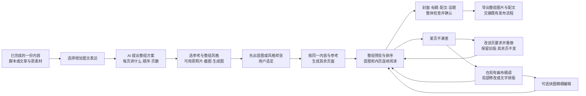

# T-1047 小红书组图主线：外部证据与产品建议

检索时间：2026-10-02。范围：官方公开资料、两个 MIT 组图实现的实际文件；未登录小红书，未使用用户凭证，未发布，未安装或执行上游脚本，未进行付费生图。代码/提示词审查不是实际生成效果验收。

## 结论

用户指出的核心成立：图文创作应当围绕“一份内容怎样变成一组能连续阅读、视觉统一的图片”组织。快图回答的是“这一张怎么改”，只能放在单页细调入口。现有画布承接素材、参考、生成和修改；主工作台应呈现整组页序、每页意图与出图结果，再把封面、配文、话题、检查串起来。

这是一份 CreatorOS 方案建议；没有足够官方或代表性样本证据断言“所有小红书作者都按同一流程创作”。照片分享、教程卡片、测评对比、漫画叙事应允许采用不同的组图结构。不能将“组图”简化成批量生成同一句主题的若干变体。

## 官方已核验事实与未核验项

| 核验项 | 实际证据 | 结论边界 |
|---|---|---|
| 图文笔记输入由图片与文字组成 | [官方 Android 分享 SDK 文档](https://agora.xiaohongshu.com/doc/android) 实际渲染页面的“开始分享”表格，页面显示更新于 2023-10-11；图片列表必传，标题、正文在 SDK 请求中可选，图片范围 1–18 张 | 仅是该 SDK 的公开契约。不能写成当前桌面发布器通用上限，不能把 SDK 字段可选误写成创作建议。图片与视频同时传入时按图文处理。 |
| 接口把内容交给平台发布器 | [官方分享平台](https://agora.xiaohongshu.com/) 将内容工具创作与 App 内发布能力衔接起来 | CreatorOS 应先形成完整可交付内容包，不能将打开分享器当作发布成功。 |
| 自动填标题/正文有限制 | [官方 FAQ](https://agora.xiaohongshu.com/doc/qa) 实际渲染页面“通用”第一问，页面显示更新于 2023-12-10，指出分享 SDK 自动填充标题和文案受限制 | 同时保留可复制配文与图片导出。将来接入渠道需单独验证实际能力，不能只依据 Android 示例承诺一键填完。 |
| 真实桌面作者流程 | [创作服务平台](https://creator.xiaohongshu.com/) 实际跳转登录；点击公开入口“创作百科”后也回登录，返回原路径带 401 原因 | 本轮没有实测登录后的上传、排序、封面设置、标签、声明、发布页。其当前字段、图片限制、裁切规则仍待实际账号验证。没有绕过登录。 |

平台硬限制、平台推荐和 CreatorOS 的默认建议必须区分。3:4、默认 5 页、首图醒目、尾页互动都可作为生成方案的可改默认，不能被写成小红书硬规则。未经官方当前证据，不写“一定限 9 张”“高浏览标签优先”“AI 内容必须固定声明句”“关键词影响推荐”等结论。

原始页面证据：本目录 `official-android-rendered.txt`、`official-qa-rendered.txt`、`official-creator-rendered.txt`、`official-encyclopedia-rendered.txt`；HTML 外壳也保留。浏览器读到了前两个完整页面正文，绝非只引用搜索摘要。

## 两个可复用的开源组图实现

### 1. baoyu-xhs-images：优先研究其组图规划和视觉参考链

官方仓库 [JimLiu/baoyu-skills](https://github.com/JimLiu/baoyu-skills)，核验提交 `1567581c26ec29f4216c6e6835415bf30343b0e3`。[许可证文件](https://github.com/JimLiu/baoyu-skills/blob/1567581c26ec29f4216c6e6835415bf30343b0e3/LICENSE) 为 MIT；不是图文编辑器。

实际审查 [SKILL.md](https://github.com/JimLiu/baoyu-skills/blob/1567581c26ec29f4216c6e6835415bf30343b0e3/skills/baoyu-xhs-images/SKILL.md) 与 [逐页大纲模板](https://github.com/JimLiu/baoyu-skills/blob/1567581c26ec29f4216c6e6835415bf30343b0e3/skills/baoyu-xhs-images/references/workflows/outline-template.md)：

- 按整体内容生成逐页大纲，区分首图、内页、结束页；独立记录每页内容、视觉意图与 Prompt。
- 先出首图，后续图把首图作为直接参考；另有风格、布局、色板配置和同会话参数。可保留外部参考图。
- 成功图不随失败图一起重做；修改某页时先改对应 Prompt，再生成新候选并保留旧图。输出编号 PNG 和大纲/提示词文件。
- 图像生成依赖宿主工具或其他生成后端，Skill 自身不是模型，也没有编辑器 UI、CreatorOS 资产归属和采纳事务。

重要改造点：上游有“按关键词先命中风格”的自动表，不能照搬为 CreatorOS 智能判断；应由可配置模型分析内容并提出方案，或落实用户明确选择。其禁止修改生成图中文字的策略是上游工作法，不能变成 CreatorOS 禁止用户在画布中改字。参考链能减少漂移，不能保证人物、品牌或中文文字始终一致；需要实际模型样本验收。

### 2. yy-text2-xhs-img：可参考任务清单和样式配置，不建议作核心规划引擎

官方仓库 [ivercurry99/yy-text2-xhs-img](https://github.com/ivercurry99/yy-text2-xhs-img)，核验提交 `12521824dc5525790cca4d5f7ce909c7551fa23d`。[MIT 许可证](https://github.com/ivercurry99/yy-text2-xhs-img/blob/12521824dc5525790cca4d5f7ce909c7551fa23d/LICENSE)。实际审查 [generate.py](https://github.com/ivercurry99/yy-text2-xhs-img/blob/12521824dc5525790cca4d5f7ce909c7551fa23d/scripts/generate.py) 与 [样式配置](https://github.com/ivercurry99/yy-text2-xhs-img/blob/12521824dc5525790cca4d5f7ce909c7551fa23d/styles/presets.json)。

- 有每张任务、输出清单、恢复执行，色板/光线/构图共享；脚本 API 路径为 DALL·E 3 和 FAL FLUX，TRAE/Seedream 路径是宿主交接。
- 代码主要以同一主题加“首图/解释/结尾”角色拼 Prompt，没有实际逐页语义大纲、参考首图上传或完整图文 UI；没有专门的单图重做选择参数。
- API 恢复跳过已有有效图片，PNG 和比例检查不能检验阅读连贯性。比例默认警告；“文件小于 50 KB”会拒绝简单但合法的图。

因此可借鉴清单、恢复与显式样式配置，但不能把 README 的风格一致、重现效果当成已证明能力。关键词选场景、武断小文件校验和供应商切换造成的风格漂移都应替换，不直接接管原生成服务。

### 名称与许可排除

搜索 `AutoRedbook` 只得到 `XuWink/autoredbook` 的公开仓库元数据，描述为抓 Telegram 图后自动发布；未核验出可用的同名组图生成上游，不围绕名称继续追踪。红墨 [HisMax/RedInk 的官方 README](https://github.com/HisMax/RedInk/blob/main/README.md) 明确 CC BY-NC-SA 4.0，商业集成要求另行授权；因此不能直接按可商用开源集成。本轮仅核验该排除点，没有将它列为第三个完整代码候选。

## 建议的 CreatorOS 用户流程

设计建议而非平台规定：主区展示组图和逐页意图，顶部始终能识别当前作品；选中一页才出现重做、替换、在画布编辑。AI 解释本页承担什么内容、如何衔接上一页；不要求每张套同一版式。封面是同组的一页并有明确角色，标题/正文是该图文表达的发布文案，不能与母稿分裂成多个独立项目。

### 一致性要分成三件事

1. **内容一致**：母稿观点、事实、人物、产品名、数值、论据来源为共同基准。AI 拆页可删减，但新增事实应显示为候选待采纳；不要把 AI 自动补写当已确认原稿。
2. **阅读连贯**：页序、每页唯一核心信息、指代、步骤号和结论能连续阅读。删页/换顺序后 AI 提出受影响页与配文的修改候选；用户采纳后再更新，不能静默全组重生成。
3. **视觉一致**：共享参考、调色板、字体层级、人物/品牌元素、画幅及安全区。首图和内页可有不同信息密度；布局、图像参考及图片资产共同版本化。模型参考图是辅助，不是确定性保证。

### 现有画布怎样衔接

建议复用已经存在的作品、图文稿件、页/图卡、素材、版本和生成候选采纳，不建立第二份作品数据库。画布承担三类动作：汇集原照片/截图与风格参考；生成或修改某页候选；对已采纳页面作细调再回到组图。具体既有接口由项目内部审计补充，本文没有声称所有接口已经具备。

一页必须关联稳定页 ID、页意图、当前采纳图片及候选列表、原素材、画布元素和版本。排序只是顺序变化，不换页 ID；单页重做只换本页候选；画布编辑回流时标记原图候选与新采纳文件关系。整组风格修改提示哪些页需要更新，已锁定页应保留。可选快图用于这一页的文字/图片/图层细调，不在进入图文表达时强制打开。

发布前整体预览应把图片、首图、标题、配文、话题和声明/审核放在一个稿件上下文中。正文需与组图内容对应，避免新配文引入未经确认的结论；检查失败应指明受影响页，允许保留合法已完成页、单页补做与可用导出。检查“结构和必需字段”可确定性实现；内容、画风、连贯性判断交给模型及用户。发布渠道的字段能力和实际限制单独验证。

## 后续实际验收建议

用真实授权的样稿分别测试“原照片+少量标注”“教程卡片”“测评对比”三种表达，记录母稿→拆页→首图→内页→单页重做→画布回流→导出；不只看一张好看的封面。至少证明：同组无新增未确认事实；重做一页其他页不变；参考被实际传给模型；改字不必全图重生；重排/删页后提示衔接变化；既有资产/版本/作品关系可恢复；局部模型失败不阻断合法输出。

未经运行的功能、生成成本、效果质量和当前桌面发布限制均保留待验，不写 PASS。本轮主产物是方向与证据，可供接下来产品 SPEC 和独立评审使用。
