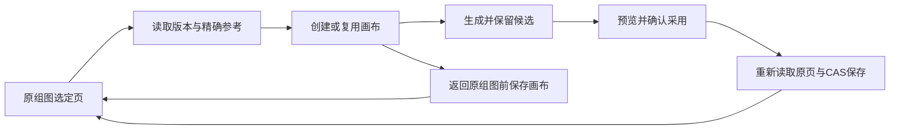

# T-1048 画布回原页独立只读审计

审计日期：2026-10-03。主树 `/Users/zyongzhu/.codex/worktrees/user-diagnostics/Thirdspace-creator` 只读；只写本报告。核对现有 SPEC、当前 graphic-page-context / tests、work-canvas-context、CanvasEditor 的实际装配、节点控件及新 Contract。没有模型调用、浏览器恢复、领域写入，也没有把主会话已有 20 个组件测试通过写成独立运行或真机 PASS。

结论：发现 4 个由当前源码状态可确定复现的缺陷，应修复后继续验收。下文复现为源码分支推演与现有 fixture 可构造的行为，不声称本审计已运行新失败测试。

## 1. 更新页规划后重复进入仍绑定旧版本，无法恢复

严重度：major，可用性。`graphic-page-context.tsx:32-35` 的 ready 缓存只按 account/output/cardId 固定键复用。`readGraphicPageScope:66-72` 核对归属、旧不可变版本与当前页存在，但没有比较当前规划；复用返回旧 node / baseVersion / prompt。`adopt:90` 又要求当前整组 basis 等于旧 base，错误提示“从原组图重新进入”。重复进入仍复用旧缓存。

复现步骤：成功打开 page-a 画布，返回原稿并改 page-a.body 或 seriesProfile，然后再次调用同一 openGraphicPageCanvas。仍返回旧 canvas/handle 且不重新保存节点。生成/采用时因 basis 不同失败，再按提示返回重进仍失败。

建议：ready 复用前核对当前规划与冻结 base。规划变化时在原画布保留旧节点/候选，明确创建或更新绑定当前版本的新页节点和 handle，不能覆盖旧生成历史；或提供真实的重新带入动作。加“正文/风格改变后重入→当前 Prompt/base→可采用”回归。单纯清缓存后无控制重建画布不能替代未知创建保护。

## 2. 明确 CAS 冲突后重新读取仍永久重放旧失败 body

严重度：major，可用性。`adopt:84-95` 以 scope/file/origin 作为 digest，在 sessionStorage 持久保存 request pointer 与包含 expectedCurrentVersionId 的完整 body。明确 409 后 `refreshSlot:79` 清内存 request，但若本页 expectedFile 没变，digest 未变，`:85` 再读同一 pointer，`:87` 再取原 body，仍带旧 CAS。

复现步骤：预览 page-a 候选并提交保存，createVersion 期间另一操作只采用 page-b，服务返回明确 CAS conflict。点“重新读取当前页”：本页精确文件未变，整组规划未变。再次确认，仍发出旧 expectedCurrentVersionId、旧 requestId / body，反复冲突，无法采用。

建议：明确区分“回复未知、可能已提交”与服务已返回的“确定未提交 CAS 冲突”。未知继续原 ID/完整 body；确定冲突经读回/用户重新确认后建立新请求与当前版本，保留原冲突记录。不能无条件丢未知请求或无条件永远复用旧 body。加入“其他页只换图造成 CAS 失败→读当前→新 CAS成功”和现有“回复未知→原body重放”并行回归。

## 3. 返回原组图绕过画布保存，立即离开会丢未保存修改

严重度：major，数据丢失。`graphic-page-context.tsx:104` 用直接 Next Link 返回原组图。CanvasEditor 的已有离开操作 `:193` 经 leaveCanvas → saveNow；自动保存 `:126` 延迟 1200 ms 并在卸载时清定时器。`:127` beforeunload 不能拦截 Next 的同站 SPA 导航。

复现步骤：在画布编辑生成 Prompt 或移动节点，在 1200 ms 内点“返回原组图”；新 Link 直接导航，自动保存定时器取消，修改未入持久画布。保存处于错误或冲突时该 Link 也没有保持原窗口。

建议：把 CanvasEditor 既有受控 leaveCanvas 回调和 navigating 状态传入 CanvasWorkContext / GraphicPageCanvasContext，返回原组图经同一 saveNow 路径；失败时保留页面和修改。保持真实返回 href 与可访问性，不另建保存循环。组件集成验证 dirty立即返回、保存中返回和保存失败留原页。

## 4. 节点内模式/参考下拉没有清理新 referenceFileId

严重度：major，原合法编辑回归。`infinite-canvas-node.tsx:43` 模式变更只清 referenceAssetId 和 aspectRatio；`:45` 参考变更只换 referenceAssetId。新组图节点已有 referenceAssetId/referenceFileId，因此留下旧 fileId。Contract `creative-canvas.ts:11` 要求 file 必须归属指定 Asset。CanvasEditor inspector `:249` 已同时清文件；拖入 `setReference:170` 已携带 source.fileId，只有节点内两处遗漏。

复现 A：带精确参考的节点在卡片内从参考图生图改为文生图，留下 referenceFileId 而 referenceAssetId 为空，保存被 schema 拒绝。复现 B：卡片内参考下拉选另一 Asset，旧 fileId 留在新 Asset，保存/生成精确归属核验失败。

建议：节点内模式切换同时清 referenceFileId；参考变更也明确清旧 fileId 或绑定用户明确所选新精确文件。清空参考同步清两字段。回归从带精确参考组图节点进行这三种操作，确保原合法文生图/换参考保存生成仍可用。

## 已核对成立与证据限制

- CanvasEditor 已实际传入 canvasId 和 confirmed selections；新页上下文过滤 confirmed/image/canvas/node，仅向目标页展示采用动作；候选选中后预览精确 AssetFile URL，再二次确认，非假按钮。
- 采用前重新读取 getCanvasGenerationMaterial，验证 confirmed/image/node/canvas、确切 file 和 checksum，原素材证明仍由 backend 公共查询产生；正式写入沿 GraphicPosts createVersion，未造第二数据库写者。更强的 origin 全字段比较可作为回归内容，但本审计没有证据认定已有不可变后端查询会返回另一任务回执，故不据此凭空列阻断问题。
- 账号各 await 后 assertAccount；CanvasEditor accountsChanged 清画布和任务并跳回画布库，组件 key 隔离上下文，迟到旧账号回读已有单测覆盖。未实测真实浏览器账号切换。
- 已有网络未知保存测试验证刷新后重放原完整 body；它没有覆盖问题 2 的确定 CAS conflict 分支。
- createCanvas 前 creating 标记、创建后 saving 标记及 ready 缓存阻止同页未知重复创建；创建/保存未知目前是停止并提示画布库核对，不是一个已经验证可恢复的幂等创建接口。没有把此保守限制夸成自动恢复已完成。
- 现有三份新 Contract 的可选字段保持旧稿/自由画布读取思路，referenceFileId 沿 existing getReference/readImageReference port 可接；本审计没有运行模型或后端未交付部分，不判断实际供应商参考能力和已生成图片的一致性。

主会话需针对上述问题建立当场红测再修复；本报告不是补拍 TDD RED、真实图片生成或浏览器验收证据。
