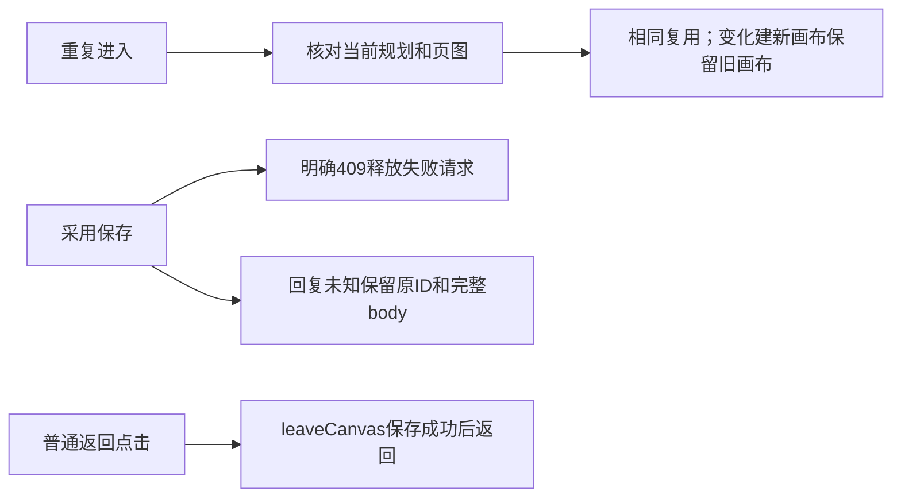

# T-1048 画布四项问题增量复核

结论：原报告的 4 项确定性缺陷已在当前源码中消除，静态增量复核 PASS。没有修改主树、没有运行浏览器/模型；读取主会话当场红绿日志，不能等同于本人独立运行或真实 E2E PASS。

| 原问题 | 当前修复与核验 | 结论 |
|---|---|---|
| ready 缓存旧规划死循环 | graphic-page-context.tsx:34 比较 readGraphicPageScope 返回的 current/base basis 和目标原槽；变更解除 ready 指针并读取当前不可变版本创建新画布/节点，旧画布与旧 handle 不删除；未变化保持复用。新测试修改正文后验证第二画布及新 Prompt。 | 已消除 |
| 明确 CAS 冲突仍重复旧请求 | :80-100 持有 pointerKey/requestKey。HTTP 409 或明确 ConflictError/VERSION_CONFLICT 才删除两缓存并清内存 request；网络 Error/未知回执保留旧 request/body。刷新后新请求重新读取当前版本，保留其他页最新图。HttpTransportError 确实携带 status/code，当前判断能接真实 transport。 | 已消除 |
| 返回原组图绕过画布保存 | CanvasEditor:234 实际传入 onLeave={leaveCanvas}，WorkCanvasContext 透传给 GraphicPageCanvasContext，:104 普通左击 preventDefault 后调用原回调；leaveCanvas:193 先 await saveNow、核对 epoch，再 router.push，失败保留页面并写 editor alert。保留真实 href，modifier 点击保留浏览器正常新窗口语义。 | 已消除 |
| 节点内切模式/换参考残留 fileId | InfiniteCanvasNode:43 模式改变同时清 Asset/File；:45 参考改变同时清旧 File，清空同一分支生效。CanvasEditor 的 patch merge 保留 undefined 清除效果，后续序列化移除；拖入仍显式带 source.fileId；右侧 inspector 原正确行为保留。 | 已消除 |

## 证据与真实装配限制

`docs/research/evidence/t1048/canvas-controls-red.log` 记录 2 文件 14 tests，其中 5 failed / 9 passed；失败分别为 ready 重入、明确 CAS、返回回调和节点内两处字段清理。日志有 retry 导致重复 failure 行，不能把它说成 15 个独立问题。

`docs/research/evidence/t1048/canvas-review-green.log` 记录 4 文件 25 tests PASS；既有未知 ACK 测试仍验证刷新后原完整 body/ID 重放。当前复核未重新运行这些命令，仅检查当场日志和对应源码/测试。

返回组件测试使用会 reject 的 onLeave mock，而真实 CanvasEditor.leaveCanvas 自己 catch 保存错误，并在 editor error 区显示 alert、保留当前页，不会再 reject 给子组件。两者错误展示位置不同，实际父子装配仍满足保存失败不导航；不能用这份单测声称已真机检查 dirty→点击→后端保存的完整链。真实 UI、modifier 实际行为和布局仍属于主任务后续验收。

创建接口仍无通用请求回执，creating/saving 未知窗口继续保守阻止重复创建并提示核对；本次 ready 更新只对已经确认成功的 ready 窗口起效，未删除未知状态防护。精确模型参考效果、候选图像一致性和未交付后端部分不在这次四项复核结论中。

## 当前源码指纹

- `frontend/src/features/creative-canvas/graphic-page-context.tsx`：`b7dd59ed7ea534959379c964d4f06a3d0233d68151035f87165072bc7d436c4a`
- `frontend/src/features/creative-canvas/work-canvas-context.tsx`：`f078706afd5643b6231d53dc6c725eaa62331c4778b136234a7a87cc61e1f213`
- `frontend/src/features/creative-canvas/canvas-editor.tsx`：`48a459d5334ef9559f1d4d9f64bd3340e3eeeee49c5d48ed51b972e5c97aabe9`
- `frontend/src/features/creative-canvas/infinite-canvas-node.tsx`：`7a8b216375d556be3887462adcbe7e76072c5adbfafb15b6b2db448d0c58de5a`
