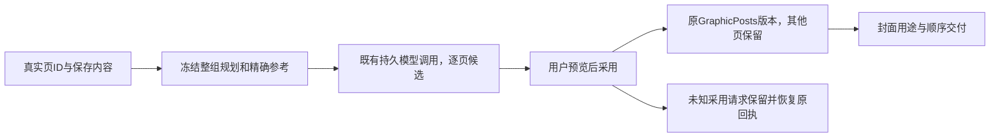

# T-1048 组图主流程独立集成审计

结论：CONCERNS，发现 3 项本任务范围内的确定问题。主会话已接收并安排针对性修复；本报告固定本轮发现，不复核已经修复的上一轮 4 项，也不把旧全仓欠债列成本任务新增问题。

主树只读；只写此报告。未读取凭据、运行真实模型或浏览器。下述复现是源码/契约确定性分析，未把它写成已执行的运行时故障。当前主会话日志有组件/服务测试通过，但这些样例不足以排除本轮三个遗漏。

## 1. 新页图片候选与公开采用 body 契约不匹配

严重度：major/completeness。媒体 adapter 的 value 与 UI adoptPage 都包含真实 cardId。审查时 `contract/src/operations/creative-results.ts` 的 adoptResult.editedValue 图片数组仍使用 strict 的 `{assetId,assetFileId,order,role}`，没有可选 cardId。资源 graphicPostImageUse 与实际领域采用已允许该字段。

确定复现：将 UI 的合法已生成单页候选（cardId=page-a）提交给 `ENDPOINTS.adoptResult.body.parse(...)`，图片数组分支拒绝未知 cardId，其他 union 分支也不能接受该图片值。现有 card adapter 服务测试和组件 mock 绕过此公开 body schema，故可同时显示测试通过。

影响澄清：进一步追踪 `contract/src/client.ts`、普通 UI 的 createHttpTransport、dispatch route 和 creative-results.transport，当前普通 UI 并没有统一执行 endpoint.body.parse，不能声称本审计实测 UI 发出后一定 400。确定缺陷是公开 contract 与合法请求不一致，遵守合同的调用者/校验测试被拒；不能靠普通路径跳过入参校验维持正确性。

修复要求：补上真实图片用途里的可选 cardId，并保持相应 owner/kind 的真实 ID 核验；当场以实际公共 schema 红测→绿测覆盖新单页与旧无 cardId 候选，不把 mocks 作为入口验证。

## 2. ZIP 全局去重会删掉合法页，并隐式改变同文件封面的页序

严重度：major/data-integrity。`graphic-series-document.ts:graphicDeliveryImages` 对全部 imageUses 按 assetId/assetFileId 建 seen 集合，而 SPEC 只要求封面与页同文件的重复用途只交付一次。`replaceGraphicPageImage` 及 UI “使用到这一页”允许用户明确将相同精确图片用于不同 cardId；backend 只限制每个 cardId 单图，没有禁止不同页重复图片。

确定复现 A：page-a 与 page-b 都明确选择同一精确 AssetFile，交付 helper 只返回一个，ZIP 少一页；同样会删除用户明确保留的旧未绑定重复图片。

确定复现 B：页序为 A→B，选择 B 的同文件用途为封面，当前 normalize 先 cover，delivery 全局去重导出 B→A，cardBriefs 仍 A→B。现有 helper 测试反而把此隐式换序写成预期。SPEC 已确认“整组交付按页顺序；单独封面置首，其他页保持顺序”。

修复要求：保留所有明确页及旧照片的用户顺序，只省去 cover 与实际页完全同文件的重复用途；同文件 cover 不隐式改页序，独立文件 cover 才置首。若产品要改变阅读顺序，必须落实用户明确排序，不能靠去重偷偷改变。以重复页、重复旧照片、第二页作同文件封面、独立封面等行为红测验证真实 ZIP/manifest 顺序。

## 3. 单页采用原请求只存在内存，刷新无法恢复 owner 已提交的未知窗口

严重度：major/correctness。`graphic-post-results.tsx` 的 pageAdoptions 仅 useRef，adoptPage 按 result/file 缓存 requestId 和 expected version。canvas 页采用已持久固定 body，但组图主线未持久。

确定故障窗口：creative-results.service.adopt 先 adapter.adopt → GraphicPosts.createVersion 正式提交，之后单独写 creativeResults.adoptionReceipt。若两者之间进程中断/后者写失败，GraphicPost 已换图但 Result wrapper 仍无 adopted receipt；media.read 将已 confirm/succeeded 任务仍投影为 awaiting_confirmation。刷新清空内存，用户再次采用取得当前版本与新 requestId，owner 的旧幂等回执无法命中，可能新建重复正式版本，而非恢复原提交。

普通“整个 adoptResult 已成功但浏览器未收到”刷新可能读到 adopted，无此重复；应测试上述确切 owner/wrapper 间窗口，不能用前者代替。此为新组图采用路径的恢复遗漏，不把所有旧采用方式一并扩进本任务。

修复要求：按 account/output/result 隔离持久原采用请求（result/file/expected version/requestId/完整 body）；真正未知刷新后先恢复原 ID/原 body，确定冲突才允许新的明确尝试。保持局部页候选与稿件，不重复采用；实际 PGlite owner 提交后 ACK 丢失/ wrapper 回执未写的服务回放证据，加组件刷新恢复回归。

## 已核对的主链与范围限制

- 单页 targetSectionId 在 creativeResults generate/bundle/重试持久身份中保留；GraphicPostMediaAdapter 从真实 current/baseVersion 找唯一 cardId，冻结 cardBriefs 全有序页、seriesProfile、sourceRefs；scriptSnapshot 单独冻结 title/body/summary。Worker business prepare 重读不可变 base 并 deep equality，不从前端自报全文取事实。
- 指定参考先从 Assets exact file 读取并冻结 checksum/mime；__coverContext 带 fileId/checksum/aspectRatio 到原两段持久执行。execution-cover 指定 fileId 时不 catch 降文生图，参数与供应商能力校验走已有端口；readReference 再次读取同一精确文件并核 checksum。没有新增模型网络通道。
- 页采用以当前期望版本 CAS；graphicSeriesBasis 比较文字/全部页规划/来源/风格/参考，故同批其他页只换图片不会导致余下页规划作废；实际使用 target 当前稿构建，保留其他页及旧未绑定图，不回写旧稿全文。新页按真实 cardId 替换；旧无 cardId 任务沿原追加路径，未被自动猜页。
- 首图用途 setGraphicCover 复制精确文件用途并保留 card/cardId；问题出在交付列表泛化去重与排序，不是正式稿页绑定被删除。
- 单项 retry 保留冻结 input、bundle 持久预约、原 retryRequestId；未知提交可恢复原项，其他页不重生；>12 项按系统容量分组提交，sessionStorage 保存每组原请求。未将容量解释为平台限制。
- frontend 工作台/候选按 account/output 组件 key 隔离，异步回写有 mounted/epoch 与一在途轮询保护；画布路径有显式账号校验。没有真实浏览器跨账号切换证据，本审计不作此 PASS。
- 开源规划/画面 method 确实 import 到两个现有模板，使用原可配置 Skill；没有上游 CLI 执行、关键词自动风格或第二 writer。provenance 固定 commit `1567581c26ec29f4216c6e6835415bf30343b0e3`；本地选用原文件和 MIT license 的 SHA 全部匹配。

本次只读看到 root-frontend.log 8 文件 57 tests PASS、root-backend.log 11 文件 69 tests PASS、root-worker.log 4 文件 6 tests PASS、root-contract.log 2 文件 4 tests PASS。它们属于主会话实际运行，不是本人重跑；范围内测试缺口解释了三个问题为何未被捕获，不等于整组实际模型图片/真实 UI 已验收。

完整真实图生成、视觉/事实/文字一致性、画布到原页真机操作、ZIP 实际下载和两个视口仍待主任务验收。当前不得据此标 T1048 全面完成。

## 本地开源来源校验

- `upstream/SKILL.md`：SHA256 与 provenance.json 一致。
- `upstream/references/workflows/outline-template.md`：SHA256 与 provenance.json 一致。
- `LICENSE`：SHA256 与 provenance.json 一致。
