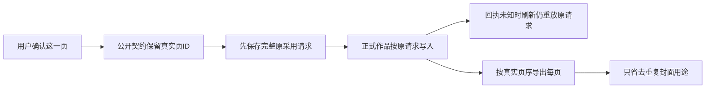

# T-1048 组图主流程三项问题增量复核

结论：**PASS（仅本轮固定的三项问题）**。公开采用契约、导出去重与页序、未知采用请求刷新恢复均已按原修复要求落实。没有扩展审计范围，也没有把此结论当作 T-1048 整体完成。

本人只读核对当前主树源码、测试断言和主会话留存日志；未重跑测试、读取凭据、调用模型或浏览器。主树未作任何修改。

## 1. 公开采用 body 与真实 cardId 不匹配：已解决

`contract/src/operations/creative-results.ts:37` 的图片数组复用 `graphicPostImageUse`，保留可选 cardId；其 owner refine 拒绝非 graphic_post 采用带 cardId 的图片数组。`contract/tests/graphic-series.test.ts` 实际调用 adoptResult.body.parse 验证合法单页请求完全保留，同时验证其他 owner 被拒、旧无 cardId 候选仍通过。

证据：`adopt-contract-red.log` 实际新行为 1 failed / 3 passed，失败为真实 body.parse；`adopt-contract-green.log` 为 3 files / 6 passed。后端集成第一项现使用官方 ENDPOINTS 的 body.parse 再进入真实领域服务。

原问题是公共契约缺口。普通 UI 路径没有统一执行 body.parse，因此不能将原缺口改写成“当时 UI 必然 400”。此区别仍保留。

## 2. 全局去重删页、同文件封面隐式换序：已解决

`frontend/src/features/projects/graphic-series-document.ts:14` 现在只排除与页图片精确 assetId/assetFileId 相同的 cover 用途，所有真实页与旧未绑定照片均保留；normalize 仍按 cardBriefs 中的明确页序安排绑定图片，并保留未绑定照片的相对顺序。独立文件封面保持置首，同文件封面不再把第二页挪到第一页。

`graphic-post-workbench.tsx:192` 真实 exportGroup 使用这一列表逐项读精确文件，每项使用独立序号文件名并逐项写图片顺序.json，不会因相同源文件覆盖 ZIP 中另一页。`graphic-series-document.test.ts` 明确覆盖两个不同页和旧未绑定照片共享同文件仍保留三项；`graphic-post-workbench.test.tsx:108` 通过导出按钮生成 ZIP，再 unzipSync 断言实际文件与 manifest 为原页序 file-a → file-b。

证据：`delivery-order-red.log` 为 2 files / 3 failed / 8 passed，`delivery-order-green.log` 为 2 files / 11 passed。ZIP 测试属于组件环境，图片下载端口使用 fixture；这不是浏览器下载的实测记录。

## 3. 未知采用请求仅内存、刷新后重复提交：已解决

`graphic-post-results.tsx:96` 新 PageAdoptionAttempt 按 account/output/result 隔离保存完整原请求：真实 resultId、精确 editedValue、原 expectedVersionId、clientRequestId 及一致性 digest。采用前先保存，未知错误保留；重挂恢复后重放原参数，不用新 currentVersion 或新 UUID 替代。明确 409 清除旧尝试，候选保留，用户下一次明确采用才重新读取当前版本。账号/output 组件 key 与 epoch 防止旧回写。

`graphic-post-results.test.tsx:82` 模拟 owner 已保存、wrapper ACK 丢失，remount 后断言第二次采用请求完全等于原请求且没有重新读取当前版本；其下一项覆盖明确 409 后重新确认取得新版本与新 UUID。`frontend-adoption-persistence/red.log` 1 failed / 18 passed，失败断言明确显示版本 original-v1 被替换为 owner-already-v2 且 UUID 改变；`green.log` 19 passed。

`backend/src/modules/creative-results/graphic-series.integration.test.ts:95` 使用实际 PGlite GraphicPosts/Results owner，在 originalCreate 真正提交版本后抛 owner ACK lost，验证 current 已前移且 wrapper 仍 awaiting_confirmation；恢复完整原请求后取得原 versionId，正式版本数量、内容不再变化，确认任务只执行一次，再重放仍命中同一回执。`public-adopt-final.log` 4 passed，包含该确切窗口。模型和 Assets 字节端口为 fixture，没有真实生成图片。

sessionStorage 恢复限于同一标签刷新/重挂。存储被系统禁用时代码只保留内存，不将该环境声称为已验证的跨刷新恢复。

## 证据有效性与剩余验收

- `public-adopt-red.log` / `public-adopt-green.log` 中早先未导出名称导致的 fixture 失败不算行为红绿证据。
- `public-adopt-baseline-red.log` 是修正为官方 ENDPOINTS 后，当场临时还原接任务时契约的基线回归 RED（1 failed / 3 skipped），不是前置历史 TDD。
- 新 owner ACK 丢失用例证明已有 owner 回执路径可恢复，为 GREEN-only 新增证据；不虚构其修复前 RED。
- 本复核认可上述三项在源码、契约、组件与实际 PGlite owner 层的解决。真实供应商图像质量/一致性、真实 UI 操作与跨账号切换、画布回原页真机链、浏览器 ZIP 下载及两个视口仍由主任务继续验收。

## 复核时源码 SHA256

| 文件 | SHA256 |
| --- | --- |
| contract/src/operations/creative-results.ts | 3368c8c8eb087c602183d33195692149fc989ce3bd856d7651a8d95d4c495773 |
| contract/tests/graphic-series.test.ts | 02fd07871e18f01a6631a5c75ec64fb54c68f0a0264e52b5aed00cd421503dbf |
| frontend/src/features/projects/graphic-series-document.ts | beb2a6d276ed572465d5e4a62c4cedc1d73c3acc22ac8b1f899a8c4ab7635c10 |
| frontend/src/features/projects/graphic-post-results.tsx | 52cde47cc13b33900ebccba8d865e418e3c8d4a7f0865ef6900c4f66212ae5f9 |
| frontend/src/features/projects/graphic-post-results.test.tsx | 03dff47bba5d6e40272bb733f4414b6c2abc81a561d85a0aab72dfdbaed7f8df |
| backend/src/modules/creative-results/graphic-series.integration.test.ts | d6da29376326cb27bc2800707583e66195cabcd5909bc28b9752341564669e70 |

日志均位于主树 `docs/research/evidence/t1048/`；逐页持久化证据位于其 `frontend-adoption-persistence/` 子目录。本轮只写本报告，不触及 root 控制面。
