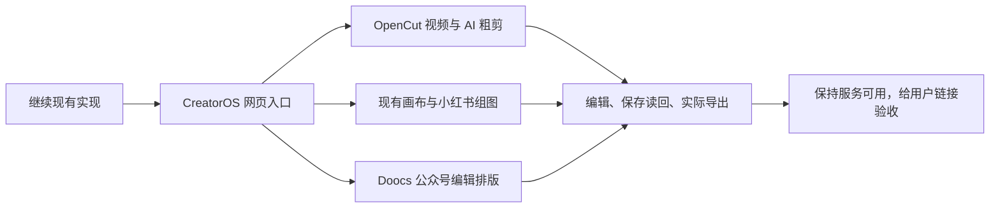

# 新会话接力：完成 CreatorOS 网页版工作台集成，交用户验收

## 最新用户指令

2026-10-03 用户原话：**“交给一个新的会话来接力吧 现在网页版完成集成 然后让我来验收”**。

本次交付目标是可直接打开的 **CreatorOS 集成网页**，包括原视频、组图与公众号创作流程。用户亲自验收交互与视觉。完整安装包和尚未通过的真实模型/界面项目继续如实登记，不作为提供网页编辑、保存和导出能力的前置条件。不要用候选编辑器独立站、研究报告或接口 200 代替产品内集成。

保持用户已确认方向：先完成一份内容，再按需扩展成视频、小红书组图、公众号或朋友圈；表达可自由组合。优先集成开源工作面，接原作品、素材、画布、版本和审核，不从零堆按钮/表单。快图可保留单页细调，小红书主线是出图与整组一致性。原脚本工作台是体验基准。

## 必须使用的现有工作树

- **实际实现及混合控制面**：`/Users/zyongzhu/.codex/worktrees/user-diagnostics/Thirdspace-creator`。
- 分支 `codex/user-diagnostics`；交接前 HEAD `39c1be32`，另有本交接文档提交。
- 默认项目目录 `/Users/zyongzhu/Workbase/Thirdspace-creator` 是另一份工作区。进入实际实现工作树后再按 AGENTS.md 读取 BACKLOG、SPEC、PROJECT、PROJECT_CONTEXT 和产品流程。不要在默认目录修出另一套实现。
- 原树有大量继承 WIP、未跟踪代码与混合治理文件；禁止 reset、批量 stage、整仓搬运或以“清理”为名删除。实际开发、测试、构建均显式指定 workdir。原会话移交后停止写入，新的接力会话接任整合。
- 不新建 worktree，不默认从 main 开始；保留现有源代码、依赖和未提交接线。无需推送、部署或对外发布。

## 开工真相与授权变化

T-1048、T-1046 仍进行中，T-1049 已完成开源运行准备，产品适配未开始。最新用户确认记录于 `orchestrator/DECISION_LOG.md` 的 DEC-T1049-01 与 BACKLOG 对应行。旧 SPEC 的“当前任务完成后/安装版验收”不能把最新网页交付目标堵死，也不能据此把旧未验项改为完成。

按 `product-to-code-orchestrator` 重新路由，调整受最新用户确认影响的规格、依赖与验收约束；需要独立合同/设计复核的适配先复核再实施，使用 taskctl 留状态审计。现有 T-1049 规格回执 `PASS[REV:ce967af81708]` 只绑定原规格，不证明新适配合同、界面或集成完成。不再就已明确的网页版目标重复向用户询问是否实施。

## 已完成与可复用证据

1. **T-1046 视频**：OpenCut 同工程粗剪/ASR/候选/采用、手工编辑接线已落地。真实 MiniMax 候选、同轨采用、撤销/重做、实际 10.68 秒 MP4 导出曾跑通；后续 4.68 秒最终导出中断，不能称已验。详见 `docs/research/evidence/t1046/verification.md`。实现提交 `66e65d27`，其它开发树接线仍有混合 WIP。
2. **T-1048 组图**：逐页规划/生成/重做、候选采用、页排序、共享精确参考、画布回原页、整组导出代码已集成，提交 `1932e30d`。前端 60、Backend 91、Contract 6、Worker 8、LED-047 159 项通过；前端/Contract/Worker 类型检查及隔离默认桌面前端生产构建成功。只属于代码与构建证据。详见 `docs/verification/t1048-image-series.md` 及其证据目录。
3. **T-1049 开源工作面**：报告 `docs/research/t1049-open-source-workbenches.md`，提交 `39c1be32`。三个候选原构建通过，Doocs 原模块 59 项通过；来源、许可、锁文件和 40 个关键源码哈希在 `docs/research/evidence/t1049/source-provenance.json`。尚未产品接线，也未真实 UI/下载验证。
4. 以前完整 OpenCut、快图工作面接入实测在 `docs/research/evidence/t1042/complete-editors/verification.md`。不能把这些较早旅程当成此次整个工作台验收。

## 开源参考与接线重点

**公众号优先 Doocs/md 完整 Vue Web 工作面**。固定提交 `a7c17fc4cda92e3c13aa7e24f06615cfa4219b31`、WTFPL；源码 `/tmp/t1049-reference-doocs`。编辑、主题、自定义 CSS、移动预览、公众号复制/HTML 处理可复用。React 宿主可用同源独立页面与明确协议，不强行重写 Vue。适配现有 `articles` 服务、稳定 sectionId、来源/事实/配图信息、CAS、原生文档及源版本。上游 IndexedDB 不成为第二正式 owner；上游云账户/图床/AI 配置不能直接变成用户必经流程。原 Web 默认带 Google Analytics，产品接入时移除；核对外部字体/公式/图表依赖。实际输出需带样式 HTML 和真实图片资源 ZIP，不能只出本机私有图片 URL 后声称可微信直接使用。

**小红书保留 T-1048 与现有画布**。rednote-cards 固定 `9c675f08681188838e6857c59bb0cd08be662a68`、MIT，源码 `/tmp/t1049-reference-rednote`。它提供文字卡片富文本/模板/输出，不是 AI/照片组图 owner；缺稳定页 ID、页排序和正式保存，固定尺寸会截长内容，导出缺节点会跳过。可复用文字排版，须补真实保存、逐页对应、完整输出和明确失败。MarkCardStudio 固定 `23522d57dcce56c7299ce364323727d27f918f10`、GPL-3.0-only，源码 `/tmp/t1049-reference-markcard`，有多页/配图/排序/预览，但本地图片/字体/文件夹依赖 Tauri，部分路径有 Web 回退；原 Web 构建成功不等于这些功能在 CreatorOS 可用，目前未选为产品依赖。不要把全部组图限定成 Markdown 文字截图。

**视频继续原 OpenCut**。AI 产候选，用户明确采用后落实同一时间轴；无模型或无精确转写仍能手工剪辑。别另建隐藏可写时间轴或改用只有组件的假工作台。

## 测试环境与实际限制

- 隔离生产构建在 `/tmp/t1048-build-work/frontend/.next/standalone/frontend/server.js`；`/tmp/t1048-build-runtime` 为隔离运行数据。它是此前桌面模式的构建证明；本次网页需按真实集成源码重新核对启动方式和运行依赖，不能把旧包直接当新交付。
- 参考静态服务曾在 `127.0.0.1:4196/`（rednote）和 `127.0.0.1:4197/md/`（Doocs）启动。新会话先核实是否仍在，不把它们作为 CreatorOS 验收入口。
- 用户已授权沿用客户端当前模型。公共 CLI 已确认文本 MiniMax-M3、图像 gpt-image-2 有凭据；CLI 返回脱敏信息，隔离配置备份路径仍待用户提供。不要复制聊天密钥、解密私有存储或把凭据写入仓库/日志。该限制不能阻塞普通编辑/原照片/保存/导出；真实模型功能如实显示配置状态，并在可用时测试。
- 旧 CUA Browser Use 曾因非 HTTP/error/data 页面受到策略阻断。**新会话接力不是绕过方式**；不要换浏览器、CDP、Playwright 或间接浏览器执行绕过原拒绝。做获准的代码测试、构建和服务健康核对；用户已明确亲自进行网页视觉与交互验收。未做的真实 UI 证据继续标待验。
- Backend 全 tsc 52 错、boundary 7 相对基线 5、semantic boundary 与全仓 reconcile 35 errors/1 warning 为已登记未通过项，T-916/T-1026/T-1027 跟踪。报告当前实际结果；不要改门卫/放宽失败基线，也不要把未触碰文件报错等同本次功能不能接入。源码变化后仅重跑适当及规定回归，不重复大套件制造虚假进展。
- 共享 `frontend/src/server/persistence-client.ts` 两处 T-1048 接线未整文件提交；范围内 patch 与 hash 在 `docs/research/evidence/t1048/persistence-assembly-delta.patch` 等记录。先验证 actual tree 与 patch，不重复覆盖。现有提交不是干净 checkout 可独立重建证明。

## 本次必须交给用户的结果

真正集成后的网页服务保持运行，给出 **直接打开的 URL、进入三个工作台的点击路径、可验收的完整操作与已知未验项**。合理提供本机测试内容与素材，不改用户真实作品或伪装数据。不让用户先配置模型才能检验基本编辑、保存和导出。

检查视频导入/手工剪辑/保存重开/实际导出；小红书至少三页混合真实图片与可编辑文字、排序/单页替换、画布往返、封面/配文/标签和整组 ZIP；公众号完整正文/配图/主题/移动预览、保存刷新与带资源 HTML/ZIP。未知回执/冲突保留原草稿和请求，账号/作品切换不串内容。900×600 与 1440×900 主操作和滚动由用户网页验收，自动化未完成不得标 PASS。

假按钮删除或实现；视觉以原脚本工作台的清楚主区、就近素材和可收起助手为基准。交付已集成作品工作面，而不是更多研究/表单。不要替用户提前打“验收通过”。
