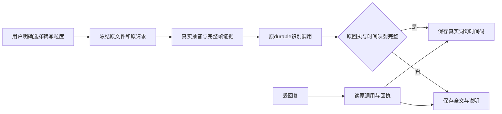

# 精准转写 21 文件独立窄审

结论：冻结 21 可窄合；原全帧探针缓冲失败反杀全文的独立红已关闭。没有把真实音视频处理夹具或 HTTP fixture 冒充供应商语音识别，也没有宣称真浏览器或全局任务通过。

patch SHA256：b6d4a0563f919fa9b1970df54e0907ad4f3a5e21818b8787c970077589a27df6。
manifest SHA256：f6b1cfc92cc2ac416ed03c20a663ccdaf4c42fb9e9d2e382396b53ae13709171。
21 文件逐个校验，0 漂移；完整临时 runtime 上覆盖全部冻结文件后独立运行，5 文件 15 PASS：precision-frozen15-independent.log。

人能理解的行为：用户明确选择全文、句级或词级。只有真实完整音频时间映射与原识别回执都齐全时，保存可剪切的词句；其余保留全文并允许时间轴手工剪。恢复旧任务保持原输入，不补改模式、不重复识别。

独立验证：
- 精确处理真实 native PCM MOV 的视频时钟原点、音轨 6000 tick 偏移、全部源/输出帧、完整样本数及 WAV SHA；供应商 fixture 返回原 word/segment 单位，经整数样本与整数 source tick 映射后由原公开服务采用，再执行原 removeTranscriptRange。
- 真实 AAC、真实 PCM 帧 gap、非整 source tick、全帧缓冲限制保全文 unverified；不制造词、补时间码或升级未知精度。
- 丢 ASR settle ACK 原 call 只执行一次；实际输入音频丢失、原片丢失继续拒绝采用，不重发识别。
- 新公共 granularity 只是 optional，没有 default 进入旧 create body。内部旧 text 已是 required 固定值，本包把其枚举扩展，不向旧数据插字段。text 的原 ASR request/body/operationKey/hash不变；显式不同 mode 同 RID 拒绝。
- 独立旧版升级：merge前从真实 shared 冻结旧 ProductionTranscripts 源码 SHA bf2f99f0e6fe4301c0f788badfcba555c51bb2ff1e25db57f1e7a3d1bcdba2e8，与包 baseline 相同。旧 factory 建原无 granularity 预约，在 execution 绑定前丢回复，再换本包新 factory：requestDigest、完整 frozenInput 不变，同 queue/task/call，provider 一次，get/adopt 完成。
- 独立故障注入：同真实 native.mov 原 text 可抽音，新增 full-frame probe 抛 ERR_CHILD_PROCESS_STDIO_MAXBUFFER 时回退全文；EACCES、用户取消及原字节身份改变仍拒绝。红证据保留在 /tmp/t850-independent-precision-review/full-probe-fallback-red.log；冻结 green 见本目录 15 PASS。

原始故障注入是机械 probe 能力模拟，不是制作真实超大媒体。早期 config bootstrap 和复制作者新扩展 test family 时的 fixture 命中错误已单独命名，不计产品红。

边界：同原 Production/Assets/Execution owner、原 durable calls/aggregate，不造第二账本、公开 timing claim 或 AI 正式写库；全字段严格 schema 与原 receipt 身份闭环；只有 native PCM 完整 same-rate 无 skip/discard/trim 满足时映射，其他全文仍合法。实际供应商、真实浏览器、正式根装配及全局 Gate 由主代理继续验收。
