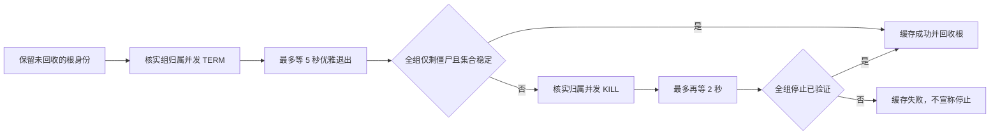

# T-915：macOS sidecar 进程组停止确认

范围：`codex/t915-shell-stop-proof`，基线 `79c2343c`。独立工作树 `/tmp/creatoros-t915-shell-stop-79c2343c`。此证据只覆盖受控 macOS 进程组停止，不代表 T-915、浏览器租约跨重启或分发包验收完成。

## 修复结果

旧逻辑发送组 SIGTERM 后，只要根 `try_wait()` 返回退出便成功，忽略仍执行的同组后代。另一个 SharedChild watcher 会提前 reap 根，随后拿历史 PID 发组信号还有复用风险。

新 helper 独占原始 Child，watcher 用 `waitid(WNOWAIT)` 观察，最后一次组信号前不回收根 PID。每次信号前读取根的 PID、PPID、PGID 验证当前父子及组归属；根退出后仍保留该身份。SIGTERM 保留 5 秒 flush 窗口，必要时 SIGKILL，之后最多再轮询 2 秒。轮询间隔 150 毫秒，系统调用/线程调度耗时不属于硬实时保证。

成功必须看到完整组成员集合中只有僵尸，并复读集合确认未在观察期间新增成员；停止态、睡眠态都仍算执行成员。根单独消失、权限/读取错误、截断或持续扩张的成员列表、SIGKILL 后成员仍执行都不能成功。成员列表最多扩到 65536 个 PID，避免无界分配/枚举重试。



停止结果缓存，后续 stop 不向历史 PID 再发信号。自然根退出的 watcher 也走同一清理流程；确认失败时同样先冻结最终结果、禁用后续信号，再回收已退出根，避免错误路径永久留僵尸。根还活着时 watcher 继续只观察，待实际退出再回收，不无限阻塞 stop。

## 当场红测与实现验证

2026-09-07 在临时 Rust harness 中，直接抽取基线 `lib.rs` macOS `kill_confirmed` 的生产方法体，使用原 SharedChild 句柄。新建 `/bin/sh` 的 `process_group(0)` 隔离组；根收到 TERM 退出，同组子进程先忽略 TERM，再 exec `/bin/sleep 60`。管道 ready 后才开始停止。没有应用数据、网络、模型调用或现存用户进程操作。

首次探针把 `proc_listpgrppids` 返回值误当字节数而无效；纠正为 PID 个数后才取得有效 RED，不把首次探针当验收。实际 RED 命令：

```text
cargo test --offline --manifest-path /tmp/t915-sidecar-rust-harness/Cargo.toml root_exit_does_not_prove_descendant_stopped -- --nocapture
FAILED: 根退出后同组后代仍在执行，不能确认停止
0 passed; 1 failed; finished in 0.16s
```

RED harness 仅对自身新建的测试组做兜底清理。最终测试在 stop 后独立枚举余下成员，而非要求已正常回收的根仍存在；生产 helper 本身也承担 Drop 清理。

实现后的同名回归及完整 helper 测试：

```text
cargo test --offline --manifest-path /tmp/t915-sidecar-rust-harness/Cargo.toml --lib -- --nocapture
10 passed; 0 failed; finished in 5.21s
```

聚焦覆盖：根先退出但后代忽略 TERM、自然退出 watcher 清组并回收、Drop 清理、错误组不发送信号且失败重复调用不变成功、并发 watcher/stop 共用结果、优雅退出窗口、强制停止超时、身份不符、读取失败和信号失败。测试 harness 直接通过 `#[path]` 编译本分支 helper，未复制修复实现。

默认应用检查：

```text
cargo check --offline --manifest-path frontend/src-tauri/Cargo.toml --lib
FAIL（检查环境缺资源）: resource path `binaries/creatoros-server-aarch64-apple-darwin` doesn't exist
```

仅在检查进程中通过 Tauri 配置覆盖关闭打包资源要求，未创建假 sidecar、未改配置文件、未运行应用或打包：

```text
TAURI_CONFIG='{"bundle":{"externalBin":[],"resources":[]}}' cargo check --offline --manifest-path frontend/src-tauri/Cargo.toml --lib
PASS；仅既有 decoy_gate.rs 未读取字段 warning。
```

完整应用 crate 中使用仓库 Cargo.lock（libc 0.2.186）的同组聚焦测试：

```text
TAURI_CONFIG='{"bundle":{"externalBin":[],"resources":[]}}' cargo test --offline --manifest-path frontend/src-tauri/Cargo.toml --lib sidecar_process::tests -- --nocapture
10 passed; 0 failed; 169 filtered out; finished in 5.18s
```

这是应用 crate 内真实 macOS 隔离子进程测试，不是完整桌面/浏览器旅程或打包验收。

```text
rustfmt --edition 2021 --check frontend/src-tauri/src/sidecar_process.rs frontend/src-tauri/src/sidecar_process_tests.rs
PASS

git diff --check
PASS

node orchestrator/process/boundary-scan.mjs
无新增违规；现存 5 条基线违规（R2 4 条、R3 1 条）。
```

## API 核实

查阅本机 macOS SDK 声明及 Apple 开源实现后确认：`proc_listpgrppids` 返回 PID 个数；`proc_pidinfo(PROC_PIDTBSDINFO, arg=1)` 才包含未回收僵尸。macOS `getpgid` 对僵尸会返回 ESRCH，不能在根退出后充当本逻辑的身份读取。相关实现：[libproc 包装器](https://github.com/apple-oss-distributions/xnu/blob/main/libsyscall/wrappers/libproc/libproc.c)、[进程枚举与僵尸查询](https://github.com/apple-oss-distributions/xnu/blob/main/bsd/kern/proc_info.c)。

## 限制与后续集成

- 仅覆盖留在受控进程组内的成员；主动 setsid/setpgid 逃离组的后代不在此证明内。不是完整浏览器子树或跨宿主重启协议。
- 身份锚定依赖该 helper 独占 Child 的回收权；未新增持久 host 代次记录。
- Windows/Linux 实现未变，也未进行双平台包验收、真实应用重启或浏览器租约释放旅程。
- 未安装、打包、推送、调用模型、访问用户媒体/数据库/档案。
- 本子任务不修改 BACKLOG 状态或复杂度 ledger；主线程集成时复评 `lib.rs` 的 ledger hash。全局 reconcile 已有 T-916 承接的 211 errors / 1 warning，本分支未把它们宣称清零。
