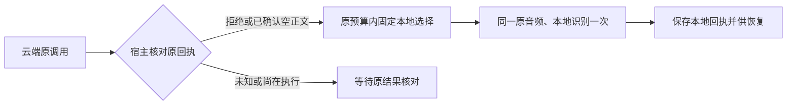

# T-915：持久本地回退与转写取流代码迁移

Worker 识别节点现在复用原来最多一次、固定 small 的本地回退策略。云端拒绝或已确认空正文后，先由宿主在原任务锁内验证事实，再登记独立本地选择。原云端身份、调用和回执保留，本地回退不能覆盖它们；后续恢复直接沿原本地选择执行。

首次回退要求：真实账号与原作品、同一原音频、连续云端已确认前缀，以及拒绝尾片或全部已确认空正文。任何在途、未知调用或未知 token 用量都不能开启回退；调用次数与截止时间沿用原预算。回退选择记录引用原调用 ID。已经固定本地后不能再次预留云端调用，旧云端结算仍按原云身份核对且不能改换已确认结果。本地失败不递归、不重置预算。

独立评审发现并修复重启窗口：云端已拒绝、Worker 尚未选择本地时退出，恢复不能先去续云凭据。准备服务现在在凭据前复用同一宿主判据恢复本地选择。缺片、未知或非空成功结果不会被 optional 恢复分支变成回退。评审对修复做了只读复核，未将其当作测试执行。

取流迁移独立提交 3da96f73：匿名分享页请求与超时、HTML/detail 解析、播放地址规范化、图集判断、解析失败后登录 detail 回退控制移入 ai-worker。主线新增包导出并验证原前端薄包装。登录浏览器会话、导航和 detail 请求的实际执行寿命暂留宿主，不能把本次代码迁移说成完整 Worker 取流已接通。

验证：后端四文件 51 项，Worker 四文件 59 项，前端既有四文件 161 项，共 271 项不同测试通过。三侧类型检查退出 0。包含云拒绝后本地成功、未知阻止回退、预算/截止时间、不递归、已确认空正文、回退选择 ACK 丢失、旧云事实保护和云拒绝后重建 Worker 且凭据失效的整链。主回退和评审发现的重启窗口都有当场红绿证据；纯迁移不补造行为红测。数据库、媒体目录、模型和浏览器均为隔离测试或替身，没有调用真实供应商或用户媒体。主线前端回归使用正式新增 package export，未依赖子任务的临时 alias。

尚未完成：正式 transcribe.douyin 任务入口、登录浏览器寿命、后处理与最终落稿仍待接通；正式聊天、其余 R-05、旧路径退役、性能基准和双平台验收仍属于 T-915 完整范围。提交钩子环境缺少 lefthook，未当作钩子通过。

后续取流迁移约束：既有 chromium-guard 的浏览器占用记录在进程内，不能直接跨宿主与 Worker 共用 authDir；已有 execution-browser-profile-lease.service 可作为统一占用的扩展点，仍需覆盖旧宿主登录/采集入口，不能另建互不知情的浏览器池。

工程对账：pmem sync 完成；reconcile 退出 1，211 errors / 1 warning，保留 T-916 历史工程欠债，不宣称全绿。
