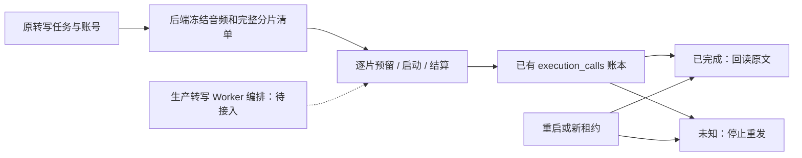

# T-915：ASR 持久账本、完整音频清单与命名端口

本批推进 R-03/R-05，复用 execution_calls 与执行租约，未新增队列。后端 dispatcher 已装配 ASR 命名端口，尚未把生产转写准备和完整 Worker 编排切过来；不能据此宣称用户端转写已具备全部恢复能力。

## 实现

- 0090 仅为 execution_calls 增加 accounting_basis，历史默认 tokens。ASR 专用服务使用 requests，真实 HTTP 请求继续消耗 maxCalls 和原 deadline；reservedTokens=0 表示不在 token 维度预留，不代表免费。实际 token 仍 null，聚合 spentTokens=null、unknownUsage=true。只有已经 settled 的 requests 调用不因缺 token 阻断下一片；unknown 及 token 计量未明仍阻断。
- 普通 Worker 请求不能指定计量维度；同操作键回放或重试不能偷换 accounting_basis。通用模型 start/settle 不能操作 ASR 回执，聊天子模型与父工具的 token/providerResult 要求未放宽。
- 三种云适配器描述包含完整音频与全部分片的摘要、长度和顺序。首片清单写入原 execution_tasks 私有 payload，与 reserve 同事务；重启后音频或任意分片不同必须停止，不能覆盖清单继续计费。MP3 可含未发送的 ID3 元数据，因此分片长度和允许小于原音频长度，禁止超过原音频。
- 专用端口绑定原 ai_task、execution、账号、aweme 列表与冻结 provider/model/endpoint/protocol/language。前缀已确认才准新建下一片；成功首片仍可回读，不被未知尾片阻断。
- 成功正文采用版本化 resultText，不伪造聊天 providerResult 或异步供应商 job。明确拒绝只在宿主指定原 retryOfCallId 后开启同键新尝试，次数继续累计。同步 ASR 没有供应商查询凭据，新租约不能把旧未知请求补成成功或拒绝；已确认正文仅可幂等回读。
- Supervisor 将 settleAsrRequest 识别为结算，允许当前租约的在途结果收尾；reserve/start 继续执行准入检查。生产模型 dispatcher 已路由三个命名端口，但任务准备、Worker 运行分支及原文之后的业务提交尚待连接。

## 验证与真实失败

- ASR 数据库文件最终 13 项通过：两片无 token、成功前缀回放、unknown、完整清单变化、越权/旧租约、预算、ACK 丢失、取消、宿主重试、跨 attempt 结算保护。
- 独占临时磁盘 PGlite 实际关闭再打开，使用真实 Qwen 分片适配器与假 HTTP 供应商回读两片，仅首次两次 HTTP；重复运行 0090 迁移成功。另有真实子进程经过 Supervisor 调用命名端口并结算。没有访问真实媒体目录或付费供应商。
- 邻接账本、通用模型端口、聊天恢复、真实 Worker 进程共 50 项通过；Worker 侧四文件 29 项通过。backend/ai-worker/frontend 最终类型检查均退出 0。
- 新账本模块最初缺失，因此首次是模块加载失败，不算行为红测。计量兼容、通用端口旁路、跨租约补交分别有当场失败断言，修复后通过。
- 一次合跑有两项旧 Supervisor 测试失败：严格能力清单缺少已经实现的 chat.script-draft，已按当前生产注册修正并通过。新 IPC 测试还曾漏算 run 本身的一次 admission，实际结算模式正确；修正测试后通过，失败日志保留。
- 初次类型检查发现旧聊天恢复 fixture 缺少新增默认字段，已补 tokens。初次工作租约 claim 因上一批证据文档的 IPC 复杂度未登记失败，随后新 IPC 测试与 Supervisor 哈希也被拦；补充精确文件账本后才成功 claim，不将初次调用描述为通过。
- 独立方案与代码复核指出计量维度偷换、通用端口绕过和跨 attempt 结算边界，均保留限制与测试。

## 未完成

生产转写任务准备与 authority 绑定、原音频持久保存、Worker 的取流/抽音/ASR/后处理编排、最终落稿与任务状态提交、Whisper/ffmpeg 终止仍待完成。未知请求不会在本批被自动证明成功。正式 /api/chat、其余 R-05、旧出口退役、性能与双平台验收仍保留全部范围；T-915 不标完成。

工程对账：pmem sync 已执行；reconcile 退出 1，仍为 211 errors / 1 warning。与上一批相比，T-893/T-900 的两条历史 frontend receipt 诊断从“工作区代码漂移”变为“receipt commit 后代码已变化”；错误任务未新增或消失，不能宣称诊断文本完全一致。既有欠债继续保留 T-916。

生产接线定位：persistence-client 的 dispatch 分流应在 runTaskWithEffectiveSkillSnapshot 前发生，参考 asset-business-execution.prepare/recoverQueued/stop；原有旧租约、已开始调用和旧步骤不能直接转新账本。默认 Whisper、prepareManagedTranscribeSpec 按音频申请凭据、douyin-cdp 取流与抽音、transcript-postprocess 隐藏模型调用、transcript-artifact 的事实落稿及随机 attempt 的 onTranscriptReady 重建提交，均是剩余真实入口，不能只接云 ASR 后宣布迁移完成。
