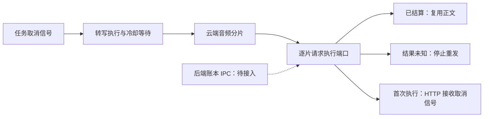

# T-915：转写逐请求执行与取消传递

本批推进 R-03/R-05：三个云转写适配器提供逐请求执行端口，生产旧转写 runner 接入任务取消信号。持久执行器尚未接 backend 账本 IPC，不能据此宣称生产 ASR 已完成持久恢复或迁入独立 Worker。

## 本批代码

- OpenAI 兼容、Qwen、MiMo 每个真实 HTTP 请求都经过 executeRequest；Qwen/MiMo 每片分别标识，音频与端点仅进入 SHA-256 指纹，不记录密钥或音频正文。适配器入口复制配置与音频，包含 Buffer 视图，防止等待回执期间请求内容被调用方修改。
- durable-asr-request 提供 reserve/start/settle 协议：成功正文可直接复用；预留、启动或结算响应丢失保留中断；网络错误、408 和 5xx 不能证明未受理，保持 unknown，不直接回退重发。宿主仍须实现指纹、预算、归属与租约校验。
- 取消与 unknown 穿过渠道错误包装和本地回退，不再被当成普通云错误触发 Whisper。取消自定义原因统一为不含原始诊断的 AbortError。
- 生产 dispatchCreatedTask 接收已有租约 signal 并传入 runTranscribe 和云 HTTP；冷却等待可取消；已有稿件探测之后，无论 true/false 都重新检查取消，取消后不启动恢复写入或取流。
- 取消不会回滚已完成写入；尚未改造 ffmpeg、浏览器取流或 Whisper 的在途终止。本批只阻止取消后的后续阶段，并使云 HTTP 可中止。

## 验证

- Worker 5 个文件 34 项通过：三个适配器、逐请求执行、分片前缀回放、启动/结算响应丢失、结果未知、HTTP 分类与可变输入。
- backend runner 27 项通过；frontend 本地回退 15 项通过。合计 76 项，均使用注入依赖或测试 fixture，无真实供应商请求或媒体目录操作。
- ai-worker、backend、frontend 类型检查均退出 0。write-set preflight 通过；只刷新实际修改文件已有的复杂度哈希。
- 真实失败日志保留：初始执行端口与取消缺失、408/5xx 被错判拒绝、探测 true/false 分支取消竞态、直接适配器 Buffer 修改。修正后相关文件全绿，不补造历史证据。
- 独立只读复核指出上述 HTTP 分类、可变输入及探测分支问题，均已用失败断言复现后修复。

## 仍需完成

backend ASR 账本端口和生产绑定、原始转写正文先结算再后处理、抓取/ffmpeg/Whisper 生命周期、长执行 Worker 迁移及 unknown 状态投影仍待完成。正式 /api/chat 全量切换、其余 R-05 入口、旧路径退役、性能及双平台验收保留原范围。T-915 不标完成。

工程对账：pmem sync 已执行；全局 reconcile 退出 1，211 errors / 1 warning，与上一批 transcription-submission-reconcile.log 的 212 条 ERROR/WARN 诊断集合完全一致，未新增或消失。既有欠债继续保留 T-916，不宣称全绿。
