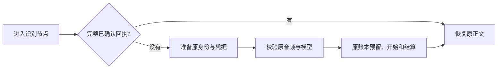

# T-915：识别完整回执优先恢复与 Worker 识别节点

转写准备服务现在先读取原任务全部已确认识别回执，再决定是否读取音频、解析配置和续期凭据。完整云端正文在当前凭据失效、音频对象暂时不可读时仍可恢复；这不允许伪造音频收据或改变原输入。部分或未知回执不会被当成完整正文。

完整读取按原清单和每个操作的最后调用核对顺序、归属、实际身份、请求摘要和 requests 计量。每片都必须已结算，缺片或未知返回未完成；摘要损坏和旧租约拒绝读取。一次读取全部调用并建立索引，不按片重复查数据库。Qwen 与 MiMo 的确定性拼接移为适配器和回放共用函数，保持原换行和语言行为；OpenAI 与本地协议保持单回执原结果。

新增 Worker 识别节点经真实命名端口读取准备结果、校验字节摘要与实际模型，再使用现有持久识别执行器。恢复分支不需要注册模型适配器，不读取音频、不续凭据。开始/结算回执必须匹配原调用和状态；取消后不返回迟到正文。准备、音频私有响应和身份校验失败统一为执行结果待核对，不能被当作普通模型失败转本地。

验证：后端 4 文件 42 项，Worker 5 文件 33 项，共 75 项不同测试通过。包含 Worker 节点 → 后端命名端口 → 隔离音频存储 → 实际 Qwen 适配器 → 数据库回执，恢复仅调用准备端口一次且不再 HTTP。模型响应为替身，未访问用户媒体或收费供应商。完整回读两项和独立评审发现的私有响应错误分类两项都有当场红绿证据。

独立只读评审发现私有调用 ACK 丢失/坏响应会漏成普通错误，主线已修复并由同一评审复核覆盖；未把评审当测试执行。当前未启用完整 transcribe.douyin Worker 任务能力：新节点只是完整编排所需的识别部分，正式取流、云端明确失败后的宿主授权本地回退、后处理与落稿仍待接通。正式聊天、其余 R-05、性能基准及双平台验收继续属于 T-915。

backend、ai-worker、frontend 类型检查均退出 0。

工程对账：pmem sync 完成；reconcile 退出 1，211 errors / 1 warning，继续保留 T-916 历史工程欠债，不宣称全绿。
