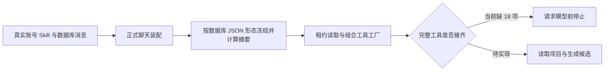

# T-915：完整聊天装配暴露的接线缺口与序列化修复

这一批把真实账号配置、正式聊天上下文装配、持久提交、组合工具工厂和 Worker 连在同一测试中。完整链路仍未通过，不能切换公开聊天入口。

实际发现了两层问题：

1. 可选字段显式为 undefined 时，schema 验证后的对象仍包含这些键；摘要计算保留了它们，而数据库 JSON 省略了它们，导致合法任务回读时被拒绝为映射无效。宿主上下文同样受影响。新增两个真实数据库红测分别复现“聊天执行映射无效”和“宿主上下文摘要不符”。修复在严格验证后、摘要计算和持久化前统一 JSON 形态，不改共享摘要算法，不重算历史记录。
2. 修复后正式工具工厂被实际调用，完整清单检查列出下面 18 项未接工具。任务仍为 failed / CHAT_WORKER_INPUT_UNAVAILABLE，模型 HTTP 请求数为 0。Skill overlay 的 tools 在当前聊天架构中是优先顺序，场景工具仍追加挂载；测试保留这一真实行为，没有裁掉清单。

新 createChatTaskToolHost 组合既有 19 项短读取工厂与开场工具工厂。它不添加新执行权限，调度器继续核对整个冻结清单。两次独立只读评审未发现组合层与序列化修复新增阻断，评审者未独立运行测试。

剩余工具按真实调用链审计如下，这只是当前接线事实，不缩减 SPEC 范围：

| 工具 | 需要兑现的执行职责 |
| --- | --- |
| learning.capture、brief.fill | 真实参数候选回显；brief 读取冻结项目的当前数据，采纳前不写业务实体 |
| local.workspace、local.tools、local.read | 授权目录、受控工具探测、有界文件读取；一次授权消费不能当普通只读重试 |
| script.draft、planning.thesis、publish.package、cover.generate、material.generate | 短宿主提交既有后台任务；必须以父工具调用绑定稳定 taskId，不能每次新建尝试键 |
| topic.generate、topic.enrich、positioning.generate、calibration.diagnose、knowledge.distill | 真实 Worker 模型路径；保留子 Skill、上下文、结构化处理，分块或多次调用分别记账 |
| material.gather、material.screenshot、web.read | Worker 搜索或浏览器执行；宿主保存素材的操作仍须稳定键、真实回执与登录/取消语义 |

本轮完整测试使用临时数据库、同一用户的两个账号、真实设置仓储与 Skill resolver、实际项目 service、prepareDurableChatTurn、提交 service、动态工厂和实际调度器。选择标签是测试输入，未验证真实候选选择归属；模型为本地 HTTP fixture。当前在模型调用前失败，成功后的项目证据、子模型与最终候选断言尚未运行。这不是公开 /api/chat 请求、商业模型或安装包验收。

完整前端集成测试应当保留成功断言，当前失败属于 T-915 自身未完成工作，不能归入 T-916 历史欠债，也不能改成预期失败来宣称迁移完成。

最终专项验证：后端提交与真实 hooks Worker 两文件 36 项通过；前端原两条集成通过、新完整链路 1 项失败。contract、ai-worker、backend 和前端类型检查通过；边界仍为既有 5 条，无新增；orphan 0 errors / 100 warnings。源码 diff 检查通过。

pmem sync 已完成；最终全局 reconcile 仍为 211 errors / 1 warning，与此前 T-916 登记的全局欠债相同。该全局结果不覆盖或豁免上文 T-915 自身的完整链路红测。T-915 继续进行，未做完成声明。
