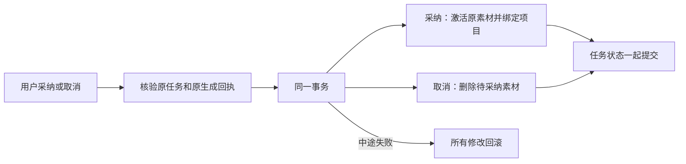

# T-915：生成素材的采纳与取消事务

日期：2026-09-06。基线：48a04247。沿用已批准 SPEC 和 DEC-RUNTIME-055。

新执行链的素材候选现在通过公开 confirmTask/cancelTask 进入同一个事务边界。采纳时一起完成素材激活、项目用料链接和业务任务成功；拒绝时一起完成 pending 素材软删除与任务取消。中途失败全部回滚，已经成功的请求可重复回读，不重建用户后来删除的素材或链接。

## 实现事实

- 仅已映射的 asset.generate 分流到专用服务；旧未映射素材及 cover.generate 继续现有路径，没有将未迁移旧产物伪装成新回执。
- 先锁 execution，再锁 AI task，随后锁素材和文件；采纳、取消和迟到候选提交保持锁顺序一致。
- 首次动作核对 execution 双向归属与成功状态、唯一候选、executionCallId、settled 调用及 resultRef、冻结输入、素材持久提交回执。采纳再校验当前文件、类型、长度、校验和与归属。
- 项目链接复用已有 production/broll、addedByType=ai 的服务行为；无项目只激活素材。正式组合根共用 linkAdoptedMaterial，内部项目、素材与链接服务全部绑定传入事务。
- 成功采纳及成功取消重放只回读终态，不再次写领域实体。取消时不删除已激活素材；原素材已被删除时不恢复它。
- 仅用户显式动作调用这些端口，Worker 仍只创建待采纳候选。

## 当场验证

- 公共 confirmTask 红测：旧路径链接写后失败，素材实际仍为 active，1 个测试失败。修复后同一故障下素材 pending、零链接、任务 awaiting_confirmation。
- 三个文件最终 **111 项通过**：包含素材生成和恢复、公开采纳/取消、原 AI 服务及原结构化目标采纳回归。新增覆盖并发确认、成功后重复确认、删除后重放、无项目、跨账号/项目/文件/校验和/回执/候选变化、已取消、采纳与取消同时请求、取消状态写入失败回滚。
- 使用真实 PGlite 数据库、本地对象存储和真实领域服务。并发请求覆盖服务层竞争结果，不声称完成独立 PostgreSQL 多连接死锁压力测试。生成输入沿用明确测试 fixture；不声称正式 UI 生成入口或商业模型已验收。
- 提取素材回执读取后，类型检查捕获跨函数 accountId 收窄丢失，已修复；失败日志保留。修复后前后端类型检查均通过，见 *-typecheck-fixed.log。独立只读复核确认最终采纳/取消事务和锁序未发现具体阻断；全局检查维持既有 **211 errors / 1 warning**，见 asset-adoption-reconcile.log，未宣称全绿。

## 未完成范围

素材生成公共入口仍需迁移输入准备、配置摘要、凭据装配、旧任务恢复和旧 runner 退役。此批只接通已映射素材的真实采纳/取消入口，不能代表所有素材请求已使用新 Worker。完整 T-915 的所有入口、性能与商业供应商、双平台验收仍未完成。
