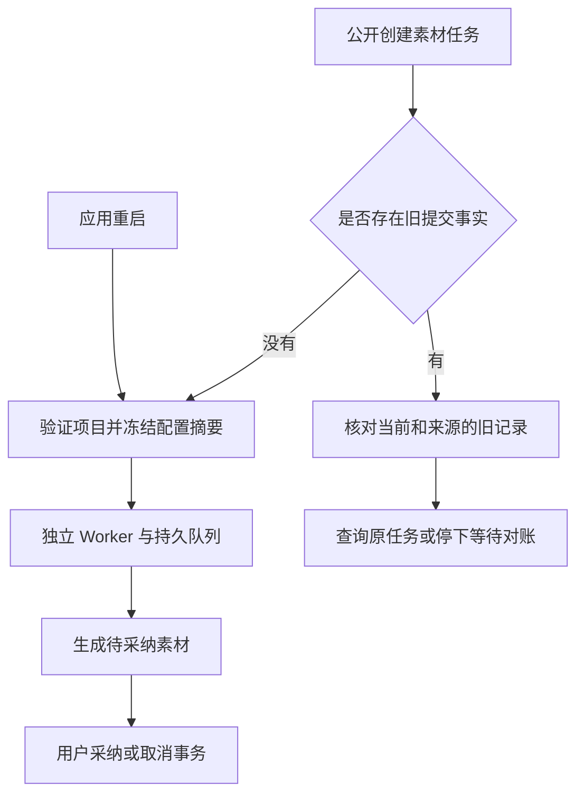

# T-915：实际素材入口转交独立执行

日期：2026-09-06。基线：b8ce4b30。沿用已批准 SPEC 与 DEC-RUNTIME-055；仅修改仓库源码，未安装、发布或部署。

新建且没有任何旧提交事实的素材请求，现在由后端冻结输入与模型配置，再交给现有独立 Worker。已有供应商任务号的旧任务只续查原任务；损坏或无法解释的旧提交事实不会被当成未提交而再次计费。

## 接线与边界

- production 的素材创建分派接 dispatchAssetTask；新任务通过 assetBusiness.prepare 绑定原 ai_task，注入 assetStorage 和 resolveAssetCredential 后运行 Worker。原 dispatchCreatedTask 中的大段素材装配被集中到兼容函数。
- 准备阶段保留原 prompt、默认 image、视频默认 6 秒及 768P、用户比例等规格；保存供应商身份与非凭据选项的 SHA-256 摘要，不保存 token 或完整运行选项。已有映射重放不重读新模型配置，不覆盖旧输入或预算。
- 每次凭据解析沿原 modelAuthority 校验与 scope；Worker 命名端口再次核对冻结身份与选项摘要。per_request 空凭据不会被伪造或换用其他模型，仍由凭据端口拒绝执行。
- 转交前在同事务重读原任务、指纹、输入、项目、旧 checkpoint/结果，以及 authority 既有状态/lease/modelCallStartedAt 守卫，防止旧 runner 与新 Worker 同时取得执行权。
- 素材任务从原 requestedAt 计算 30 分钟总期限，覆盖既有视频最长约 20 分钟轮询及下载窗口；不沿用文本的 10 分钟总期限截断原视频能力。次数和 token 仍复用既有 Worker 上限，不因重启重置。
- 启动扫描接走 queued、未映射素材任务；原子聊天 hostTaskSubmission 尚未开放素材准备，因此仍排除，不伪装为已完成全场景迁移。
- 新准备支持停止：中止项目/配置等待，绑定后再次检查信号并可回滚；恢复和生产分派在调用兼容入口前再次检查停止。已经启动的旧 runner 生命周期仍未迁移，不宣称其停止机制已完成新链路验收。

## 旧事实保护

任何 retryOfTaskId、任意形态的 multimodalProviderCheckpoint、已有候选结果均不进入新账本。兼容 runner 同时读取当前和来源记录：损坏/输入不匹配拒绝，多任务号拒绝；唯一已知视频任务号只续查；没有任务号的已提交、未知提交、已生成图片等不重新提交。来源 submitted/unknown 不能被当前 rejected 覆盖。已有 generated_asset 结果要求先核对原产物。

## 当场证据

- 新业务模块最初缺失，日志保留为模块缺失红测，不冒充业务断言失败。
- 损坏旧提交记录导致重复生成的真实断言红测 1 失败；“当前 rejected 遮盖来源 submitted/unknown”的红测 2 失败。修复后零新提交。
- 四个文件 **82 项通过**，包含新业务准备、旧 runner 回归、真实 Worker/HTTP 适配器/持久队列、原素材保存与公开采纳取消事务。新恢复停止测试证明配置挂起可结束等待，迟到结果不绑定任务。
- 新整链测试调用公开 ai.createTask，不手工植入 execution payload；业务准备后实际 fork Worker，HTTP fixture 首次 429、随后成功，公开 ai.getTask/listResults 回读并 confirmTask 采纳。实际两次请求、一个素材、一个候选；重复采纳成功，数据库无 token。
- 此测试使用本地 HTTP fixture 和真实 PGlite/本地对象存储，复用生产所用服务工厂；没有启动完整 buildPersistence/UI，也没有调用商业供应商。源码装配经 TypeScript 与 CodeGraph/rg 核对，不将其当真机体验验收。
- 类型检查初次捕获测试字面量和同步候选接口的错误，修复日志保留。修复后前后端类型检查均通过；独立复核确认两处阻断已解决，未发现新增具体阻断。全局检查维持既有 **211 errors / 1 warning**，见 asset-entry-reconcile.log，未宣称全绿。

完整 T-915 尚包括旧 runner 完全退役、旧任务全面迁移、结果未知自动对账、全部 R-05 入口、性能对照及商业供应商和双平台包验收。
