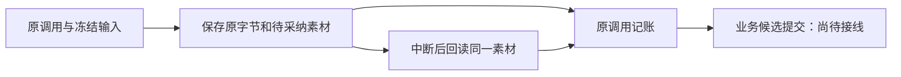

# T-915：生成素材与原调用结算贯通

日期：2026-09-06。基线提交：3e84b679。当前实现继续服从原 SPEC 和 DEC-RUNTIME-055，未启用正式入口切换。

用户可理解的变化：图片或视频已经保存后，即使调用账本补记失败，重新接管也能找回同一份素材，只补原回执。取消后不会借恢复创建新素材；没有供应商用量时仍显示未知，不能按零费用释放预算。

## 实现边界

- 新增后端专用 reserve/start/save/recover 服务，复用同一个 execution 账本、预算、租约及素材提交服务。操作键由真实 callId 派生，名称和描述从旧 runner 原样提取共用，MIME 保留旧入口 image/png、video/mp4 口径。
- 共享素材执行绑定校验：真实 ai_tasks 双向映射、账号、原业务 kind/prompt、完整冻结输入摘要、原根调用及供应商身份。开始、素材事务写入、结算分别重查当前凭证。
- 新 attempt 上传必须持原供应商任务号；无任务号只能恢复本地已保存原字节。missing / bytes_missing 不授权重新提交模型。
- 仅创建 pending 素材，尚不提交 AI 候选、不切换用户 active 素材、不伪造执行完成。取消后的历史补账不改终态。
- resultText 保存稳定素材回执；resultRef 仍留给后续候选事务。未知用量不记零，原预算保留。此服务尚未注册 Worker IPC，也未接通生产素材 dispatcher。

## 当场验证

- 首次红测：新增测试找不到尚未实现的模块，0 项执行；这是接口缺失证据，不冒充业务断言红测。见 asset-execution-result-red.log。
- 首轮三个测试文件 56 项通过。增加取消组合测试时，测试触发器函数重名导致 1 失败 / 93 通过；改为可重复创建后重跑，并保留原失败日志，非产品回归。
- 最终五文件 **94 项通过**，包括本批 13 项、供应商任务号、预算账本、真实本地素材存储和旧 runner 回归。覆盖提交成功后结算失败再取消、重装服务补账、旧 fence、新 attempt 原号续查、原图对象恢复、缺字节、unknown、异字节拒绝。
- backend 与 frontend 类型检查通过。
- 独立只读评审未发现本批具体阻断；建议的“保存后结算前取消”组合测试已补齐并通过。评审没有验证生产 Worker 或候选提交。
- 全局 reconcile 仍为既有基线 **211 errors / 1 warning**，未新增边界违规；详见 asset-execution-result-reconcile.log，未以局部测试替代全项目验收。

## 未完成范围

后续仍需接通素材 Worker 命名端口和候选事务、全部 R-05 正式入口迁移与旧路径退役、同条件性能样本、真实商业供应商及双平台包验收。当前证据不足以宣称 T-915 全部完成，也不足以宣称所有 AI 卡慢问题已经根治。
