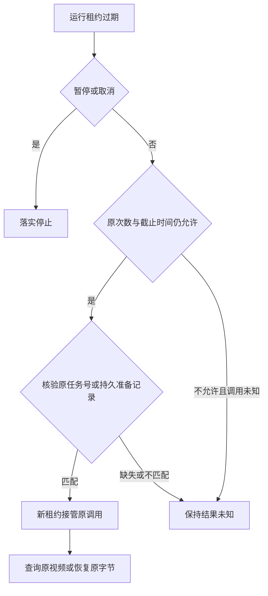

# T-915：素材租约过期后的原任务接管

日期：2026-09-06。基线：73cc86eb。沿用已批准 SPEC 与 DEC-RUNTIME-055。

Worker 中断后，已有原视频任务号或素材持久准备记录的任务可以重新被领取。接手者只查询原任务、恢复原字节，不重新提交付费生成。准备记录并不证明字节已保存；字节缺失时仍返回真实的缺失状态。

## 改动与边界

- 恢复仍使用原任务行锁。素材绑定复用双向业务归属、冻结输入摘要、原调用和供应商身份校验。
- 素材模块新增只读服务出口，按用户、账号和后端原调用键查询持久准备事实；执行模块不访问素材 repository，也不在调度事务里读写对象。
- 只将核验通过的 started/unknown 调用列为可对账；不改调用状态、startedAttempt、费用、预留额度、截止时间或最大尝试次数。新领取仍增加原 attempt。
- 没有证据、错误供应商身份、次数耗尽或截止后，未知调用保持 unknown_result。暂停和取消保留原优先级。
- unknown_result 终态未加入扫描范围，避免准备记录但没有字节时反复唤醒。本批仅接通过期 running 的恢复；运行中直接报未知后的自动对账尚未完成。

## 当场验证

- 首轮新增测试 6 失败 / 24 通过：其中 2 个失败真实复现“原 job/原字节存在但未重新排队”；另 4 个是测试误把公共 blocked 投影当内部 unknown_result，改为读取真实数据库状态，未据此修改产品行为。
- 修复后素材结果和持久任务测试通过；扩展原 unknown 调用再次中断、次数耗尽、准备后字节缺失等回归后，三个文件共 47 项通过，包含真实子进程素材测试。供应商仍为本地 HTTP fixture，不是商业上游。
- 后端类型检查通过；原始日志见同目录 asset-expired-recovery-*.log。
- 独立评审发现通用 settled 快路径仍会绕过素材最大尝试次数。真实 save 成功但未提交候选的红测 1 失败；增加素材专属上限后，三个回归文件最终 **48 项通过**。原素材和已结算账本保留，不再领取超额 attempt。独立复核未发现新增阻断。
- 首次全局检查维持既有 **211 errors / 1 warning**，未宣称全绿。该次扫描运行期间补入了评审修复，因此另留最终重跑日志 asset-expired-recovery-reconcile-final.log；最终仍为 **211 errors / 1 warning**。

旧公共素材提交入口和生产输入准备仍需迁移。完整 T-915 未完成，不以这一处恢复修复代表全部可靠性和性能验收。
