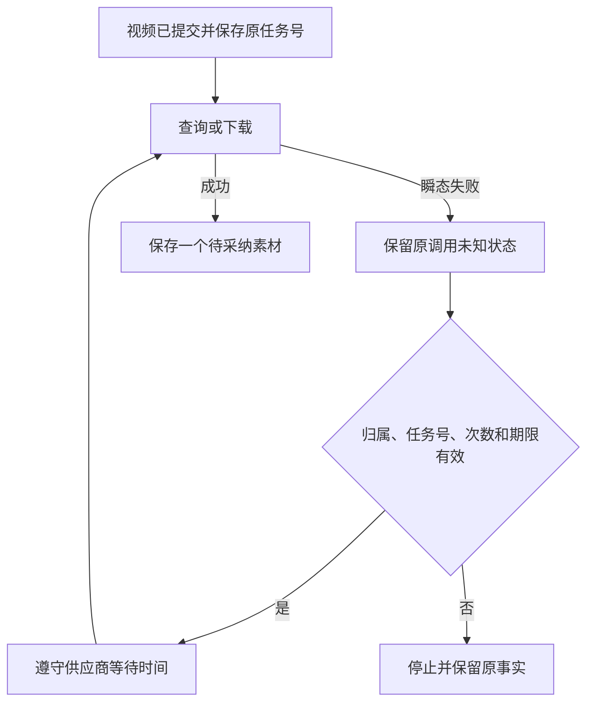

# T-915：视频查询失败后自动续查原任务

日期：2026-09-06；基线：9cc6e9e5。沿用已批准 SPEC 与 DEC-RUNTIME-055。

视频已经提交且原任务号已保存时，查询或下载遇到可识别的瞬态故障，现在会在原预算内等待后续查原任务。不会因为查询失败重新提交一份付费视频生成。

## 实现边界

- Worker 只对已知 job 的 poll/download 瞬态错误发出 ASSET_RECONCILE_RETRYABLE；原账本依然是 unknown。没有任务号、提交结果不明、认证/余额/参数错误、主动取消不会自动重试付费提交。
- 后端在同租约事务重验原业务绑定、实际开始记录和供应商任务身份，要求其他调用均已明确拒绝，检查原 maxAttempts 与 deadline，并采用供应商 Retry-After 和退避时间中的较大值。保留原 retryOfCallId，覆盖之前经历过 429 的任务。
- MiniMax V1 原先将 HTTP/网络异常退化为普通 Error，导致无法识别查询阶段；本次保留阶段、状态和 Retry-After。H3 提交/查询/下载也传递等待时间，下载连接及正文中断保留可恢复阶段。
- 凭据失效后的用户恢复、历史终态 unknown_result 的全面对账仍未完成。本次没有增加扫描所有未知终态的机制；不宣称所有供应商、所有故障均已恢复。

## 当场验证

- 最初真实 Worker 测试从查询 503 得到 blocked，保留 asset-unknown-recovery-red.log。首次修复仍失败（asset-unknown-recovery-green.log 名称含 green，但内容是失败）；进一步定位并修正 V1 阶段丢失，不把文件名当作通过证据。
- 最终后端 3 文件 **69 项通过**：真实 fork Worker、真实 PGlite 与本地对象存储，HTTP fixture 查询首次 503、下一次成功，实际等待至少 Retry-After 的 1 秒。无先前拒绝时仅一次 POST；先前一次 429 时总共两次 POST，查询失败不增加 POST。最终只有一个素材和一个候选。
- 后端负例覆盖缺任务号、身份错误、次数耗尽、期限不足、取消、暂停和未分类错误；均不自动恢复。
- Worker 与适配器最终 **47 项通过**。其中 H3 等待时间丢失与正文中断新增 3 项断言先失败后通过；401/402/403/404 不自动续查，429/503 保留完整等待时间。
- ai-worker 与 backend 类型检查通过；H3 测试曾因不完整 Response 类型失败，改用真实 Response/失败流后通过，原失败日志保留。独立审查分别复核初始修复和最终 H3 增量，未发现具体阻断，审查者未重复跑测试。
- 测试未调用商业供应商、未启动完整桌面 UI、未打包安装或发布。全局 reconcile 仍为既有 **211 errors / 1 warning**，见 asset-unknown-reconcile.log；不能用局部测试替代 T-915 全范围验收。
