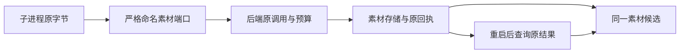

# T-915：真实子进程素材端口与二进制传输

日期：2026-09-06。基线：7240cc1e。沿用原 SPEC 与 DEC-RUNTIME-055。

此前后端已能保存素材，但默认 JSON 进程通信不能保留 Uint8Array。现有 Worker 监督器现在保留原二进制字节，后端可以接收保存请求并生成待采纳候选；回执丢失后新的子进程可找回同一份素材。

## 实现

- 现有 fork 使用 Node advanced serialization，保留同一进程、同一版本信封和逐端口 schema；不新增进程拓扑。
- 注册 reserveAssetCall、startAssetCall、saveAssetResult、recoverAssetResult、readAssetProviderJob、recordAssetProviderJob 六个严格端口。save 仅接受 callId 和 Uint8Array；不接受身份、存储路径、名称、MIME 或预算。
- 后端预留按冻结输入的 UTF-8 字节与协议余量计算，沿用原累计预算和未知用量规则。执行引用在第一次等待前复制。
- 保存、原结果恢复及供应商回执允许进入 settlement 校验；真正新增素材仍由内部事务执行 admission，取消不是新写授权。reserve/start/read job 必须 admission。
- 调度器可注入原对象存储后启用该端口组，并跟踪在途请求与取消信号。未注入时明确不可用。

## 当场验证

- 原 JSON 通信的真实子进程测试 **1 项失败**，不能保持 Uint8Array 类型；修复后通过。
- 真实子进程向后端传输 **11 MiB + 3 字节**，逐字节验证 0..255 循环数据、实际落盘、原供应商任务号、未知计量、唯一素材和唯一候选。模拟保存已完成但回复丢失后，重新 fork 只执行恢复；save 请求总计一次。
- 素材端口 5 项、普通模型/调度/取消及账本回归合计 34 项、真实结构化生成 5 项、真实聊天入口 24 项，共 **63 项通过**。素材测试包含在 34 项内，未重复计数。
- 回归曾发现两项旧能力列表断言缺少现有 chat.web-read；已核对基线 worker-entry 原本就启用该能力后更新精确断言，保留失败日志，不降低断言。
- 四包类型检查通过：contract、ai-worker、backend、frontend。
- 独立评审提出 advanced 可能保留 undefined 的兼容疑问；沿生产调用链确认 structured-worker-generation 已显式 JSON 规范化，真实结构化和聊天回归通过，评审撤回该阻断。没有对二进制信封整体 JSON stringify。
- 全局检查维持既有 **211 errors / 1 warning**，见 asset-ports-reconcile.log；本批不能替代完整 T-915 验收。

## 事实限制与继续接线

本批素材执行使用显式测试子进程，不冒充真实模型生成或商业供应商验收；11 MiB 测试也不证明 2 GiB 实传。沿用原存储字节上限，尚未做大文件内存峰值验收。

生产 Worker 的素材生成函数、冻结输入准备、凭据解析、恢复调度和全部正式入口尚待接通；没有新增 asset.generate 能力声明或默认切换。后续必须继续完成正式入口迁移、旧路径退役、性能样本及双平台包验收。
