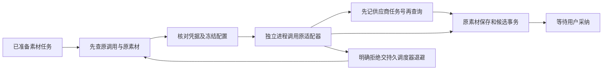

# T-915：实际素材 Worker 与持久重试

日期：2026-09-06。基线：0179aa39。沿用已批准 SPEC 与 DEC-RUNTIME-055；尚未切换旧业务提交入口。

现在真实独立 Worker 可以运行现有图片和视频适配器，经后端账本、存储和候选服务完成一次素材任务。遇到保存回执丢失会当场找回原素材；明确 429 拒绝由原持久调度器等待后重试。普通 5xx、408 和提交状态不明不获得重新付费资格。

## 实现事实

- Worker 输入支持 asset.generate，真实入口装配 runAssetInWorker 并声明对应能力。继续使用已有 minimax、openai、omnihi/seedance/seeddance 适配器，不增加规划调用。
- 每任务 fetch、轮询等待绑定取消信号。适配器可配置的瞬态重试设为一次，提交重试集中到原执行账本和调度器，保留实际供应商任务号。
- 私有 resolveAssetCredential 由后端当前租约及双向业务映射验证；provider/model/baseUrl/serviceId/kind 必须匹配原输入。settings/apiFormat/displayModelKey/credentialLifecycle 按 canonicalJson 做 SHA-256 摘要，与冻结 runtimeOptionsDigest 匹配；缺省只接受空 options。token 只经私有端口返回，不持久化。
- 凭据缺失或漂移发生在 start 前时保留同一 reserved，不假装发生过提交。旧 started/unknown 先回读素材；没有本地原产物又没有原 job 时保持 unknown，禁止重提。
- job 回调完成前不进入 poll；回调回复丢失保持未知，下一次只能读原 job。已有 job 后的失败不能改写为 rejected。
- save 回复丢失当场 recover；只恢复原调用的素材，不能重新生成。取消后不提交新候选。
- 仅 submit 4xx 且排除 408 可确认拒绝；普通 5xx 保持未知。明确拒绝后按 task.retryOfCallId、原 operationKey 和累计预算创建重试调用。model 队列可领取已准备 asset 输入。
- 通用 startCall/settleCall 不再接受素材任务，必须经专用绑定端口。

## 当场证据

- 新模块首次缺失红测据实保留，不冒充业务断言红测。
- 保存 ACK 丢失当场恢复：真实 fork 红测 1 失败 / 1 通过，修复后通过。
- 独立评审发现原实现把 submit 5xx 当拒绝，真实 HTTP 502 红测 1 失败 / 2 通过；修复后原进程及重新 fork 均不二次 POST。
- 队列尚未领取 asset 时真实调度测试失败；接通后 429 自动等待重试并成功，实际 HTTP 两次、一个素材、一个候选。
- 51 项核心回归通过，含原素材候选、普通模型调用与调度、Worker 停止及能力声明；随后素材真实进程扩展到 7 项，全部通过。另有 Worker helper 6 项通过。
- 7 项真实素材进程测试包含图片成功、保存回执丢失当场恢复、普通 502 不重提、凭据模型漂移零请求、真实 MiniMax 视频提交/查询/下载、持久原 job 的视频查询/下载零 POST，以及真实调度器 429 重试。供应商为本地 HTTP fixture；数据库和对象存储真实。原 job 续查场景使用明确种入的既有提交事实，未冒充商业模型历史。
- 四包类型检查通过。backend 曾因新增测试输入未保留字面量类型失败，修复 as const 后通过，失败与修复日志均保留。
- 独立评审已确认 5xx、重试来源、保存回读和专用端口问题收口。全局检查维持既有 **211 errors / 1 warning**，见 asset-runtime-reconcile.log；未用局部成功替代整体验收。

## 尚未完成

旧业务素材提交入口仍走原 runner；本批证明新 Worker 和调度器可执行已准备任务，不代表现有所有公共入口已迁移。下一步接通业务输入准备、原配置摘要生成及凭据生产装配、租约过期/未知状态的自动对账恢复，再迁移并退役旧路径。

完整 T-915 仍包括全部 R-05 入口、性能基线及商业供应商与双平台包验收。这里只验证本地 HTTP 供应商，没有付费请求或安装/部署，不宣称系统所有卡慢问题已根治。
