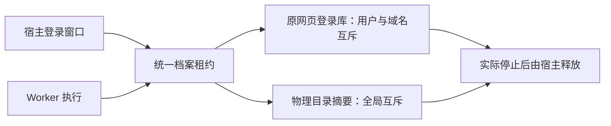

# T-915：统一浏览器档案租约的宿主持有者

同一张 execution_browser_profile_leases 表新增真实宿主持有者，无需把登录窗口伪装成执行任务。原 Worker 三字段所有权与宿主实例/操作两字段所有权由数据库 CHECK 保证互斥。所有领取复用同一事务实现，释放只允许原 leaseId 与完整持有者匹配，时间流逝不会自动抢占。

独立实施前复核指出，若物理摘要还与 user/domain 组成联合唯一键，同一目录仍可被另一用户或域名重复领取。实现采纳两个部分唯一索引：profileKey 为空继续原 user+domain；非空仅按 profileKey 全局互斥。user/domain 保留授权范围，不能削弱物理资源互斥。物理摘要端口只供受信宿主适配器使用，不注册为 Worker IPC；实际路径授权尚待接线。

迁移 0091 与 journal 保留旧记录、leaseId、attempt、fence 和占用状态，新增 profileKey 默认为空。历史记录升级后没有被自动释放。迁移必须通过正式 journal 执行，不手工重复执行 SQL。

新增能力的三项测试先因端口缺失失败，实施后通过；这不是既有行为的历史红测。随后增加并发与旧表升级测试，14 项通过。覆盖宿主/Worker 争用、跨用户域名不能绕过物理互斥、不同目录独立、长期占用不被抢占、错误 owner/旧 lease 拒绝释放、旧 fence 拒绝新 admission、网站兼容与数据库 CHECK。数据库均为隔离内存 PGlite，不打开真实用户库、浏览器或媒体目录。

本批实现后的独立只读复核未发现明确阻断。完整生产迁移仍未完成：当前登录/采集的真实启动尚未接入新增 host owner，抖音路径规范化与授权、宿主重启后的实际子树停止证明仍要接线。没有把本批数据库能力当作完整浏览器或 T-915 验收。

定向回归：执行租约、浏览器会话、调度器与档案服务共 4 文件 / 36 项通过；backend/frontend 类型检查退出 0。pmem sync 完成。完整工程对账结果见同前缀 reconcile 原始日志。

全局 reconcile 退出 1，仍为 211 errors / 1 warning；已有 T-916 工程漂移继续保留，不宣称全绿。提交环境缺少 lefthook，不能将未执行钩子记为通过。
