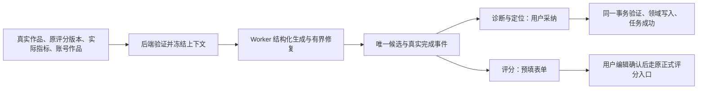

# T-915 校准与定位迁移记录

基于 `e749dd02`，把 `calibration.diagnose`、`calibration.score`、`positioning.generate` 的三个真实生产入口接入既有结构化 Worker。删除旧宿主模型执行生命周期；聊天共享提示、解析、归一及定位作品上下文保留。

## 实际变化

- 诊断冻结原主体、当前账号真实量表版本与维度，只接收这些维度的可用评分。原 `rubricVersionId` 可覆盖的注释与旧事实不符，本次不增加覆盖权限。
- 自动评分要求已锁定盲预测，读取该预测绑定的不可变规则版本；不再拿今日默认版本作为旧预测标签。先验真实作品归属，再冻结实际指标；缺指标仍诚实显示空值。模型评分只是表单预填，不作为采集事实，也不自动写正式评分结果。
- 定位仍包含当前账号画像与真实作品 brief，可选作品读取失败保持原空值降级。动态作品数量不回写长期定位。
- 诊断采纳校验原输入、冻结来源与当前作品归属，经 calibration service 创建草稿预测；定位通过账号行锁串行画像和版本写入。领域写入与任务成功在同一事务中提交，成功回执重放不重复写入。
- 定位正式人工写和 AI 采纳共用账号锁。已有事务里的领域调用使用 savepoint；真实 PGlite 测试验证没有另开连接争抢外层锁。历史直接 service 调用若没有账号行仍保留原行为；新采纳 UoW 强制真实账号归属。
- 诊断的“已生成 N 维度评分”步骤与候选、调用账本和任务终态原子写入，稳定 ID 绑定真实 callId，重投不重复记录。
- Worker 的固定业务输出校验集中为 `structured-business-schema.ts`，在已有有界修复内拒绝不可提交结果；没有增加规划模型或新的执行系统。

## 本轮证据

- 运行时、原 AI 服务与共享上下文/解析：101 PASS，见 `calibration-positioning-runtime-final.log`。其中真实 fork Worker 使用本地 HTTP 供应商夹具，覆盖三入口正常与无效输出、冻结来源、一次正常调用、无候选失败和诊断步骤唯一。
- 采纳、真实账本提交：17 PASS，见 `calibration-positioning-adoption-green.log`。覆盖真实主体不存在/跨账号、冻结版本冲突、两任务首次定位并发、人工与 AI 版本并发、写后故障整笔回滚、成功后人工修改不被重放覆盖。
- 定位与校准原领域：41 PASS，见 `calibration-positioning-domain-regression.log`。
- 类型检查与工程门卫结果以相邻 evidence JSON 和原始日志为准。
- 独立只读审查通过，包括最后补回的诊断事件事务；审查者没有冒充运行测试。

## 红测与夹具修正

适配器首次红是新模块尚不存在导致收集失败，不当成行为红；新评分夹具曾缺 schema 必需 reason，随后按真实协议修正。采纳使用合法量表后的旧行为红为 3 FAIL，见 `calibration-positioning-adoption-red.log`；更早缺必需变现维度的量表夹具失败另存 fixture 日志。诊断完成事件有真实 1 FAIL/4 PASS 红，见 `calibration-diagnosis-step-red.log`。

初次真实组合验证暴露作品查询会以 null 表示不可见，断言端口已明确拒绝 null；两个定位任务测试最初被公开任务去重合并，改用真实 attemptId 才验证不同任务并发。前端组合类型检查曾错误读取 overview.title/brief，已按真实 overview.project 结构修正。均保留中间日志，不将夹具错误记为产品通过。

## 完整任务仍在实施

本记录只更新 R05 三项真实入口，不替代完整 SPEC。聊天、搜索/选题编排、多模态、后台蒸馏等其余调用仍需迁移；浏览器宿主崩溃的生产资源监管、真实供应商矩阵、30 次同条件延迟对照、macOS/Windows 安装包验证仍未全部完成。本轮未操作用户数据库或安装包，未推送、发布。

最终 reconcile 为 211 errors/1 warning，与既有 T-916 基线一致；原始日志见 `calibration-positioning-reconcile.log`。没有降低门槛或标记 T-915 完成。
