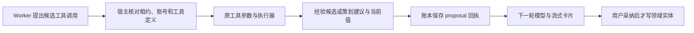

# T-915：经验与策划候选接入持久聊天工具

learning.capture 和 brief.fill 已接入真实工具工厂。经验工具仅回显模型传来的结构化候选；策划工具读取冻结项目的当前值并附建议。两者不调用额外模型、不执行浏览器、不修改领域实体。

原短读取工具的参数、授权、执行、错误封装逻辑抽成共享适配器。只读包装仍固定限定原 19 项工具；候选工厂只开放以上两个已审计工具，不能凭 proposal 分类把模型生成搬回宿主。每次授权和执行重新读取任务并校验完整原工具定义，策划项目来自冻结上下文，模型不能另传 projectId。无项目或既有读取端口返回空值时保留 current:null；不把空值编成资料。

成功回执为 proposal，错误为 none。读取明确瞬断返回可恢复错误但适配器不自行重试；执行期间取消不返回成功候选。候选的复用和最终流式投影继续走同一工具账本。

当场验证：

- 先在已存在的组合工厂上添加五个测试，均因工具缺失而失败；没有用缺失模块导入充当行为红测。
- 新候选、原短读取、开场工厂三文件共 20 项测试通过，包括冻结账号/项目、定义变化、非法参数、无项目、租约失效、瞬断和取消。实现中一个测试误共享上下文引用，隔离测试对象后重新验证。
- 真实 Worker 专项在一轮模型回复中请求两个候选工具；下一轮供应商请求包含当前策划、建议与经验，最终消息保存两张卡片。共两次模型 HTTP、四个已结算调用，两个工具回执明确为 proposal；只读策划一次，项目字段与经验实体前后相同。
- 该专项使用真实临时数据库、项目 service、宿主上下文 reader、工厂、账本、Worker 和流式持久化；模型是本地 HTTP fixture，聊天装配固定为此两个工具，用于专项验证。上轮完整场景测试未裁剪或改成预期失败。
- 前端该文件最终为 3 passed / 1 failed：原两条读取集成、新候选专项通过；完整真实聊天依然 failed / CHAT_WORKER_INPUT_UNAVAILABLE，模型请求 0，缺失工具从 18 降为 16。
- 独立只读评审未发现新增阻断，评审者未独立运行测试。

仍未接入的完整场景工具：topic.generate、topic.enrich、script.draft、planning.thesis、publish.package、cover.generate、knowledge.distill、positioning.generate、calibration.diagnose、material.gather、material.screenshot、web.read、local.read、local.tools、local.workspace、material.generate。公开聊天入口尚未切换。完整迁移、商业模型、性能及双平台验收仍未完成，T-915 保持进行中。

contract、ai-worker、backend 与前端类型检查通过；边界保留既有 5 条、无新增；orphan 0 errors / 100 warnings；源码 diff 检查通过。

pmem sync 完成；本轮全局 reconcile 仍为 211 errors / 1 warning，与此前全局欠债相同。完整聊天红测是 T-915 自身待实现工作，未以全局欠债作豁免。
