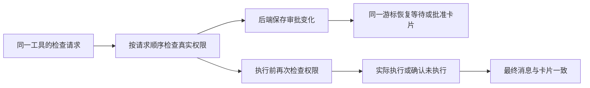

# T-915：授权等待与批准状态可以恢复

聊天工具等待授权时，后端现在保存稳定 ID 的审批卡片；实际授权检查产生批准或拒绝记录。重启恢复时重复检查不会重复建卡，未授权仍不会执行工具。最终消息与 SDK 流式卡片保留相同授权信息。

授权显示记录不授予执行权限。独立审查发现较早检查晚返回可能覆盖新批准；新增测试先真实失败，再用租约和模型工具调用标识串行检查修复。排队期间不持有数据库事务；检查失败不影响后续队列，完成后清理。保留接口的异步拒绝行为。

正式 Worker 测试先等待授权，未改变授权直接恢复一次仍等待、无工具预留和实际执行、无重复模型请求；真实授权检查改为通过后再恢复，最终消息与 readUIMessageStream 还原卡片一致。另覆盖批准后执行前撤权，同一 ID 显示本次未获授权且未执行。该情况不冒充用户主动拒绝。

4 文件 63 项通过（正式 Worker 14、权限和卡片 15、最终消息 28、事件服务 6）；backend 与 frontend 类型检查通过。使用隔离 PGlite、本地 HTTP SSE、正式 Worker fork 与 SDK reducer；没有商业模型、实际产品聊天页面或安装包验收。

worker_review 独立只读复核并发修复与本批，无剩余具体阻断。范围门通过；边界原有 5 条无新增，orphan 0 errors / 100 warnings。全局 reconcile 结果另随原始日志记录。T-915 保持进行中：公开聊天入口、完整恢复订阅和剩余业务迁移等尚未全部完成。

最终全局 reconcile：211 errors / 1 warning，exit 1，与前批相同；已有欠债由 T-916 跟踪，未标全绿。提交时 Git hook 提示若缺少 lefthook，应视为未运行 hook 而非通过。
