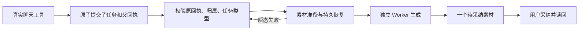

# 聊天素材原子子任务接入持久准备与生产 Worker

基线 f68bbd00，沿用 DEC-RUNTIME-055 和 T-915 SPEC。用户明确解除以数据恢复为前提的阻塞；事故另见 2026-09-06-media-test-incident.md，不宣称数据恢复。

聊天已经提交的素材任务，现在与论点任务共用持久准备恢复。准备失败后复用原子提交的同一个任务，不重复创建子任务。生产装配将素材任务交给素材准备服务和独立 Worker，候选经公开采纳接口完成。

## 改动和边界

- submitted-task-preparation 扫描 planning.thesis、asset.generate，使用现有 chatSubmittedTaskType 协议映射匹配原父工具；保留已结算父回执、原 taskId、attemptId、inputDigest、账号、预算及期限校验。混合工具声明不能借另一工具的回执启动任务。
- production prepare 按真实业务任务类型调用 assetBusiness 或 structured business；素材返回 legacy 时明确停止，不借旧 runner 重提。wakeChatMaterialTask 与原 wakeChatPlanningTask 共用准备和唤醒，保留各自类型守卫，停止后不重新 start Worker。
- 准备的尝试次数、退避及 requestedAt 不因重建服务重置；资产模型配置和生成预算沿用已冻结输入。

## 验证

- 后端最终 **39 项通过**，覆盖原子提交、ACK 丢失、父回执错误、跨账号、类型偷换、同一任务恢复扫描、准备服务重建后次数不重置及停止。扫描测试调用真实 assetBusiness.prepare，未伪造 execution payload。
- 生产装配最终 **5 项通过**，包含论点原行为以及素材首次准备成功/503 后恢复。使用完整 buildPersistence、真实聊天工具工厂、真实独立 Worker、PGlite、本地 HTTP 和临时目录中的 LocalFS；素材只有一个子任务、一次生成请求，候选通过 runtime.ai.confirmTask 采纳，重复采纳成功。
- 前后端类型检查通过；最终前端日志为 chat-asset-frontend-final.log，后端为 chat-asset-backend-typecheck-final.log。
- 首次后端测试存在两个测试构造错误和真实素材缺口，原日志保留。生产路由红测明确显示素材被交给论点准备而 failed，修复后继续发现 jsdom 下素材端口结果 unknown。相同测试切到真实服务端 Node 环境后通过，已固定文件环境；不据此宣称修复了生产环境跨 realm 通用协议。
- 早期测试使用的内存存储不提供真实字节，随后一次错误的设置迁移造成数据事故。最终测试只在隔离数据库直接初始化存储根，不调用设置迁移，并在本测试模块拒绝 migrateStorageRoot。旧失败日志保留，不以 green 文件名当通过依据。
- 正式 /api/chat 路由尚未接入新的聊天 dispatcher；此测试显式装配已实现的聊天工具，不代表完整场景的其余工具、公开 HTTP 流或双平台安装包已验收。没有推送、部署、安装或商业供应商调用。

独立只读复核覆盖准备来源、生产装配、停止及最终测试隔离，未发现具体阻断；评审者未重复执行测试。全局对账仍为既有 211 errors / 1 warning，见 chat-asset-reconcile.log；完整 T-915 保持进行中。
