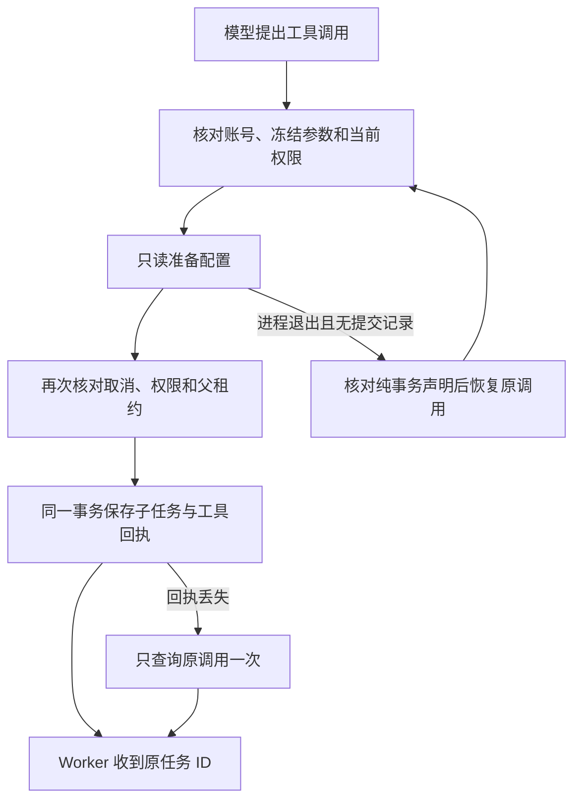

# T-915：聊天工具原子提交与丢回执恢复

聊天执行端口新增 host.task-submit 声明，目前只允许 planning.thesis 且副作用为 committed。普通宿主工具不能借此声明自动重放。准备只读取配置；实际子任务和父工具成功回执在同一父执行行锁与数据库事务中提交。

实现边界：

- 私有声明、版本、工具名、模型调用来源和输入摘要共同绑定执行。只允许准备端口，拒绝把普通 execute 闭包挂到事务声明。
- 父租约和取消在提交事务内重新核对；准备期间权限变化不能创建任务。子任务 runtimeData 保存可信父引用，成功回执只接受该真实子任务 ID。
- 结果生成或事务失败回滚子任务；普通工具的未知提交仍不得重放。纯准备读取明确失败时可保存无副作用错误，复用现有错误分类，不在宿主内部重试。
- 同参工具复用已有已确认回执并记录 reusedCallId，并发情况下等待前序调用；不重复创建子任务。
- 过期恢复只重新预留冻结为纯事务提交、输入摘要匹配且没有结果、用量、宿主执行领取记录或子调用的 started 调用。原调用 ID、operationKey、已消费模型用量及任务预算保持原值。unknown、旧宿主声明、损坏摘要等仍进入待对账。
- Worker 在执行或结算 ACK 丢失时仅回读原调用一次；必须匹配原 callId、toolName、toolCallId，状态为 settled 且无未知副作用才继续。没有确认事实仍报未知；取消期间收到的迟到回执不交回模型。不会再次 execute。
- 保留用户明确拒绝的固定回执通道，宿主须再次确认 denied；不允许伪造成功或将未提交的原子调用改成 unknown。

当场验证：

- 原子提交四项初始红测在旧契约上失败；提交前恢复另有真实失败记录。并发重复工具先产生不同任务 ID 的红测、Worker 丢 ACK 报未知的红测、纯准备 503 被抛出的红测均先发生后修复。
- 后端七文件 125 项通过：原子提交、拒绝/取消、回执伪造、并发复用、租约恢复、旧宿主隔离及既有授权、hooks、检查点和工具账本回归。
- Worker 工具边界 23 项通过；包括恢复查询期间取消、其他调用/工具的回执和未知副作用不能冒充成功。
- 契约三文件 11 项通过；独立 Worker 开场集成 13 项通过。
- 前端完整聊天文件为 3 passed / 1 failed。原读取和候选集成通过；完整场景仍在调用模型前失败，缺 16 项工具，模型 HTTP 为 0。未裁剪工具清单或改为预期失败。
- 扩大回归发现旧测试仍期待落库后的 ACK 丢失报错；按新行为改为当轮直接恢复，同时保留新执行器重放、实际动作仅一次、账本已结算断言。独立评审发现固定拒绝回执被误挡，修复并补测；拒绝 fixture 最初缺 reason 导致校验不可用，已改为真实完整拒绝形状。
- contract、ai-worker、backend、frontend 类型检查通过。两名独立只读评审未发现剩余阻断，评审者没有独立重跑这些测试。

尚未完成：实际 planning.thesis 工具工厂及其提交后派发唤醒、原始主题/项目默认值兼容、真实进程跨重启的完整生成旅程、其他 15 项工具、公开聊天切换及完整 R-05 迁移。当前专项使用真实 AI service、数据库、聊天宿主端口及 Worker 工具函数；故障模型数据为 fixture，不冒充商业供应商或双平台包验收。

工程记录：初次 claim 被上轮证据报告的未登记术语标记阻断；代码的准确 write-set preflight 已通过。本轮登记了该已批准范围报告的精确哈希后重新取得 claim，未关闭或放宽门卫。前置 claim 缺口据实保留，不补写为当时通过。

最终扫描：boundary 保持既有 5 项；orphan 为 0 error / 100 warnings；pmem sync 已执行。reconcile 为 211 errors / 1 warning，与既有全局欠债基线一致，未通过，不能据此宣称 T-915 完成。原始输出保存在同目录 chat-atomic.reconcile.log。
