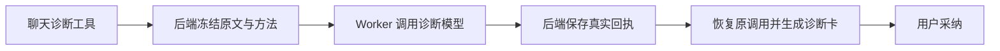

# T-915 聊天诊断迁移与进程请求兼容修复

2026-09-06，沿用已评审 SPEC 和 DEC-RUNTIME-055；T-915 保持进行中。

聊天中的发布前诊断现可走持久 Worker 结构化生成：冻结上下文、账号 Skill 和专属模型身份，复用原模型回执恢复。生成只返回原诊断卡，用户采纳仍由后端负责。旧聊天与新节点共用提示准备和卡片投影，避免维护两套维度和标题兜底规则。

## 本次发现与修复

真实 fork 集成首次 20 项全部失败：主模型提出工具调用后，子模型尚未启动，任务进入 unknown_result。原因是 advanced IPC 保留了 SDK 请求中的可选 undefined，宿主 z.json 在调用端口前拒绝。单元测试直接调用服务没有经过这个边界，未能发现问题。

对 chat-generation-worker 与 chat-hooks-worker 的 JSON 模型请求显式序列化规范化，沿用普通 structured worker 的处理；不改二进制通信，也不重新提交结果未知的供应商调用。修复首处后 20/21 通过，剩余混合节点失败暴露开场工具的相同问题，一并修复。

无有效评分时返回 no_evidence，不能输出成功诊断卡；外层 Agent 可接收此工具失败再决定下一步，不把空对象当成候选。通用评分维度和卡片字段与旧入口保持一致。

## 验证证据

- chat-diagnosis-host-red.log：新增诊断宿主节点不存在，真实红测。
- chat-diagnosis-worker-red.log：进程边界失败的原始证据。
- chat-diagnosis-green.log：195 项服务/准备/原聊天回归通过。
- chat-diagnosis-worker.log：35 项通过。真实 fork、临时 PGlite、localhost 模型服务；包含诊断成功、空评分、模型回执后杀进程并重建，以及旧节点重试、取消、混合恢复。
- chat-diagnosis-final-projection.log：最终投影整理后 15 项回归通过。
- chat-diagnosis-types.log、chat-diagnosis-worker-types.log、chat-diagnosis-frontend-types.log：类型检查。
- 独立只读审查未发现迁移阻断，并协助定位 advanced IPC 请求校验根因；审查不替代执行测试。

本批未接通正式 /api/chat 全场景入口，未运行商业供应商和安装包验收，未完成性能基准。不能据此声称重构整体完成或卡慢已根治。全局 reconcile 为 211 错误 / 1 警告，与前次基线一致，结果见 chat-diagnosis-reconcile.log；既有欠债继续由 T-916 跟踪。
